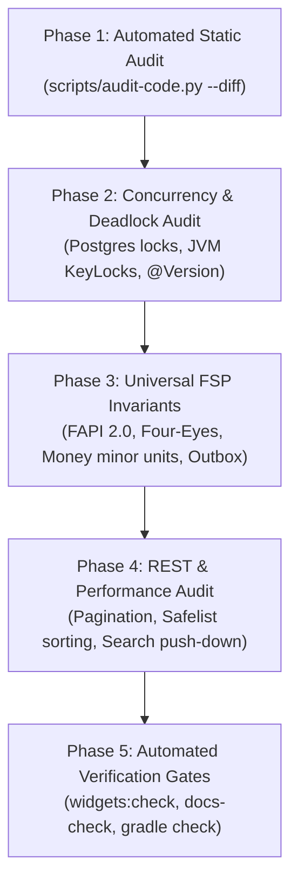

# FSP Code Reviewer Skill

This skill guides the agent through an automated and structural code review of any new code, refactoring, or pull request within the Financial Services Platform (FSP).

---

## Review Methodology

When reviewing code, follow these five sequential phases:



---

## Phase 1: Automated Static Audit

Run the static analysis script on either the current git diff or the full codebase:

```bash
# Audit modified files in git diff:
python3 .agents/skills/code-reviewer/scripts/audit-code.py --diff

# Or audit the entire codebase:
python3 .agents/skills/code-reviewer/scripts/audit-code.py
```

The script flags:
- Use of `synchronized` in Spring service beans.
- Entities with mutable state lacking JPA `@Version`.
- Long external I/O (TigerBeetle, HTTP calls) inside `@Transactional` blocks.
- Unbounded collection endpoints returning `List<T>` without `Pageable`.
- Direct imports of `com.tigerbeetle.*` outside `TbService` / `TigerBeetleConfig`.
- Direct imports of Core repositories from Plugin modules.
- Hardcoded hex colors in React components outside design tokens.
- Secret/token leakage in log statements.

---

## Phase 2: Concurrency & Deadlock Audit (CRITICAL)

Inspect the code against the [Concurrency & Deadlock Playbook](./references/concurrency-deadlock-playbook.md):

1. **Database Multi-Row Update Order:**
   - Are entities sorted by primary key (`ORDER BY id ASC` or `Comparator.comparing(Entity::getId)`) before batch updates/locking?
   - Inconsistent update order across concurrent transactions causes PostgreSQL `40P01` deadlocks.
2. **Transaction Scope:**
   - Are `@Transactional` boundaries minimal?
   - Verify that NO remote socket writes (TigerBeetle), HTTP client calls, or thread sleeps occur while holding a database transaction.
3. **Optimistic Locking:**
   - Every mutable aggregate must have `@Version`.
   - Transitions must check expected from-state in update queries to prevent lost updates.
4. **In-Memory JVM Locks:**
   - Verify NO `synchronized` on singletons or string literals.
   - Verify that `KeyLocks.withLock("domain", id, () -> ...)` is used with try/finally unlocking.
   - Verify zero lock inversion (nested locking must use lexicographical key ordering).

---

## Phase 3: Universal FSP & FAPI 2.0 Invariants

Verify against [AGENTS.md](../../../AGENTS.md):
1. **Tokens Never Enter Browser:** Only HttpOnly, SameSite=Lax BFF session cookies.
2. **Gateway Route Admission:** Every endpoint annotated with `@FspOperation` and registered in `OperationCatalog`.
3. **Core is the Sole PDP:** Gateway strips client identity headers; Core authoritatively re-evaluates permissions.
4. **Four-Eyes at `person_id`:** Maker != Checker. Machine actors cannot make or check.
5. **Money Representation:** Minor units only (`long` in Java/TB, `NUMERIC(20,0)` in DB, string on wire).
6. **Transactional Outbox & Audit:** DB mutation + Outbox row in same transaction; audit carries `correlation_id`.
7. **Plugin Process & Schema Isolation:** Every plugin is a separate OS process with its own dedicated database schema and Flyway history.

---

## Phase 4: REST Standards & Performance

Inspect against [Architecture Chapter 8](../../../docs/architecture/08-rest-query-standards.md):
1. **Pagination:** Does the collection endpoint require `page` (default 0) and `size` (default 20, max 100)?
2. **Sorting:** Is the `sort` field checked against a strict domain whitelist to prevent SQL injection or leaking internal persistence structure?
3. **Search Push-down:** Are free-text search `q` and domain filters executed in SQL `WHERE` queries rather than in-memory Java streams?
4. **N+1 Queries:** Do JPA entity relationships use `JOIN FETCH` or `@EntityGraph` when loading collections?

---

## Phase 5: Automated Verification Gates

Execute these gates to confirm zero regression:

```bash
# 1. Frontend widget and catalogue check:
cd frontend && bun run widgets:check

# 2. Living architecture documentation check:
make docs-refresh && make docs-check

# 3. Backend compilation & test suite:
cd backend && ./gradlew check
```

---

## Review Output Format

Provide structured review output categorized as:
- **[BLOCKER]**: Concurrency race conditions, deadlocks, security/token leakage, architectural boundary violations.
- **[WARNING]**: Missing pagination, missing sort whitelist, potential performance bottlenecks, missing tests.
- **[SUGGESTION]**: Code readability, naming conventions, minor simplifications.
