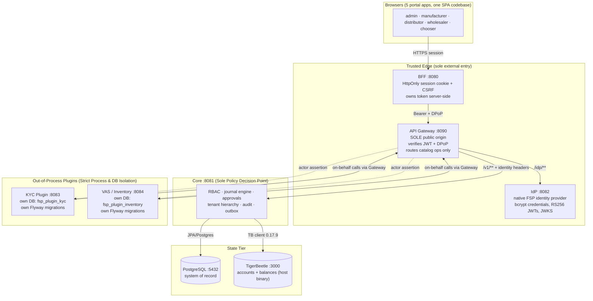

# FSP Architecture — The Living Master Blueprint

> **Governance:** Single source of truth for platform architecture.  
> **Normative Sources:** [AGENTS.md](../AGENTS.md) (Platform Rules) · [vision.md](../vision.md) (Architecture v2) · [plans/phase-0-prd.md](../plans/phase-0-prd.md) (PRD).

---

## 1. Big Picture & Philosophy

FSP is a **multi-tenant payments & financial services platform** for Namibia: a PSP (payment service provider) onboards supply-chain tenants (merchants, manufacturers, distributors, wholesalers), and every monetary movement runs through a **double-entry journal engine backed by TigerBeetle**, a financial-grade ledger database.

> **Governing Principles:**
> - *If it moves money, it is core. If it touches money, it is an out-of-process plugin.*
> - *The browser never holds a token; money never moves without a balanced, approved journal entry; and every decision is audited.*

---

## 2. Universal Architectural Invariants

Every service, plugin, and UI surface MUST conform to these non-negotiable invariants:

1. **Strict FAPI 2.0 Compliance:** Browser never touches tokens. Confidential BFF owns session. Gateway validates RS256 JWT + DPoP (RFC 9449). Zero trust on internal hops.
2. **Core is the Sole PDP:** The IdP verifies credentials; Gateway enforces token admission; Core alone decides RBAC, permissions, four-eyes approval, and journal mutations.
3. **Double-Entry Journaling:** No money moves without a balanced JE per book + currency with direct debit-to-credit matching (no star decomposition). TigerBeetle is the authoritative record of booked positions.
4. **Four-Eyes at `person_id`:** Maker ≠ Checker across all domains (KYC, JE, CoA, permissions, plugins). Machine clients can never act as maker or checker.
5. **Money minor units:** Minor units only (`NUMERIC(20,0)` in DB, `long` in Java/TB, **string on the wire**). Currency ISO-4217.
6. **Outbox & Audit:** DB mutation + Outbox event in same transaction. Append-only audit record carrying `correlation_id` and channel context at all core boundaries.
7. **Plugin Process & Schema Isolation:** Every plugin MUST run as a **separate OS process** with its **own dedicated database schema / database** and independent Flyway migration history. No shared DB access.
8. **REST Collection Standard:** Every REST endpoint fetching collections/data (Core & Plugins) MUST support **pagination**, **server-side sorting**, and **server-side search / filtering** by default. Unbounded queries are forbidden.
9. **Concurrency & Deadlock Prevention:** Every backend modification MUST be audited to guarantee no race conditions or deadlocks occur in PostgreSQL or the JVM. Requires optimistic locking (`@Version`), deterministic row-lock ordering (sort IDs), state preconditions, and zero remote I/O during open DB transactions or in-memory locks.

---

## 3. Modular Architecture Chapters

For detailed specifications, sequence flows, and schemas, read the modular chapters:

| Chapter | Topic | What It Settles |
|---|---|---|
| [01. Runtime Topology](architecture/01-runtime-topology.md) | Topology & Protocols | Service ports (:8080, :8081, :8082, :8090, :8083, :3000), request lifecycles, and omnichannel ingress (Web, App, USSD, SMS, POS). |
| [02. Identity & Security](architecture/02-identity-and-security.md) | FAPI 2.0 & Tokens | Actor types (PERSON, MACHINE, DELEGATED), DPoP proofs, operation catalog boot gate, and internal trusted hops. |
| [03. Tenancy & RBAC](architecture/03-tenancy-and-rbac.md) | Hierarchy & Grants | Subtree reachability (`hierarchy_path`), anchor roles, permission scopes, and act-as tenant ("sudo") delegation. |
| [04. The Money Engine](architecture/04-money-engine.md) | Books, CoA, JE & TB | Direct matching posting planner, posting state machine, `COMMIT_UNKNOWN` recovery protocol, and TigerBeetle driver isolation. |
| [05. Approvals & Idempotency](architecture/05-approvals-and-idempotency.md) | Four-Eyes & Deduplication | Generic approval engine, person_id separation, and `IdempotencyFilter` order 2 transport deduplication. |
| [06. Audit & Evidence](architecture/06-audit-and-outbox.md) | Audit & Outbox | One-transaction three-writes write path, evidence chains, structured logging contract, and correlation IDs. |
| [07. Plugin Platform](architecture/07-plugin-platform.md) | Out-of-Process Plugins | Separate OS process mandate, isolated DB schemas (`fsp_plugin_*`), actor assertions, and KYC onboarding saga. |
| [08. REST Query Standards](architecture/08-rest-query-standards.md) | Pagination, Sort & Search | Universal pagination (`page`/`size`), server-side sorting with safelists, and server-side search push-down across Core & Plugins. |
| [09. Frontend & Portals](architecture/09-frontend-portals.md) | Portals & Widget Harness | 5 portal apps from one SPA codebase, session hydration, widget codegen (`bun widgets:*`), and UI standards. |
| [10. Data Model](architecture/10-data-model.md) | Schemas & Migrations | ER diagram, Flyway migration ledger (generated via `refresh.cjs`), and system vs demo seed rules. |
| [11. Operations & Live Docs](architecture/11-operations-and-live-docs.md) | Ops, Tests & Maintenance | Dev happy path make targets, test pyramid, two-tier live doc update workflow (`refresh.cjs`), and glossary. |
| [12. Notifications & Push](architecture/12-notifications-and-push.md) | Inbox & Push Spine | Queue-shaped notifications, one push contract for Web Push/APNs/FCM (credential-gated adapters), data-minimized payloads under FAPI, and unread badge plumbing. |
| [13. Money Movement & Rails](architecture/13-money-movement-and-rails.md) | Bank Connectors, Bill Payments, PSP & EMI | Sealed provider-protocol taxonomy, per-bank transport/format profiles (ISO 8583, ISO 20022, REST, SFTP/MQ batches), pending-transfer bill-payment space ladder, exactly-once stack, circuit-breaker/moving-window doctrine, and BoN PSD-1/PSD-3/VAA regulatory traceability. |

---

## 4. Cross-Cutting Invariants Checklist

The one-page checklist every change is measured against:

| # | Invariant | Enforced by |
|---|---|---|
| 1 | Pure Java 25 backend, no Kotlin; Spring Boot 4.0.9; Gradle 9.9.1 wrapper | build files |
| 2 | Records at boundaries; sealed outcome algebras (`TbResult`, `PostingOutcome`, `KycDecision`) with exhaustive switch; Lombok = logging only | `backend/AGENTS.md` |
| 3 | One-line structured logs for every incident; MDC correlation; secrets never logged | log pattern + `AuditService` |
| 4 | Optimistic `@Version` + state preconditions + `KeyLocks` dispatch serialization; never `synchronized` on singletons | `KeyLocks` |
| 5 | Idempotency key on every `/v1` mutation; insert-first semantics; 5xx not cached | `IdempotencyFilter` |
| 6 | Demo data only under `client-demo` seed; migrations immutable; next migration = V32. psp/emi/recon own **separate databases with their own Flyway histories** (R5 isolation — not part of this sequence) | Flyway layout |
| 7 | Four-eyes at person_id; machines can never make/check | service preconditions |
| 8 | Minor units (`long`, `NUMERIC(20,0)`, string on wire); TB ledger id = ISO-4217 numeric | `Amount` contract |
| 9 | Balanced JE ≥ 2 lines; direct debit-credit matching; deterministic uuid5 transfer ids; linked chain except final leg | `PostingPlanner` |
| 10 | TigerBeetle is written only via `TbService`; uncertain commits resolve with ORIGINAL ids only | `TbService` |
| 11 | Audit at boundaries + transactional outbox; every record carries correlation id | `AuditService` |
| 12 | Gateway strips & re-issues identity; core is only PDP; claims advisory | `ActorContextFilter` |
| 13 | Errors = RFC-7807 problem+json with stable code + correlationId | `common/ApiException` |
| 14 | Out-of-process plugins with own process & DB schema; no shared tables | `plans/plugin-platform-plan.md` |
| 15 | Every REST collection endpoint supports server-side pagination, sorting & search | Chapter 8 |
| 16 | Concurrency safety: sorted row lock order, no remote I/O in DB tx, zero synchronized on singletons | `backend/AGENTS.md` §2d |

---

## 5. Live Document Maintenance

This document and its generated companions stay in sync with the codebase via `docs/gen/refresh.cjs`:
- Run `make docs-refresh` to update generated diagrams and inventories.
- Run `make docs-check` in CI to ensure no generated documentation is stale.
