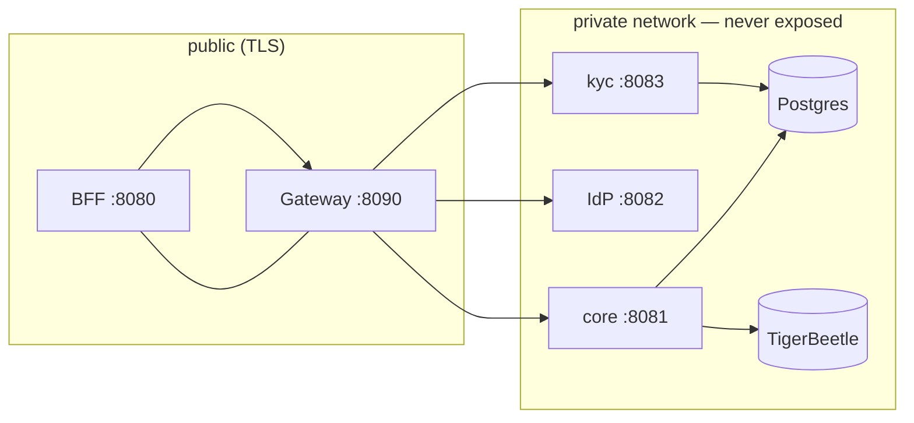
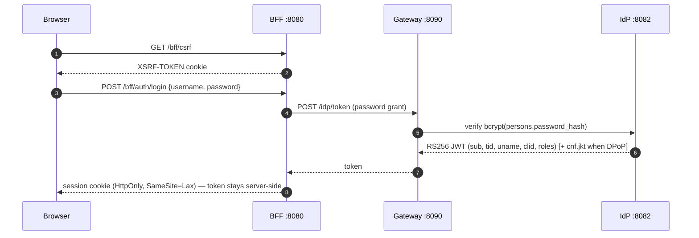
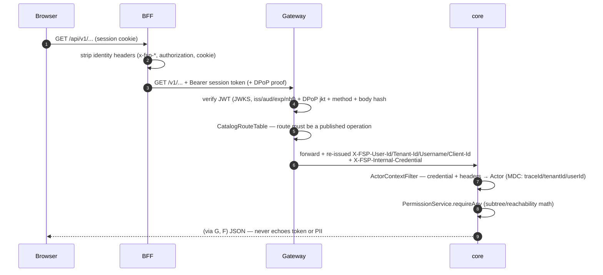
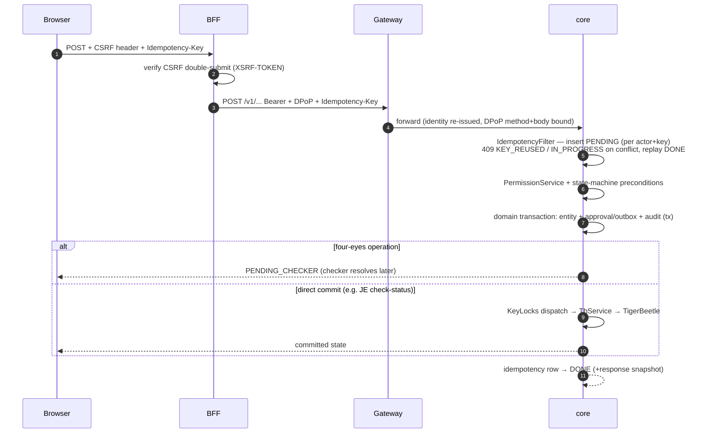
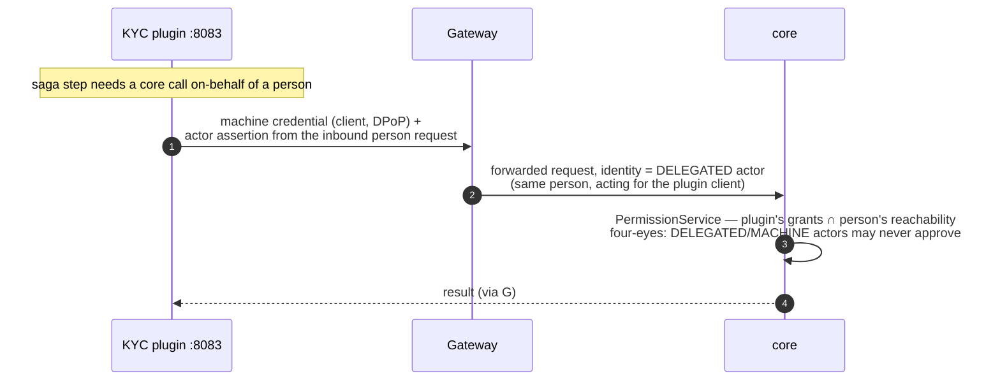
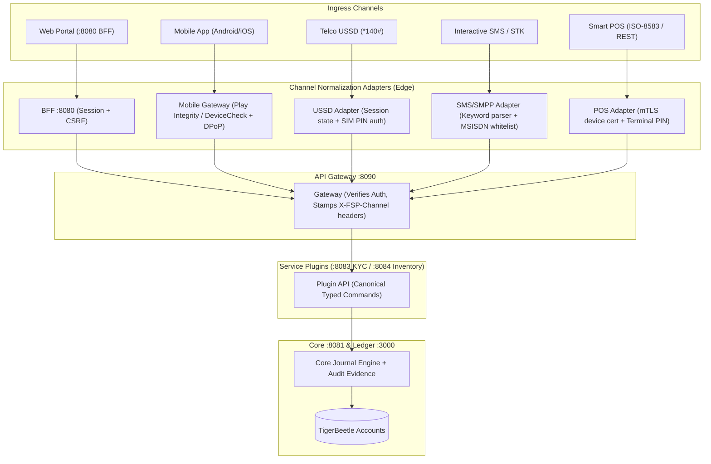

# Architecture Chapter 1 — Runtime Topology & Request Lifecycle

**Parent Document:** [docs/architecture.md](../architecture.md)

---

## 1. Processes and Ports

| Service | Port (dev) | Container? | Built from | Notes |
|---------|-----------:|------------|-----------|-------|
| SPA (Vite dev) | 5173 | no | `frontend/` | proxies `/bff` & `/api` → 8080 |
| BFF | 8080 | stack profile | `backend/bff` | session cookie, CSRF, DPoP proof gen |
| core | 8081 | stack profile | `backend/core` | Flyway V1–V31, TB client |
| IdP | 8082 | stack profile | `backend/idp` | RS256 `idp-signing.pem` mounted, never baked |
| gateway | 8090 | stack profile | `backend/gateway` | catalog-watched routing (60 s refresh) |
| plugin-kyc | 8083 | stack profile | `backend/plugins/kyc` | own DB/schema, machine credentials |
| plugin-inventory | 8084 | stack profile | `backend/plugins/inventory` | own DB/schema, machine credentials |
| **psp-service** | 8085 | **Stage 0 LANDED** (chapter 13, behavior through Stage 5) | `backend/psp` | rails/connectors, clearing positions, merchant payable — own DB, own Flyway (V1), own TB book (:805) |
| **emi-service** | 8086 | **Stage 0+2+3 LANDED incl. REST wire** — schema + wallet engine + bill-payment saga engine + `@EmiOperation` REST (gateway-routed `/v1/emi/**`) | `backend/emi` | NAD-only e-money wallets, bill-payment sagas, closed-loop asset ledgers — own DB, own Flyway (V1–V3), own TB book (:806) |
| PostgreSQL | 5432 | **always** (`postgres:17-alpine`) | compose | system of record for all services |
| TigerBeetle | 127.0.0.1:3000 | **host binary** | `infrastructure/bin/tigerbeetle` 0.17.9 | io_uring does not survive container seccomp — deliberately *not* dockerized |

---

## 2. The One Edge Rule

Only `:8080` (BFF, for its session surface) and `:8090` (gateway, for everything else) are intended public origins in production; dev publishes internals for parity. In prod topology, TLS terminates at BFF/gateway edges; core, IdP, Postgres and TigerBeetle sit on the private network.

---

## 3. Dev PKI Tree

`make pki` regenerates `infrastructure/pki/dev/` — a dev root CA and identities per service (`core.p12`, `bff.p12`, `gateway.p12` …), a workload client identity (`bff-workload.p12`) for mTLS between BFF→core under the `tls` profile, the IdP token-signing key `idp-signing.pem` and the gateway's actor-assertion EC key `gateway-assertion.pem`. Gitignored, regenerable, never shipped.

---

## 4. Request Lifecycle

### 4.1 Login Flow (Password Grant Bootstrap Seam)

The person plane uses the password grant **only** as the Phase-0 bootstrap; the FAPI 2.0 slice replaces it with PAR + PKCE (`private_key_jwt` client auth and DPoP are already wired in `shared`/BFF).

### 4.2 Browser Read (`GET /api/...`)

### 4.3 Browser Mutation (`POST /v1/...`) — The Money Path

Key rules:
- Missing `Idempotency-Key` on any `/v1` mutation → `400 IDEMPOTENCY_KEY_REQUIRED` (`IdempotencyFilter`, order 2). One key per maker, 1–128 chars, UUIDv4 recommended.
- 5xx originals are **not** cached — record is cleared so the same key may retry.
- The BFF passes the SPA's key through untouched; a checker always supplies her **own** key.
- Money mutations are **never optimistic** in the UI: an uncertain outcome shows `COMMIT_UNKNOWN` with a user-driven *Check status*.

### 4.4 Plugin → Core (Machine Plane, on Behalf of a Person)

The actor assertion is a 60-second ES256 JWS signed by the *gateway* (the token never reaches the plugin), bound to `aud=plugin:<code>`, `htm`/`htu`, with a single-use `jti` budget.

### 4.5 Omnichannel Request Ingress (Web, Mobile App, USSD, SMS, POS)

**Channel Context Rules:**
1. **Edge normalization:** Channel adapters normalize protocol payloads into typed REST DTOs.
2. **Context headers:** Requests carry `X-FSP-Channel` (`WEB_PORTAL`, `MOBILE_APP`, `USSD`, `SMS`, `POS_TERMINAL`, `PARTNER_API`) and `X-FSP-Channel-Context`.
3. **Core audit & ledger tagging:** Core logs `channel` and `channel_fingerprint_hash` alongside `actor_id` and `correlation_id`; `JournalEntry.reference` tags the channel.
4. **Channel-differentiated limits:** Gateways enforce stricter velocity and lower ceilings on low-assurance channels compared to authenticated web portals.
