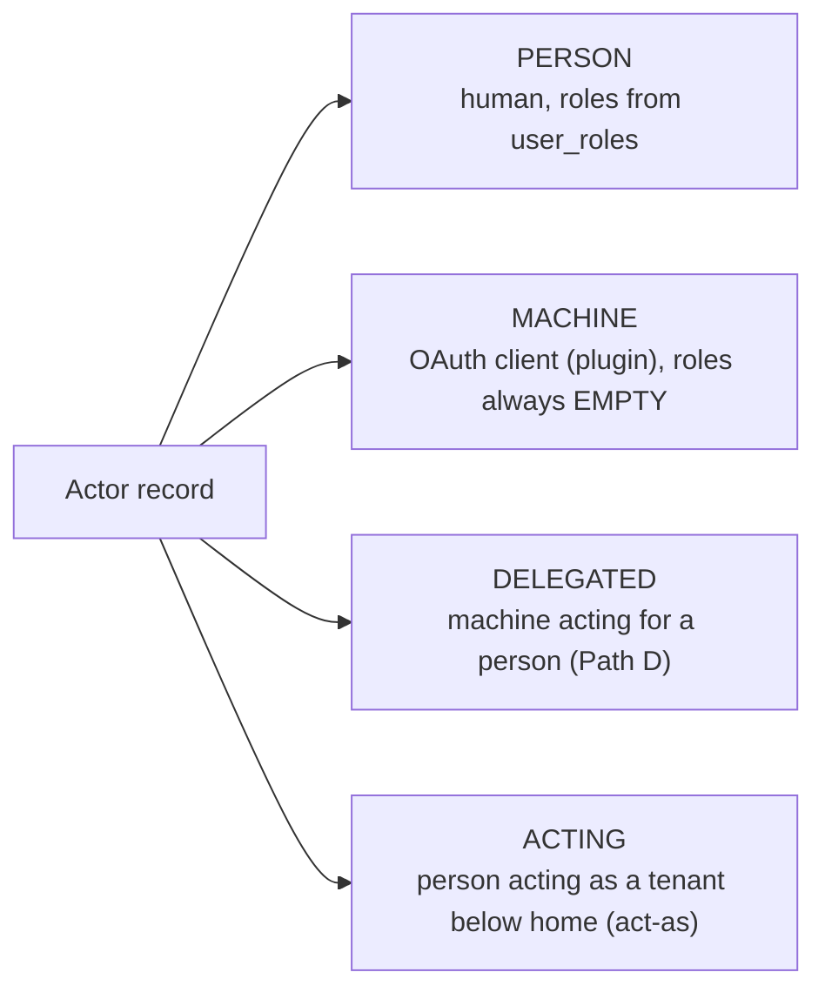
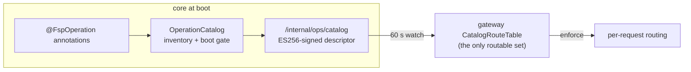
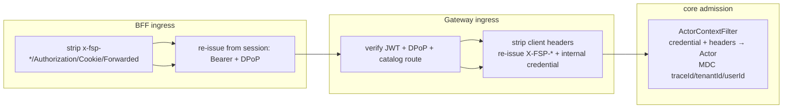
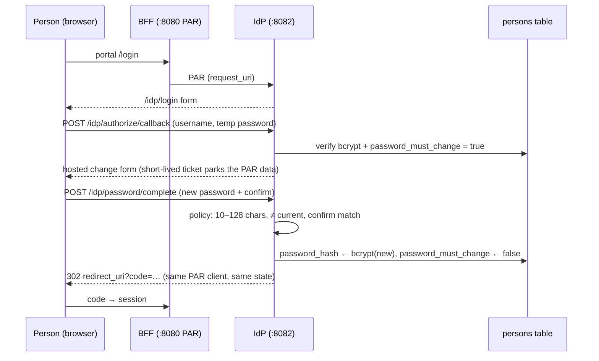
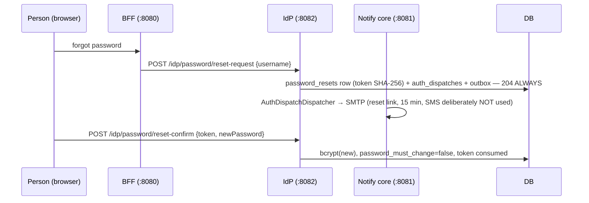

# Architecture Chapter 2 — Identity & Security Model

**Parent Document:** [docs/architecture.md](../architecture.md)

---

## 1. Three Actor Types (`common/Actor`)

| Invariant | PERSON | MACHINE | DELEGATED | ACTING (act-as) |
|---|---|---|---|---|
| Can be maker of an approval | ✅ | ❌ | ❌ | ✅ — maker = the real `person_id` |
| Can be checker (four-eyes) | ✅ | ❌ | ❌ — service precondition in `ApprovalService`/`JournalService` | ✅ at real `person_id`; never on `PLUGIN:` rows |
| Permissions resolved from | RBAC rows | `client_grants` | min(person RBAC, plugin grants) | (person RBAC at home ∪ at target) ∩ target ceiling |
| Token carries | `sub`,`tid`,`uname`,`clid` | `clid`,`tid` | both + actor assertion | the person's own token; BFF adds `X-Act-As` (gateway forwards on the person plane) |
| Admitted on operations | `actors` incl. PERSON | `actors` incl. MACHINE | `actors` incl. DELEGATED | wherever PERSON is admitted |
| Audit row | `actor_id` | client | person + client | `actor_id` = real person, `acting_tenant_id` = home, `act_session_id` = session |

---

## 2. Token & Key Inventory

| Artifact | Signer | Verifier | Notes |
|---|---|---|---|
| Access JWT (RS256, aud `fsp-financial-api`) | IdP | gateway | claims `sub/tid/uname/clid/roles`, optional `cnf.jkt` for DPoP |
| DPoP proof (ES256, RFC 9449) | client (BFF / plugin) | gateway | binds htm+htu+iat+jti; gateway compares `jkt` to token's `cnf.jkt` |
| `private_key_jwt` client assertion (ES256) | BFF / plugins | IdP | FAPI 2.0 client auth |
| Actor assertion (`typ: fsp-actor+jwt`, ES256, 60 s) | **gateway** (audience `plugin:<code>`) | plugins, core | single-use `jti` budget; htm/htu bound; key `gateway-assertion.pem` |
| Internal credential | env `FSP_INTERNAL_CREDENTIAL` | core `ActorContextFilter` | static in Phase-0; replaced by short-lived audience-bound workload credentials in the FAPI2 slice |
| IdP signing key | — | — | mounted file, never in image |
| Catalog descriptor | ES256 by `CatalogDescriptorSigner` (portal-builder trust store) | gateway/CI | boot gate |

All cryptographic signing and verification utilities live in `backend/shared` (pure JCA, zero third-party crypto dependencies).

---

## 3. The Operation Catalog

- Every domain endpoint is annotated `@FspOperation(id = "journal.entry.create", permission = "je.create", risk = …)`.
- `OperationCatalog` inventories them **at boot**: duplicates, unclassified routes, or missing handlers fail startup.
- The catalog is published as an ES256-signed descriptor (`/internal/ops/catalog`).
- The gateway (`CatalogRouteTable`) watches it (60 s) and routes **only** published operations; an unknown path → `404 ROUTE_NOT_IN_CATALOG`. New plugin operations need zero RBAC migrations — they reuse catalog IDs; only grant rows change.

---

## 4. Headers & the Trusted Hop

Inbound to BFF: all `x-fsp-*`, `authorization`, `cookie`, `forwarded` headers are stripped (`NEVER_PASSED`) and identity is re-issued *only* from the verified session/token. Gateway→core strips and re-issues `X-FSP-User-Id/Tenant-Id/Username/Client-Id` plus the internal credential. `ActorContextFilter` in core is the last line of defense and sets the MDC (`traceId/tenantId/userId`, cleared in `finally`).

---

## 5. Per-Tenant IdP Policy

A tenant admin can override the default native IdP by setting `idp_configs.provider = THIRD_PARTY` (issuer URL etc.). Third-party identities federate via `idp_identities(issuer, subject) → person_id`; until the federation client lands, external logins surface `503 IDP_EXTERNAL_FEDERATION_PENDING`. Entitlements never move — RBAC stays in core.

## 6. First-login password change (F-8)

Persons provisioned by API (user create, KYC saga admin/checker, PSP creation, child-org
provisioning) are born with the shared bootstrap password (`FSP_PERSON_PASSWORD`). They
must replace it at first sign-in; nothing in the platform may let a shared secret survive
indefinitely.

Flow (credentials never leave the IdP origin):

- **Flag, not heuristic:** `persons.password_must_change` (V24) is set `true` at every
  provisioning site that hands out the bootstrap password (`PersonProvisioning.createPerson`
  param). SQL seeds (system/demo personas) keep the default `false` — their passwords are
  environment constants such as `demo1234`, intended to be rotated by ops, not changed per person.
- **Single seam:** the native IdP owns credential verification (`IdpTokenService.grantPassword`)
  and now also the change: policy check, bcrypt write, flag flip. Core never sees the new
  password; BFF/SPA only ever see the final auth code.
- **Direct token grants are refused:** a ROPC `password` grant for a must-change person gets
  `403 PASSWORD_CHANGE_REQUIRED` — the change is only possible through the hosted surface.
- **Ticket semantics:** the change ticket (`ParService.PasswordChangeTicket`) parks the PAR
  request for 10 minutes, is re-readable across validation failures (policy / mismatch /
  same-as-current re-render the form), and is strictly consumed once on success.
- **FAPI 2.0 note:** the hosted change surface is pre-authentication; it carries no bearer
  material and issues the standard authorization code through the existing PAR/PKCE/DPoP
  pipeline afterwards — the FAPI2 slice does not need to special-case it.

## 7. Self-service password reset & MFA codes through the notification channels (V30)

Both features deliver through the notification EMAIL/SMS transports (chapter 12 §12.9
owns the transport contract; this section owns the IDENTITY semantics). Split:

* **Auth logic + secrets live at the IdP** (core-migrated `public` tables, like V6):
  `password_resets` (hashed single-use token, 15 min, ≤5 confirm attempts, one live
  reset per person), `mfa_challenges` (hashed OTP, 5 min, ≤3 attempts, 60 s issuance
  cooldown), `user_mfa` (the enrolment itself — no row = MFA off).
* **Transports live at the notify plane**: the IdP never renders or sends — it renders
  the message and parks one row on `fsp_notifications.auth_dispatches` (+ one
  `Notification.AuthDispatchRequired` outbox evidence row, same transaction); core's
  `AuthDispatchDispatcher` delivers via the same SMTP/SMS beans as F-12 and purges the
  secret-bearing text on claim. Contacts are read from the canonical `persons` row at
  send time — the dispatch row never stores them.

Flows:

MFA (native `password` grant + hosted authorize both covered):

* Password verified + `user_mfa` row exists → `401 MFA_REQUIRED`; an OTP challenge is
  issued and dispatched to the enrolled channel (EMAIL or SMS); the grant must then add
  `otp`. Re-requests inside the 60 s cooldown reuse the live challenge (no SMS pumping).
* Hosted authorize flow parks the PAR in an `MfaTicket` (mirrors the F-8 change
  ticket) and renders a code-entry page; `POST /idp/mfa/verify` resumes the PAR.
* Enrolment (bearer-authenticated self-service): `GET /idp/mfa` →
  `{channel, hasEmail, hasPhone}` (never raw contacts); `PUT /idp/mfa {channel}` sends
  a confirmation code TO the chosen channel (possession proof);
  `POST /idp/mfa/confirm {code}` writes the row; `DELETE /idp/mfa {password}` requires
  the current password (knowledge proof for removing the factor).

FAPI/SCA posture: secrets only as SHA-256 hashes at rest; all codes/links single-use
with bounded attempts; reset requests answer 204 regardless of account existence (RFC
9700 anti-enumeration); the sweepers log purpose/person/outcome only — never addresses,
codes or message text (AGENTS §2c). (⛏: SPA screens for the `MFA_REQUIRED` grant step
and the `/#/reset` route; distributed rate-limit hardening beyond per-challenge caps;
TOTP/WebAuthn as additional second factors.)
