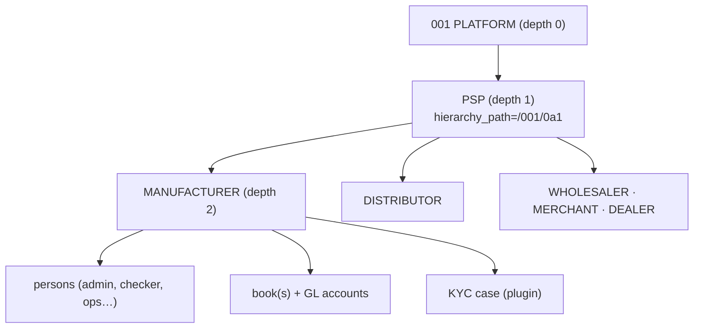
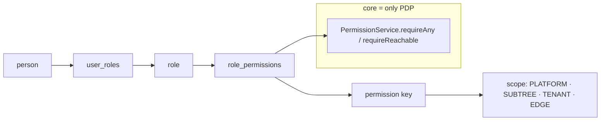
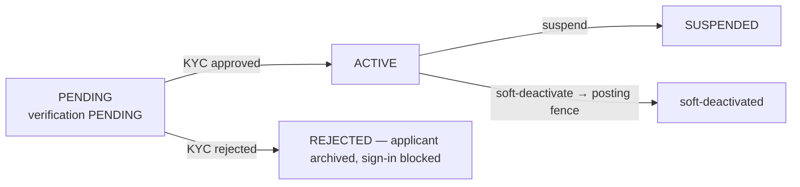

# Architecture Chapter 3 — Multi-Tenancy, RBAC & Delegation

**Parent Document:** [docs/architecture.md](../architecture.md)

---

## 1. Tenant Tree (Phase-0 Depth = 2)



Rules:
- `hierarchy_path` stores the ID path and strictly drives **subtree visibility** (`requireReachable` = ancestor chain of the target vs the actor's tenant).
- Every mutable aggregate carries `@Version` (optimistic locking).

---

## 2. RBAC Model



- **Scope semantics:** `PLATFORM` (root only) · `SUBTREE` (own tenant + below) · `TENANT` (own tenant only) · `EDGE` (direct edges only).
- Permission rename = deliberate role migration with a fresh migration; a new permission always starts with **zero grants**.
- **Machine plane:** `oauth_clients` (IdP) + `client_grants(tenant, client, permission_key)` (core) resolve through the *same* reachability math — no lateral trust; a PSP-installed plugin operates only inside the PSP's subtree.
- **Anchor roles & templates (`rbac/RoleTemplates`):** Every organization is born with `TENANT_ADMIN` (maker) and `TENANT_CHECKER` (checker). PSP and non-leaf orgs' admins can onboard children (`org.onboard_child`, `org.create`, `screening.run`); the leaf `MERCHANT` never can. Every admin/checker holds `user.manage` + `role.view`/`role.manage` so an org runs itself without platform help.
- **Role governance (`rbac/RoleAdminService`, `/v1/tenants/{id}/roles`):** Reads need `role.view`; create/update/delete are STAGED as `ROLE_CREATE|UPDATE|DELETE` approvals (202) and applied to `role_permissions` only on a checker's approval. No escalation: maker AND checker must hold every key the change adds or removes.

---

## 3. Act-As Tenant ("Sudo into an Org")

```mermaid
sequenceDiagram
    participant Admin as PSP admin
    participant CoreA as core (actas)
    participant T as target tenant
    Admin->>CoreA: POST /v1/act-as/start (tenant.act_as at home)
    CoreA->>CoreA: target strictly below home? not suspended?
    CoreA->>CoreA: create act_as_session (TTL: idle 30 min / max 8 h, one live per person)
    Admin->>CoreA: subsequent calls with X-Act-As: <sessionId>
    Note over CoreA: actor type ACTING (not DELEGATED — that is plugin-for-person); permissions capped by target-tenant ceiling (roles AT target)<br/>audit keeps actor_id = real person + acting_tenant_id + act_session_id
    Admin->>CoreA: POST /v1/act-as/:sessionId/end
```

**Act-as through a plugin:** the gateway resolves `X-Act-As` with core (`/internal/act-as/{id}`) and mints
the plugin's actor assertion for the acted-as tenant (`act` + `home` claims); core re-verifies the
session on the plugin's on-behalf calls. See `plans/act-as-tenant-plan.md` §3.7.

### Organization ladder

Every org onboards **only the next level down** (core `TenantLadder`, enforced in child creation):

```
PLATFORM → MANUFACTURER (type PSP, depth 1) → DISTRIBUTOR → WHOLESALER → MERCHANT (leaf)
```

DEALER is a recognised sub-type with no rung. `TenantView.childSubType` tells the UI the one allowed
type; the KYC form fixes it, and core refuses anything else (`CHILD_SUBTYPE_NOT_ALLOWED`, `CHILD_NOT_ALLOWED`).

Requires RBAC enforce mode; no privilege escalation is possible because grants while acting are taken from roles directly at the target tenant only.

---

## 4. Onboarding (Org Lifecycle)



Approval of the KYC case flips tenant → `ACTIVE`, books → `ACTIVE`, and provisions the chart of accounts automatically.
PSPs are created directly by the platform (`POST /v1/tenants`, admin portal "Onboarding" → `onboard.psp`) as ACTIVE/VERIFIED with sub-type `MANUFACTURER`; every deeper organization arrives through the KYC plugin saga.
