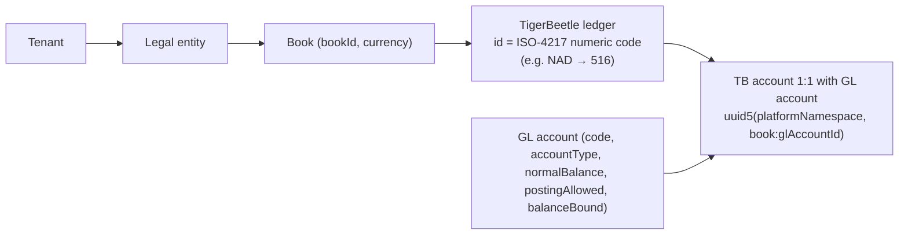
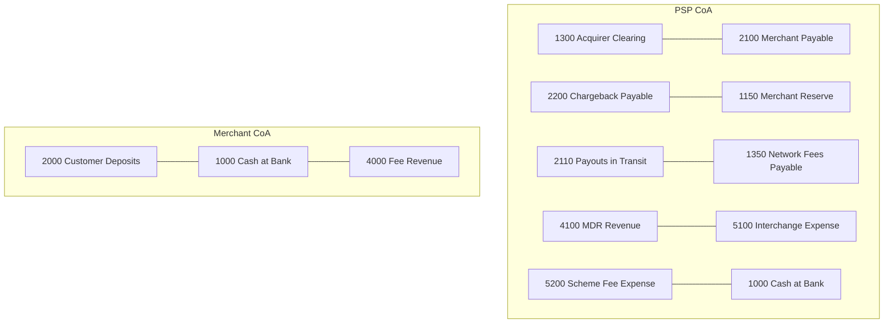
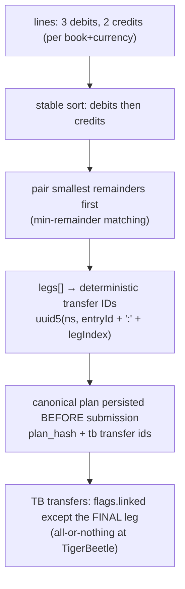
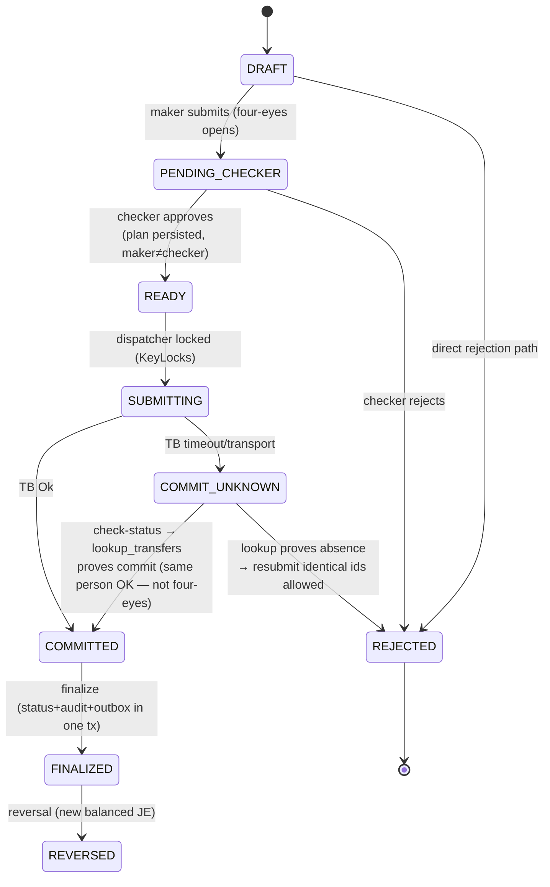
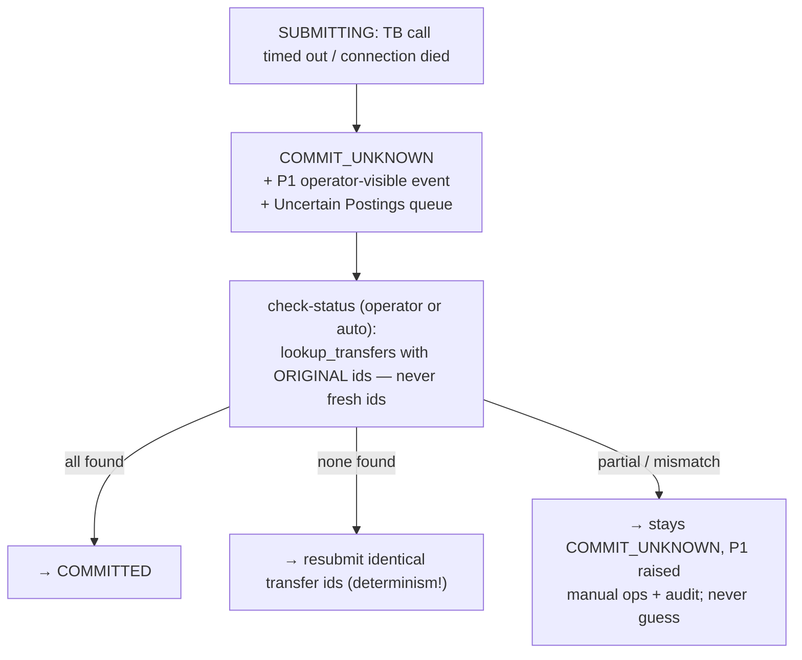
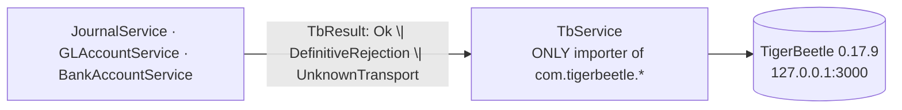

# Architecture Chapter 4 — The Money Engine (Books, CoA, JE & TigerBeetle)

**Parent Document:** [docs/architecture.md](../architecture.md)

---

## 1. Tenancy ≠ Entity ≠ Book ≠ Ledger Chain

- One book per (tenant, legal entity, currency); shared TB ledger **per currency**.
- TB accounts carry `user_data_128 = glAccountId`, `user_data_64 = tenantHash`, `user_data_32 = accountTypeOrdinal`.
- Provisioning model (accounts *and* journal legs): **persist plan → submit to TB → confirm → activate**. Any TB rejection rolls back the Postgres transaction; re-runs are safe.

---

## 2. Chart of Accounts (Seeded Templates)

---

## 3. Journal Entry Anatomy & Posting Planner

A JE = `entryId, tenantId, bookId, periodId, currency, lines[] (glAccountId, direction DEBIT|CREDIT, amount minor units, memo), totalDebits/totalCredits, status, planHash, tbTransferIds[], makerId, checkerId`.

Balancing is *by construction* (create API rejects unbalanced input). The planner turns lines into **legs** by *direct debit-to-credit matching* (never "star"):

Determinism guarantee: Two independent nodes replaying the same entry produce byte-identical transfer IDs — the recovery protocol depends on this determinism.

---

## 4. Posting State Machine

`JournalTx` exists as a separate bean so `@Transactional` transition methods are never bypassed by self-invocation inside `JournalService`. The sealed `PostingOutcome` (`Committed | Rejected | Unknown`) is consumed by exhaustive switch.

---

## 5. Uncertain Commit — The Recovery Protocol

Hard rules: never retry with new IDs while uncertain; original IDs only, even for the retry, until the outcome is definitively known.

---

## 6. TigerBeetle Driver Isolation

`TbResult` is a sealed algebra: a *definitive* rejection is a business event (log `WARN`, terminalize), an *unknown transport* result drives the recovery protocol above.

---

## 7. Money In Flight — Pending Transfers as the Universal Two-Phase (Chapter 13)

The pending/commit/void mechanism above is the same construct chapter 13 scales into
bank rails: every in-flight external movement (bill payments, SKU holds, custodian transfers)
posts as a **linked pending transfer** into a nominal clearing account, and one of three
dispositions resolves it — **commit** (confirmed), **void** (reversible window), or
**stays pending** (pending recognition, until a `probe()` or a recon finding clears the
ambiguity). A timeout on an already-submitted message is **never** a failure; only a
definitive `RailResult.Rejected(permanent=true)` voids immediately. Normative shapes, the
exactly-once stack, and the failure doctrine live in
[chapter 13](13-money-movement-and-rails.md);
the executable plan (stages, regulatory citations) in
[plans/bank-connectors-bill-payments-plan.md](../../plans/bank-connectors-bill-payments-plan.md).
