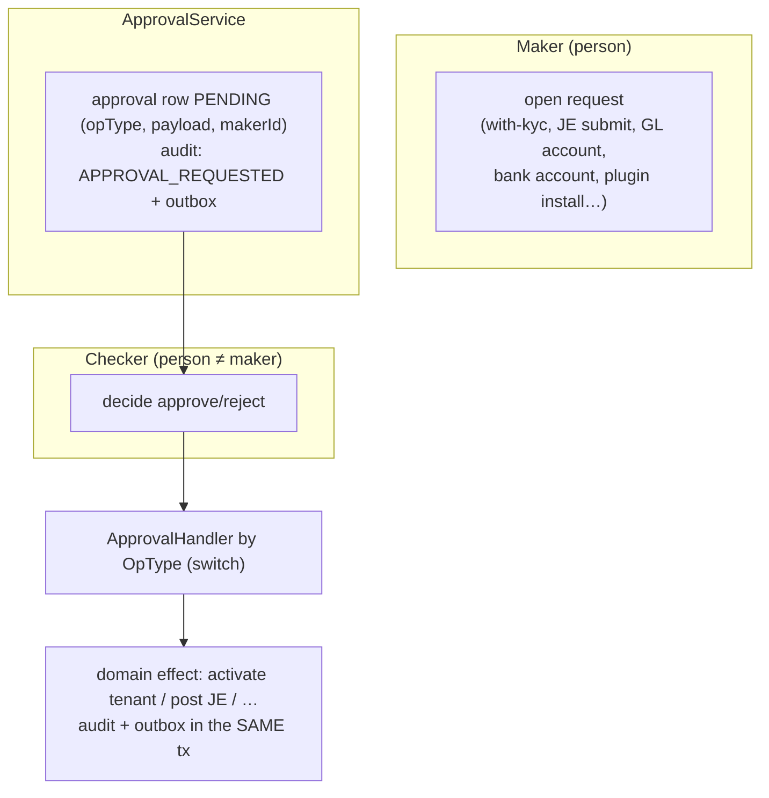
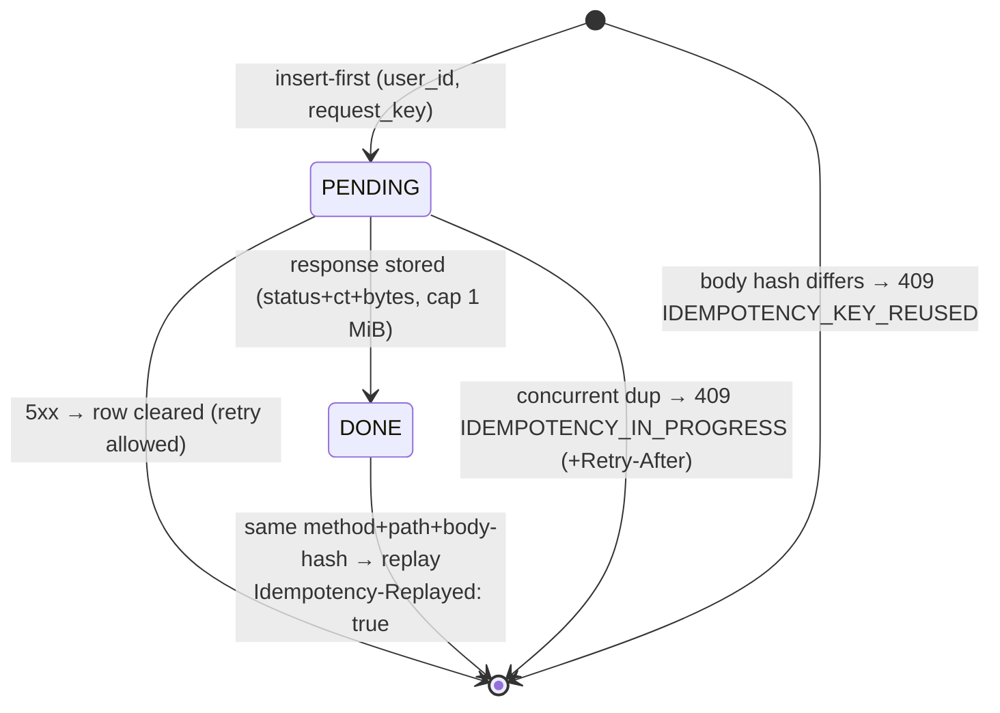

# Architecture Chapter 5 — Four-Eyes Approvals & Idempotency

**Parent Document:** [docs/architecture.md](../architecture.md)

---

## 1. The Generic Approval Engine

- Enforced in service code (maker ≠ checker at `person_id`); the UI renders a separate checker surface with a read-only diff, plan hash and maker identity.
- A `403 MAKER_CANNOT_APPROVE` renders an explicit blocked state in the UI — never silently hidden.
- Identical retry by the *same* checker is idempotent; conflicting decisions fail with a state error.
- **Atomicity is per handler:** DB-only effects (`USER_*`, `ROLE_*`) declare `atomicWithResolution()` and run in ONE transaction with the approval row — a refused effect rolls the decision back. Handlers that dispatch remotely keep their own boundaries: `JE_POSTING` must COMMIT its canonical plan before the TigerBeetle call.
- **Plugin-owned rows:** `PLUGIN:<code>:<action>` approvals are decided only through the owning plugin (DELEGATED); a person resolving one directly gets `409 APPROVAL_PLUGIN_OWNED`.
- **The queue tells each caller what they may do:** `GET /v1/approvals` opens for any checker permission and returns per row `canDecide` + `blockedReason` (`OWN_REQUEST · NOT_CHECKER · NO_PERMISSION · PLUGIN_OWNED · DECIDED`), maker/checker names and — for core `USER_*`/`ROLE_*` rows only — the proposal payload.

---

## 2. Idempotency in Depth (`IdempotencyFilter`, order 2)

Positioning: FAPI 2.0 does not define idempotency — this lives at the core resource-server layer, orthogonal to OAuth/DPoP, and *never replaces* domain invariants.

---

## 3. Concurrency, Race Condition & Deadlock Safety

Every approval resolution and financial state transition is shielded against concurrency hazards:

### 3.1 Two Checkers Racing (Double-Approval Race)
1. **JPA `@Version` & Status Preconditions:** The approval aggregate carries `@Version`. If two checkers click Approve concurrently, one commits and bumps the version; the second fails immediately with an optimistic lock or status conflict exception (`JE_STATE`/`APPROVAL_STATE`).
2. **Critical Section Serialization (`KeyLocks`):** Non-idempotent operations dispatching to TigerBeetle are wrapped in `KeyLocks.withLock("je-approval", entryId, () -> ...)`. This guarantees only one thread inside the JVM can dispatch a given entry to the ledger at any time.

### 3.2 Deadlock Prevention in Multi-Row Mutations
1. **Sorted Lock Ordering:** When an operation locks or updates multiple rows (e.g. multiple accounts, transfer legs, or approval rows), entities MUST always be processed in **strictly sorted primary key order** (`ORDER BY id ASC`). Updating rows in non-deterministic order across concurrent threads causes database deadlocks (`PostgreSQL 40P01`).
2. **Minimal Transaction Scope:** Database locks are held only for the minimum necessary duration. External HTTP calls, slow I/O, or socket operations are strictly prohibited inside `@Transactional` blocks.
