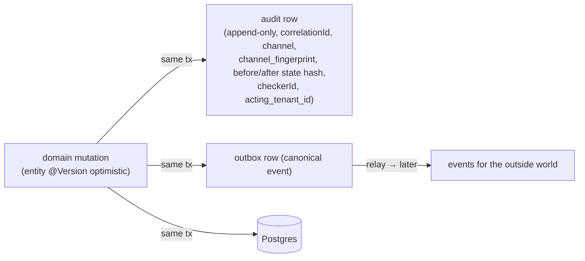
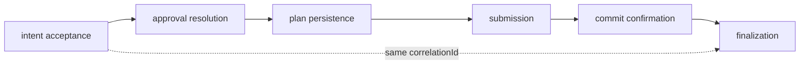

# Architecture Chapter 6 — Audit, Outbox & Evidence

**Parent Document:** [docs/architecture.md](../architecture.md)

---

## 1. Write Path — One Transaction, Three Writes

---

## 2. Evidence Chain

Milestones audited at core boundaries (`AuditService`); the correlation ID ties the whole chain; while acting as a tenant every row carries `acting_tenant_id` + `act_session_id`.

---

## 3. Logging Contract (One Line Per Incident)

| Level | Money path example |
|---|---|
| ERROR + exception | `je_commit_unknown`, `je_recovery_p1_*`, TB transport failure |
| WARN | `permission_denied`, `maker_cannot_approve`, `je_transition_conflict`, TB definitive rejection |
| INFO | `je_submitted`, `coa_provisioned`, `je_posting_committed`, KYC decision |
| DEBUG | plan legs, TB specs, screening details, per-request actor resolution |

Format: single machine-parsable line with `ts/level/traceId/tenantId/userId` from MDC (`application.yml`); multi-line detail only under the `debug` profile. Secrets, tokens, DPoP proofs and identity numbers (mask last 4) are never logged.
