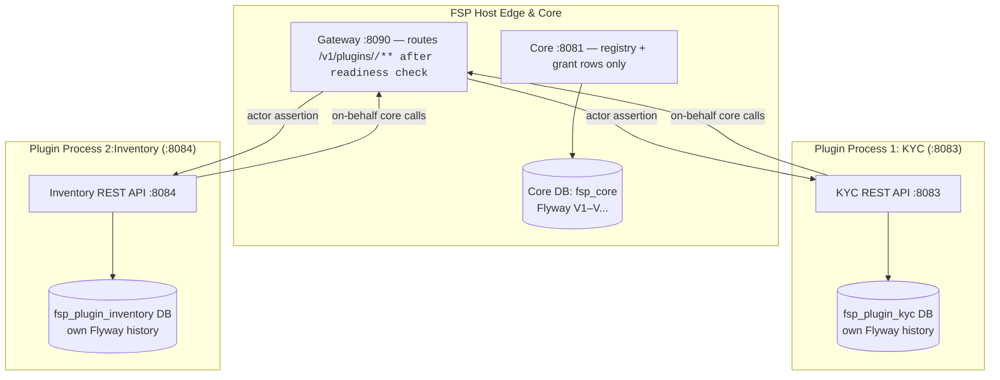
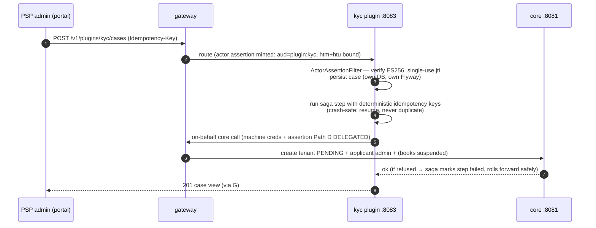

# Architecture Chapter 7 — Plugin Platform & Process/Schema Isolation

**Parent Document:** [docs/architecture.md](../architecture.md)  
**Detailed Implementation Plan:** [plans/plugin-platform-plan.md](../../plans/plugin-platform-plan.md)

---

## 1. Process & Database Isolation Mandate

Every plugin attaches **around** the non-pluggable core (RBAC, journal, audit, hierarchy, CoA are never inside a plugin) and conforms to strict isolation:

### Isolation Invariants
1. **Separate Standalone OS Processes:** Every plugin runs as an independent Spring Boot application in its own container or host process with dedicated port and lifecycle.
2. **Dedicated Database & Schema:** Every plugin owns its private database schema/database. Plugins NEVER connect to the core database or share tables with other plugins.
3. **Independent Flyway Migrations:** Schema migrations live entirely in the plugin repository/classpath (`db/plugin/<name>/migration/`) and run independently. Plugins never alter core schemas.
4. **Zero Cross-Database Queries:** No cross-database SQL joins or direct DB calls exist between Core and Plugins or between Plugins. Inter-service data exchange is strictly via REST API over the Gateway with actor assertions.
5. **Instant Revocation via Core DB Truth:** Plugin enable/disable flips rows in Core `plugin_registry` and `client_grants`, terminating access at the next call without requiring token blacklists.

---

## 2. KYC Plugin — The Onboarding Saga

- **Case state machine:** `DRAFT → PENDING_REVIEW → APPROVED | REJECTED | REQUEST_INFO`
  (REQUEST_INFO → resubmit loop; four-eyes on the decision; re-opened on bank change).
- **Five-tab data capture:** business profile · operations · addresses · UBO & key management (person 1 = applicant admin, `UsernamePolicy` generates their username) · settlement bank accounts.
- **Screening (sandbox provider, `ScreeningService`):** IDENTITY + SANCTIONS checks (PASS / FAIL / MANUAL_REVIEW) decided server-side.
- **Namibian validation** (`NamibiaRules`): BIPA `^([A-Z]{2})?\d{3,10}$` (normalized), TIN `^\d{8}$`, branch code `^\d{5,6}$`, UBO threshold ≥ 25%, records kept ≥ 5 years.
- **Approval → activation:** case APPROVED ⇒ core tenant ACTIVE + books ACTIVE + CoA provisioned + audit chain.
