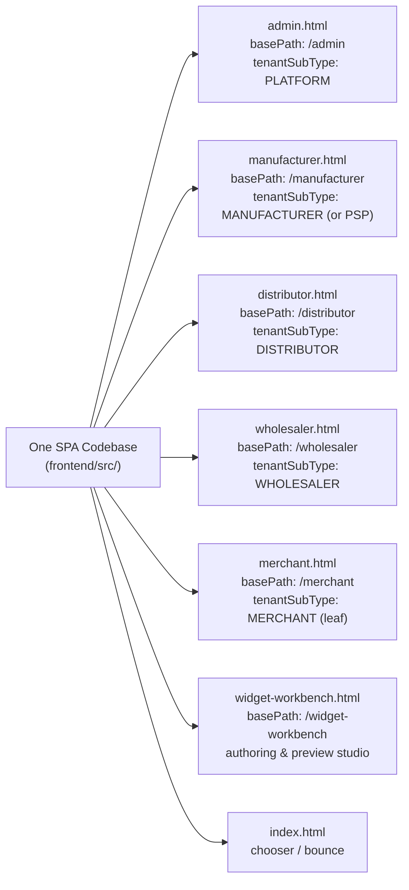
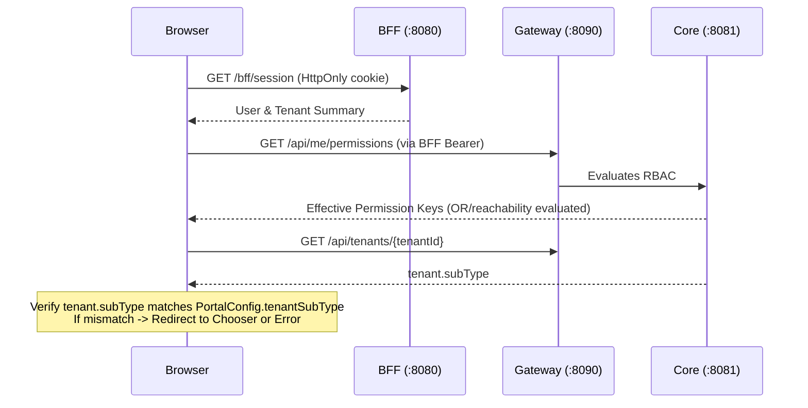
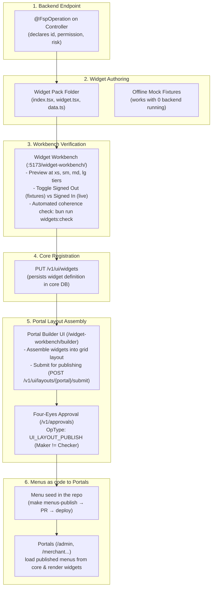
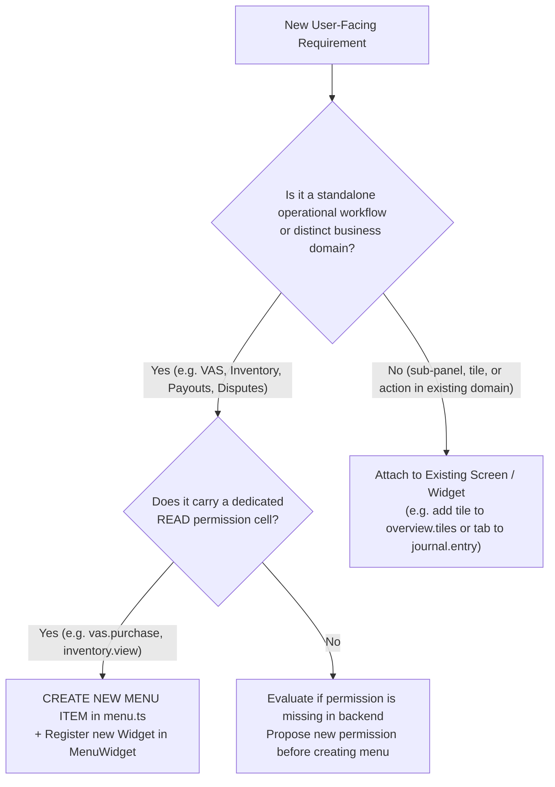

# Architecture Chapter 9 — Frontend, Portals & Widget Harness

**Parent Document:** [docs/architecture.md](../architecture.md)  
**Normative Standard:** [ui-std.md](../ui-std.md) · **Workbench Guide:** [docs/widget-workbench.md](../widget-workbench.md)

---

## 1. How Portals are Created (Single Codebase, 5 Identities)

The platform delivers **5 distinct portal web applications** from a single SPA codebase (`frontend/src/` built with Bun, Vite, React 18, and TypeScript strict).



### 1.1 The Portal Configuration Engine (`portal-config.ts`)
Each HTML entry file boots `OrgApp.tsx` (or `AdminApp.tsx`) with a dedicated `PortalConfig` object defining:
- `tenantSubType`: `'PLATFORM' | 'MANUFACTURER' | 'DISTRIBUTOR' | 'WHOLESALER' | 'MERCHANT'`.
- `basePath`: Browser route prefix (`/admin`, `/manufacturer`, `/merchant`, etc.).
- `accent`: Portal brand color injected into CSS variables (`--portal-accent`).
- `storageKey`: Dedicated browser storage prefix to prevent cross-portal session pollution (FAPI 2.0 session isolation).
- Menus: `SignedMenuGate` (historical name) loads the portal's published menus from core (`GET /api/ui/menus/{portal}`), checks their shape and renders them. Nothing is signed.

### 1.2 Session Hydration & Portal Eligibility
On boot, each portal executes the session handshake:



---

## 2. The Widget-Driven Architecture

FSP portals **do not hardcode pages or forms**. Every visible screen is a dynamic composition of independent, modular **Widgets** hosted within a responsive 12-column grid (`WidgetHost`, `WidgetGrid`).

```
frontend/src/portals/shared/widgets/<area>/<name>/
├── index.tsx      ← defineWidget({ id, version, label, requires: [...], sources, commands, size, render })
├── widget.tsx     ← Pure presentation component (strictly design tokens & atoms)
├── data.ts        ← Data sources (TanStack Query hooks) & offline mock fixtures
└── <name>.test.ts ← Vitest unit & contract tests
```

### 2.1 The Widget Lifecycle in the Pipeline



---

## 3. Menu Governance & Screen Routing

Portal sidebars are governed by **`frontend/src/portals/shared/web-core/menu.ts`** (`MENU_ITEMS`).

### 3.1 Menu Contract Rules
1. **Canonical Registry:** Every menu item is declared in `MENU_ITEMS`. Unmapped routes fail closed.
2. **Permission Gated (OR semantics):** A menu item is only visible if the authenticated user holds at least one permission in `item.perm`.
3. **Multi-Portal Targeting:** The `portals: ['platform', 'org']` array determines which portal shells show the menu point.
4. **Widget Binding:** The `widgets: MenuWidget[]` array specifies which widgets compose the screen rendered when the menu point is navigated to.

---

## 4. Agent Decision Framework (When to Engage & When to Add Menu Items)

AI agents and developers modifying or extending FSP must use the following decision matrix to determine how to interact with the widget pipeline.

### 4.1 When to Engage with the Widget Workbench
Always engage with the widget pipeline when:
- Creating any new user-facing view, dashboard, ledger view, form, or approval panel.
- Adding interactive widgets to an existing portal.
- Building components that call `@FspOperation` backend endpoints.

### 4.2 When to Add a Menu Item (Implicit vs. Explicit Requirements)

Requirements often describe a backend capability or business workflow (e.g. *"enable VAS airtime top-up for merchants"* or *"add settlement reconciliation reporting"*) without explicitly saying *"add a menu item"*.

The agent MUST use this heuristic:



### 4.3 Checklist for Adding a New Menu Capability (The Full Chain)

When a requirement implies a new operational screen:
1. **Verify / Add Backend `@FspOperation`:**
   - Ensure the controller declares `@FspOperation` with proper `id`, `permission`, and `risk`.
2. **Register Permission in Catalogue:**
   - Add the permission key to `frontend/src/portals/shared/widgets/permission-catalogue.ts`.
3. **Map Data Sources:**
   - Add logical endpoint mapping in `frontend/src/portals/shared/widgets/core/sources.ts`.
4. **Author Widget Pack:**
   - Create `frontend/src/portals/shared/widgets/<area>/<name>/`:
     - `index.tsx`: Defines `id`, `requires: ['domain.view']`, `size`, and metadata.
     - `widget.tsx`: Follows `ui-std.md` (Design tokens, `Amount` atom, skeletons).
     - `data.ts`: TanStack Query hooks + offline mock fixtures.
5. **Update Menu Registry (`menu.ts`):**
   - Add widget ID to `type MenuWidget`.
   - Add new entry in `MENU_ITEMS`:
     ```typescript
     {
       id: 'inventory-tracking',
       label: 'Inventory',
       icon: '📦',
       link: '/inventory',
       perm: ['inventory.view'],
       portals: ['org'],
       group: 'Commerce',
       widgets: ['inventory.tracking']
     }
     ```
6. **Mount in Screen Engine (`screens.tsx`):**
   - Ensure route renders `WidgetScreen` for the new menu entry.
7. **Verify Coherence:**
   - Run `bun run widgets:check` (validates that widget IDs, permissions, and manifests are 100% coherent).
   - Run `bun run typecheck` and `bun run lint`.
