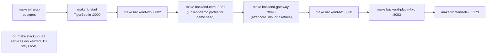
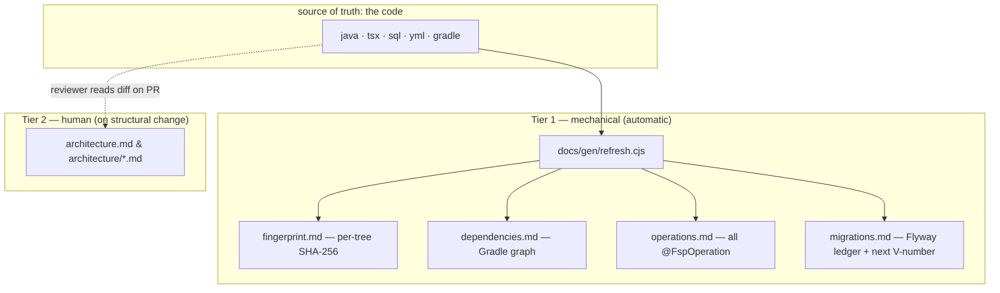

# Architecture Chapter 11 — Operations, Tests & Live Document Maintenance

**Parent Document:** [docs/architecture.md](../architecture.md)  
**Dev Quickstart:** [docs/README-dev.md](../README-dev.md) · **Full Setup Guide:** [docs/setup-guide.md](../setup-guide.md)

---

## 1. Make Targets (Dev Happy Path)

Smoke chain: `GET :8080/bff/csrf` → `POST /bff/auth/login` → `GET /api/**`; direct `:8090/v1/**` needs a Bearer from `/idp/token`.

---

## 2. Tests as Executable Architecture

| Layer | Proves |
|---|---|
| Unit + property (backend) | Direct debit-credit matching (gross/net/deterministic IDs), recovery of `COMMIT_UNKNOWN`, self-approval rejection, `NamibiaRules`, RBAC scope math |
| Service tests | State-machine preconditions, four-eyes, idempotency semantics |
| E2E (Playwright) | PRD acceptance chain: KYC 5-tab onboarding, atomic rollback, four-eyes, posting → FINALIZED, unknown-commit recovery, audit chain with single correlation ID, demo-profile isolation |
| Frontend gates | `bun run lint` / `typecheck` / `build`; bundle budget < 200 KB gz (shell) |

---

## 3. Live Document — How Architecture Stays In Sync

A **two-tier** maintenance model ensures documentation never drifts from code:

- Run `make docs-refresh` to update generated files.
- `make docs-check` is the CI gate.
- Install the git pre-commit hook via `make docs-hook`.

---

## 4. Glossary

- **BFF (Backend for Frontend):** Confidential web application proxy owning the user session cookie and generating DPoP proofs.
- **CoA (Chart of Accounts):** The structured list of general ledger accounts categorized by asset, liability, equity, revenue, and expense.
- **DPoP (Demonstrating Proof-of-Possession):** RFC 9449 application-level sender constraint mechanism binding access tokens to a private key.
- **FAPI (Financial-grade API):** OpenID Foundation security profile enforcing strict asymmetric authentication and sender constraints.
- **Four-Eyes Principle:** Dual authorization pattern requiring a maker and a checker (maker ≠ checker at `person_id`).
- **JE (Journal Entry):** The balanced accounting transaction containing direct debit and credit legs.
- **PDP (Policy Decision Point):** The authoritative component that evaluates authorization and RBAC policies (FSP Core).
- **PEP (Policy Enforcement Point):** The edge component that enforces token admission and routing (FSP Gateway).
- **TigerBeetle:** High-performance financial accounting database enforcing authoritative balance invariants.
