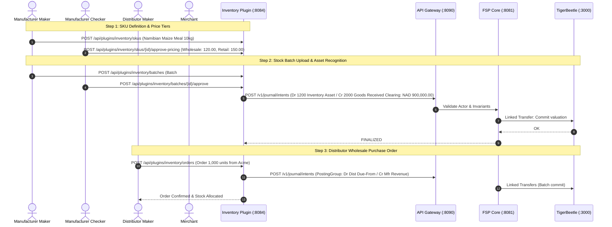
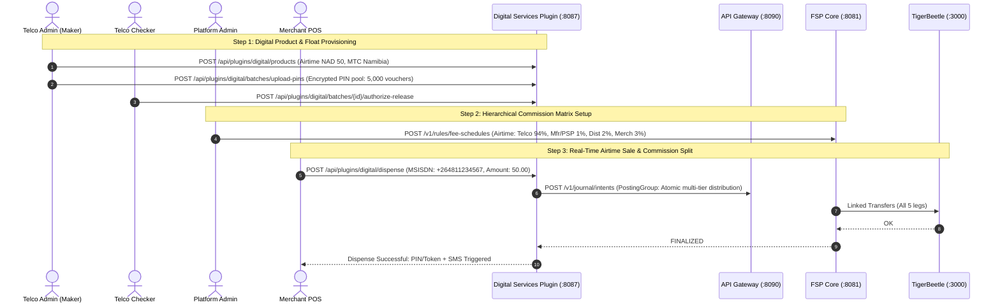
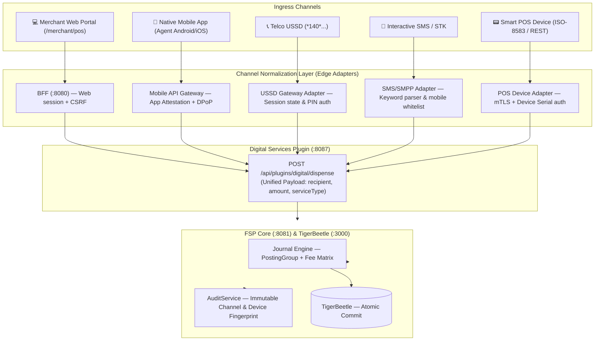

# Physical Inventory & Digital Services — Technical Screenplay & E2E Script Steps

**What this is:** A plain-text, step-by-step operational screenplay and technical test specification
for what comes after organization onboarding: **Product & Inventory Onboarding** (Physical Goods / SKUs)
and **Digital Value & Omnichannel Services Onboarding** (Airtime Top-up, Electricity Vouchers, Online Bill Payment across Web, Mobile App, USSD, SMS, POS).
It follows the exact structure, personas, and rigor established in [`docs/onboarding-script-steps.md`](onboarding-script-steps.md).

**The stories in one line:**
- **Part I (Physical SKU & Inventory):** The Manufacturer registers catalog SKUs and uploads physical stock batches; the Distributor orders wholesale stock using credit/wallet drawdown; the Merchant replenishes and sells to an end-customer at POS, driving balanced TigerBeetle double-entry journals at each step.
- **Part II (Digital Services & Omnichannel Distribution):** The Telco/Utility (Manufacturer) configures encrypted voucher PIN pools and live float accounts; the Platform establishes the multi-tier commission split; transactions ingress via **multiple channels** (Merchant Web Portal, Mobile App with biometrics, Telco USSD session `*140#`, and SMS STK keyword), executing real-time TigerBeetle ledger linked-transfer debits, channel fee deductions, and commission disbursements with full channel audit evidence.

**Legend:**
- `[UI]`      — Performed in the portal browser (clicks/forms/dialogs).
- `[APP]`     — Performed in the Native Mobile App (biometrics, touch UI).
- `[USSD]`    — Performed via Telco USSD session (`*140#` GSM interactive menu).
- `[SMS]`     — Performed via two-way SMS / STK keyword syntax.
- `[API]`     — Performed via BFF `/api/**` or Gateway `/v1/**` with the authenticated session.
- `[SHIM]`    — Temporary development workaround awaiting upcoming widget/endpoint.
- `GAP-INV-n` — Identified architectural, UI, or API gap in inventory services.
- `GAP-CHN-n` — Identified channel adapter or ingress gateway gap.

---

## THE CAST (Personas, Roles & Portals)

All actors ride the hierarchy established during onboarding:
`Platform Root (depth 0) → Manufacturer / PSP (depth 1) → Distributor (depth 2) → Merchant (depth 3)`.

| # | Persona | Username | Role / Entitlement | Channel / Portal | Focus Domain |
|---|---------|----------|-------------------|------------------|--------------|
| 1 | Platform admin (Maker) | `platform-admin` | Platform Root Maker | `/admin` (Web) | Plugin registration, fee policy |
| 2 | Platform checker | `admin-checker` | Platform Root Checker | `/admin` (Web) | Four-eyes plugin & fee approval |
| 3 | FMCG Manufacturer Admin (Maker) | `acme.admin.<tail>` | Manufacturer Maker | `/manufacturer` (Web) | Physical SKU catalog & stock batches |
| 4 | FMCG Manufacturer Checker | `acme.checker.<tail>` | Manufacturer Checker | `/manufacturer` (Web) | Catalog pricing & stock batch approval |
| 5 | Telco/Utility Admin (Maker) | `power.telco.admin` | Digital Utility Maker | `/manufacturer` (Web) | Airtime float, PIN batches, billers |
| 6 | Telco/Utility Checker | `power.telco.checker` | Digital Utility Checker | `/manufacturer` (Web) | Voucher release & float provisioning |
| 7 | Distributor Admin (Maker) | `sunrise.distribution.<tail>` | Distributor Maker | `/distributor` (Web) | Wholesale ordering, float funding |
| 8 | Distributor Checker | `checker-sunrise.distribution.<tail>` | Distributor Checker | `/distributor` (Web) | Purchase order & payout approval |
| 9 | Merchant Admin (Maker) | `namib.fresh.produce.<tail>` | Merchant Maker | `/merchant` (Web / App) | Stock receipt, POS sale, airtime sale |
| 10| Merchant Checker | `tulonga.checker` | Merchant Checker | `/merchant` (Web) | Stock write-off, end-of-day settlement |
| 11| Retail Mobile Agent | `agent.kavango` | Field Merchant Agent | Mobile App / USSD | Airtime topup on feature phone |
| 12| Retail End-Customer | *Walk-in / Mobile* | Consumer | POS / USSD / SMS | Cash payer, top-up recipient |

---

## ARCHITECTURAL BOUNDARIES & INVARIANTS

Before running either story, enforce the non-negotiable rules from [`vision.md`](../vision.md#L35) and [`AGENTS.md`](../AGENTS.md):

1. **Core Ignorance:** FSP Core **never** stores SKUs, barcodes, warehouse aisles, mobile numbers, meter numbers, or voucher PINs. All inventory and digital services data live inside plugin schemas (`fsp-plugin-inventory` and `fsp-plugin-digital-services`).
2. **Channel-Agnostic Core:** Core never knows about USSD menus, SMS keywords, or app push notifications. Channels are normalized at the edge via **Channel Ingress Adapters** into typed internal requests.
3. **Channel Traceability & Audit:** Every mutating request carries `X-FSP-Channel` and `X-FSP-Channel-Context`. Core immutable audit logs capture the channel fingerprint alongside `actor_id` and `correlation_id` for dispute resolution and regulatory proof.
4. **Money is Core:** Neither plugin nor channel adapter touches TigerBeetle directly. When goods move or airtime is dispensed, the plugin emits a `JournalIntent` to Core; Core enforces four-eyes (where configured), builds a balanced `PostingGroup`, and executes atomic linked transfers on TigerBeetle.
5. **Four-Eyes at `person_id`:** Creating a catalog price tier, posting a physical inventory batch valuation, altering an airtime commission rate, or writing off damaged stock requires a distinct checker `person_id`.
6. **Minor Units & Currencies:** All monetary amounts are strings of minor units (`NAD 100.00` → `"10000"`). Currency is ISO-4217 (`NAD`).

---

# PART I: THE PHYSICAL INVENTORY & SKU ONBOARDING STORY



---

### SCENE P0 — PREFLIGHT & INVENTORY PLUGIN GOVERNANCE

**Goal:** Register and install `fsp-plugin-inventory` (version `1.0.0`) on the Manufacturer and its subtree.

1. `[API]` Platform admin checks if `inventory` is registered: `GET /api/platform/plugins/inventory/1.0.0`.
2. `[API]` If not present, platform admin (Maker):
   `POST /api/platform/plugins` with:
   - `code: "inventory"`, `version: "1.0.0"`, `baseUrl: "http://localhost:8084"`
   - `manifest`: Declares contributed permissions (`inventory.sku.manage`, `inventory.pricing.approve`, `inventory.stock.upload`, `inventory.order.create`), contributed routes, and GL templates (1200 Inventory Asset, 1210 Inventory In-Transit, 5000 Cost of Goods Sold, 2000 Goods Received Clearing).
3. `[UI]` Platform checker signs in to `/admin`, navigates to **Plugins Governance** (`/admin/plugins`), locates the pending `PLUGIN_REGISTER` item, and approves it.
   **Assert:** Status changes to `REGISTERED`. Machine client `plugin-inventory` provisioned at IdP.
4. `[UI · act-as]` Platform checker selects the Manufacturer tenant (`Acme Manufacturers`), clicks "Act as Acme", navigates to Plugins, and requests installation of `inventory:1.0.0` with policy `INHERIT` (so Distributor and Merchant inherit capability).
5. `[UI]` Manufacturer checker signs into `/manufacturer`, navigates to `/manufacturer/approvals`, and approves `PLUGIN_INSTALL`.
   **Assert:** Readiness gates pass: `CLIENT_ACTIVE`, `PERMISSIONS_SEEDED`, `GL_ACCOUNTS_PROVISIONED`. `GET /api/plugins/inventory/health` returns `HTTP 200`.

---

### SCENE P1 — MANUFACTURER DEFINES PRODUCT CATALOG & SKU TIERS

**Goal:** Create product categories, master SKUs, unit of measurement, and multi-tier pricing with four-eyes signoff.

1. `[UI]` Sign in to `/manufacturer` as `acme.admin.<tail>` (Manufacturer Maker).
2. `[UI]` Open **Catalog & Products** (`/manufacturer/inventory/catalog`).
3. `[UI]` Click **New Product / SKU**, fill in form:
   - SKU: `"SKU-MAIZE-10KG"`
   - Barcode/EAN: `"6001234567890"`
   - Name: `"Top Score Maize Meal 10kg"`
   - Category: `"FMCG / Dry Foods"`
   - Unit of Measure: `"BAG_10KG"`
   - Standard Unit Cost: `"9000"` (NAD 90.00)
   - Proposed Wholesale Price (Distributor tier): `"12000"` (NAD 120.00)
   - Proposed Recommended Retail Price (RRP): `"15000"` (NAD 150.00)
   - Click **Submit for Pricing Approval**.
   **Assert:** SKU created in status `PENDING_APPROVAL`. Warning banner: `"Pricing pending four-eyes authorization"`.
4. `[UI]` Sign in to `/manufacturer` as `acme.checker.<tail>` in a separate browser context.
5. `[UI]` Navigate to **Approvals** (`/manufacturer/approvals`). Open proposal `SKU_PRICING_APPROVAL: SKU-MAIZE-10KG`. Verify gross margin (Cost: 90.00 → Wholesale: 120.00 = 25% margin). Click **Approve**.
   **Assert:** SKU status becomes `ACTIVE`. Available for ordering across the hierarchy.

---

### SCENE P2 — MANUFACTURER UPLOADS PHYSICAL STOCK BATCH

**Goal:** Manufacturer receives 10,000 bags from the production mill into Warehouse Central, creating the inventory asset on the ledger.

1. `[UI]` As Manufacturer Maker (`acme.admin`): Navigate to **Stock Management** (`/manufacturer/inventory/stock`).
2. `[UI]` Click **Receive Stock Batch**, fill in:
   - SKU: `"SKU-MAIZE-10KG"`
   - Batch Number: `"BATCH-2026-W47-01"`
   - Expiry Date: `"2027-11-30"`
   - Warehouse / Depot: `"WH-WINDHOEK-CENTRAL"`
   - Quantity Received: `10000`
   - Total Batch Cost: `"90000000"` (NAD 900,000.00)
   - Click **Submit Batch**.
   **Assert:** Batch staged with status `STAGED_AWAITING_VERIFICATION`.
3. `[UI]` As Manufacturer Checker (`acme.checker`): Open `/manufacturer/inventory/stock-approvals`.
4. `[UI]` Review physical bill of lading / goods receipt note reference. Click **Authorize Stock Receipt**.
5. `[API]` Under the hood:
   - Inventory plugin mints idempotency key `inv-batch-2026-w47-01`.
   - Plugin requests Core to post:
     - `DEBIT`: GL 1200 (Inventory On Hand — Asset) = `"90000000"`
     - `CREDIT`: GL 2000 (Goods Received Not Invoiced / Clearing) = `"90000000"`
   - TigerBeetle commits linked transfer.
   **Assert:** Batch status `COMMITTED`. Physical stock shows `10,000` on hand. TigerBeetle Account 1200 balance reflects `+900,000.00 NAD`.

---

### SCENE P3 — DISTRIBUTOR ORDERS WHOLESALE STOCK (INTER-ORG POSTING)

**Goal:** Distributor (`Sunrise Distribution`) places a purchase order for 1,000 bags (Wholesale value: NAD 120,000.00) against credit/wallet.

1. `[UI]` Sign in to `/distributor` as `sunrise.distribution.<tail>` (Distributor Maker).
2. `[UI]` Open **Supplier Catalog** (`/distributor/procurement/catalog`). Select supplier `Acme Manufacturers`.
3. `[UI]` Add 1,000 units of `SKU-MAIZE-10KG` @ NAD 120.00 = NAD 120,000.00 (`"12000000"` minor units).
4. `[UI]` Select Settlement Method: `PREPAID_WALLET` (Distributor holding account).
5. `[UI]` Click **Place Purchase Order**.
   **Assert:** PO `#PO-SUNRISE-1001` created in `PENDING_APPROVAL`.
6. `[UI]` Sign in to `/distributor` as `checker-sunrise.distribution.<tail>`. Open `/distributor/approvals` and click **Approve PO**.
7. `[API]` Under the hood:
   - FSP Core constructs a `PostingGroup` with two balancing JEs:
     - **Distributor Book:**
       - `DEBIT`: GL 1210 (Inventory In-Transit) = `"12000000"`
       - `CREDIT`: GL 1000 (Operating Cash / Wallet) = `"12000000"`
     - **Manufacturer Book:**
       - `DEBIT`: GL 1000 (Operating Cash / Clearing) = `"12000000"`
       - `CREDIT`: GL 4000 (Commercial Sales Revenue) = `"12000000"`
       - `DEBIT`: GL 5000 (Cost of Goods Sold) = `"90000000"` (at unit cost 90.00 * 1,000 = 90,000.00)
       - `CREDIT`: GL 1200 (Inventory On Hand) = `"90000000"`
   - TigerBeetle links all 6 legs atomically.
   **Assert:** JE state `FINALIZED`.
   - Manufacturer inventory on hand drops from 10,000 → 9,000.
   - Distributor in-transit stock shows 1,000 units.

---

### SCENE P4 — DISTRIBUTOR DISPATCH & MERCHANT REPLENISHMENT

**Goal:** Stock arrives at Distributor warehouse; Merchant (`Namib Fresh Produce`) purchases 50 bags for local retail stock.

1. `[UI]` Distributor Checker confirms physical delivery receipt: Stock moves from `Inventory In-Transit` → `Distributor Stock On Hand`.
2. `[UI]` Merchant Maker (`namib.fresh.produce.<tail>`) signs into `/merchant`, navigates to **Order Stock** (`/merchant/procurement`).
3. `[UI]` Selects Distributor `Sunrise Distribution`, orders 50 bags @ NAD 125.00 (Distributor markup) = NAD 6,250.00 (`"625000"`).
4. `[UI]` Merchant Checker (`tulonga.checker`) approves payment from the merchant cash float.
5. `[API]` Intercompany posting commits:
   - Merchant recognizes `DEBIT` Inventory Asset 1200 / `CREDIT` Cash 1000.
   - Distributor recognizes `DEBIT` Cash / `CREDIT` Revenue, relieves Distributor Inventory.
   **Assert:** Merchant stock widget displays `50 bags` on hand.

---

### SCENE P5 — MERCHANT POINT-OF-SALE (POS) RETAIL CHECKOUT

**Goal:** Walk-in retail customer buys 1 bag of Maize Meal for NAD 150.00 cash.

1. `[UI]` Merchant cashier / maker opens **Point of Sale** widget (`/merchant/pos`).
2. `[UI]` Scan barcode `6001234567890` or search `"Maize 10kg"`. 1 unit added = NAD 150.00.
3. `[UI]` Select Tender: `CASH` (Tendered: NAD 200.00, Change: NAD 50.00).
4. `[UI]` Click **Complete Sale**.
5. `[API]` Synchronous POS settlement:
   - Inventory Plugin decrements merchant stock: `50 → 49`.
   - Plugin generates immediate balanced JE:
     - `DEBIT`: GL 1010 (Till Cash) = `"15000"`
     - `CREDIT`: GL 4000 (Retail Sales Revenue) = `"13043"` (Net of 15% VAT)
     - `CREDIT`: GL 2150 (VAT Output Payable) = `"1957"` (Namibian 15% standard rate)
     - `DEBIT`: GL 5000 (COGS) = `"12500"`
     - `CREDIT`: GL 1200 (Inventory Asset) = `"12500"`
   - Core commits in TigerBeetle within 15 ms.
   **Assert:** POS renders receipt `#REC-2026-00891`. Till cash balance increments by NAD 150.00.

---

# PART II: THE DIGITAL VALUE & SERVICES ONBOARDING STORY (Airtime, Bill-Pay, Electricity)



---

### SCENE D0 — PREFLIGHT & DIGITAL SERVICES PLUGIN REGISTRATION

**Goal:** Register and install `fsp-plugin-digital-services` (version `1.0.0`) providing airtime top-up, prepaid electricity tokens, and utility bill presentment.

1. `[API]` Platform Admin (Maker):
   `POST /api/platform/plugins` with:
   - `code: "digital-services"`, `version: "1.0.0"`, `baseUrl: "http://localhost:8087"`
   - `manifest`: Declares permissions (`digital.product.manage`, `digital.voucher.upload`, `digital.float.provision`, `digital.dispense`, `digital.billpay`), routes, and GL templates (1020 Digital Float Asset, 2030 Voucher Inventory Liability, 4100 Commission Income, 1310 Utility Settlement Clearing).
2. `[UI]` Platform Checker (`admin-checker`) approves `PLUGIN_REGISTER` in `/admin/plugins`.
3. `[UI · act-as]` Platform Checker acts as the Telco/Utility Provider (`MTC & Power Corp`), requests installation.
4. `[UI]` Telco Checker signs into `/manufacturer/approvals` and approves `PLUGIN_INSTALL`.
   **Assert:** Gate check passes. Machine client `plugin-digital-services` ready.

---

### SCENE D1 — TELCO DEFINES DIGITAL PRODUCTS & VOUCHER POOLS

**Goal:** Establish digital catalog offerings:
- Product A: **Direct Top-Up (API Float)** — live airtime sent directly to phone number.
- Product B: **Prepaid Electricity (Token Generator)** — STS-compliant 20-digit token generation.
- Product C: **Voucher PIN Pool** — encrypted batches of airtime scratch-card PINs.

1. `[UI]` Sign in to `/manufacturer` as `power.telco.admin` (Telco Maker).
2. `[UI]` Open **Digital Products** (`/manufacturer/digital/catalog`).
3. `[UI]` Click **Add Digital Product**:
   - Provider: `"MTC Namibia"`
   - Service Type: `AIRTIME_PIN`
   - Denomination: `"5000"` (NAD 50.00)
   - Currency: `"NAD"`
   - Validation Rule: `"^(\\+264|0)81\\d{7}$"` (Namibian MTC mobile format)
4. `[UI]` Click **Upload Encrypted Voucher Batch**:
   - File: `mtc-50nad-batch-402.csv.enc` (AES-256-GCM encrypted using Telco HSM vault key).
   - Quantity: `5,000` PIN vouchers.
   - Batch Face Value: `"25000000"` (NAD 250,000.00).
   - Click **Submit Batch for Checker Clearance**.
   **Assert:** Batch status `PENDING_CLEARANCE`. Raw PINs are never readable in plaintext by the application or UI.
5. `[UI]` Sign in as `power.telco.checker`. Open `/manufacturer/approvals`. Verify checksum and HSM key ID. Click **Authorize Voucher Pool Activation**.
   **Assert:** Pool status becomes `ACTIVE`. Available count shows `5,000 units`.

---

### SCENE D2 — FLOAT FUNDING & PREPAYMENT SETUP

**Goal:** Downstream Merchant / Distributor pre-funds their operational digital float before dispensing airtime.

1. `[API]` In digital value distribution, merchants cannot dispense airtime on credit without float collateral:
   - Merchant transfers NAD 5,000.00 from physical bank account to FSP settlement bank.
2. `[UI]` Merchant Checker signs in to `/merchant`, opens **Float Management** (`/merchant/digital/float`).
3. `[UI]` Clicks **Confirm Bank Deposit**:
   - Reference: `"EFT-NAMPOST-88192"`
   - Amount: `"500000"` (NAD 5,000.00)
4. `[API]` Under the hood, FSP Core posts:
   - `DEBIT`: GL 1000 (FSP Settlement Bank Account) = `"500000"`
   - `CREDIT`: GL 2050 (Merchant Digital Float Liability) = `"500000"`
   **Assert:** Merchant Float Balance widget displays `NAD 5,000.00 Available`.

---

### SCENE D3 — COMMISSION & REVENUE-SHARE MATRIX CONFIGURATION

**Goal:** Configure the multi-tier fee matrix per [`vision.md §3.4`](../vision.md#L148-L151).
For every **NAD 100.00 Airtime Sold**:
- Telco (Product Provider): **NAD 94.00** (94%)
- Platform Root: **NAD 1.00** (1% Platform technology fee)
- Distributor (Super-Agent): **NAD 2.00** (2% Wholesale commission)
- Merchant (Retailer): **NAD 3.00** (3% Retail discount margin)

1. `[UI]` As Platform Admin (`platform-admin`): Open `/admin/rules/fee-schedules`.
2. `[UI]` Select Service Category: `DIGITAL_AIRTIME`.
3. `[UI]` Configure Revenue Splits:
   - `PROVIDER_SHARE`: `"94.00%"`
   - `PLATFORM_FEE`: `"1.00%"`
   - `DISTRIBUTOR_SPLIT`: `"2.00%"`
   - `MERCHANT_COMMISSION`: `"3.00%"`
   - Effective Date: Today (Open period).
   - Click **Submit Schedule Revision**.
4. `[UI]` As Platform Checker (`admin-checker`): Open `/admin/approvals`. Review before/after rule hashes. Click **Approve Fee Schedule**.
   **Assert:** Canonical rule hash persisted in Core DB. Effective immediately across all digital dispense operations.

---

### OMNICHANNEL INGRESS ARCHITECTURE (Web, App, USSD, SMS, POS)

To support selling digital services from any channel without duplicating core or plugin logic:



#### The 3 Places Channel Data is Captured
1. **In-Flight Request Headers (Edge → Gateway → Plugin):**
   - `X-FSP-Channel`: `WEB_PORTAL` | `MOBILE_APP` | `USSD` | `SMS` | `POS_TERMINAL` | `PARTNER_API`
   - `X-FSP-Channel-Context`: JSON with channel telemetry:
     - *USSD:* `{ "sessionId": "ussd-992", "originMsisdn": "+264819876543", "telcoId": "MTC_NAMIBIA", "cellTower": "WNK-04" }`
     - *Mobile App:* `{ "deviceId": "AND-9912", "appVersion": "2.4.0", "biometricAuth": true, "attestation": "PLAY_INTEGRITY_PASS" }`
     - *Web Portal:* `{ "ip": "196.216.42.10", "userAgent": "Chrome/131", "dpopJkt": "0a9f..." }`
2. **Core Immutable Audit Evidence (`AuditService`):**
   - Stored in `audit_records`: `actor_id`, `tenant_id`, `correlation_id`, `channel`, and `channel_fingerprint_hash`.
3. **Financial Journal & Ledger Metadata (`JournalEntry`):**
   - `reference`: `"TX-VAS-AIRTIME-USSD-88192"`. Enables channel interchange cost deduction and cross-channel reconciliation.

---

### SCENE D4A — MERCHANT WEB PORTAL POS DISPENSE

**Goal:** Cashier at a counter uses the desktop merchant portal to sell airtime.

1. `[UI]` Merchant cashier opens `/merchant/pos`, selects `"MTC Airtime Top-up"`.
2. `[UI]` Inputs customer mobile: `"0812345678"`, Amount: `"NAD 50.00"`.
3. `[UI]` Collects NAD 50.00 cash from customer, clicks **Dispense Airtime**.
4. `[API]` Browser sends request via BFF:
   - Header stamped: `X-FSP-Channel: WEB_PORTAL`.
   - Core builds `PostingGroup` (NAD 48.50 merchant float debit, 47.00 telco payable, 1.00 distributor commission, 0.50 platform fee).
   - TigerBeetle commits linked transfer.
   - Screen renders digital receipt `#REC-WEB-5510`.

---

### SCENE D4B — MOBILE APP DISPENSE WITH BIOMETRIC ATTESTATION

**Goal:** Field agent using Android smartphone app dispenses airtime on the go.

1. `[APP]` Field agent logs in with fingerprint biometrics (Play Integrity + DPoP attested session).
2. `[APP]` Opens **Quick Top-up**, scans customer QR code or enters `"0813334444"`, selects `"NAD 20.00"`.
3. `[APP]` Taps **Confirm with Biometric**, prompt succeeds.
4. `[API]` Mobile App sends request to API Gateway:
   - Headers: `X-FSP-Channel: MOBILE_APP`, `X-FSP-Channel-Context: {"biometricAuth":true,"deviceId":"DEV-AND-8812"}`.
   - Core processes atomic journal:
     - `DEBIT`: Agent Float (GL 2050) = `"1940"` (NAD 19.40 net cost)
     - `CREDIT`: Telco Payable (GL 2100) = `"1880"`
     - `CREDIT`: Distributor Commission (GL 2110) = `"40"`
     - `CREDIT`: Platform Fee (GL 4100) = `"20"`
   - Core records audit entry with `channel=MOBILE_APP`.
5. `[APP]` App vibrates with success animation, SMS pushed to recipient.

---

### SCENE D4C — TELCO USSD SESSION DISPENSE (*140# GSM MENU)

**Goal:** Rural merchant with a 2G basic feature phone (no internet) sells airtime via USSD.

1. `[USSD]` Merchant dials `*140*1*0812345678*50#` (or interactive menu `*140#` → `1. Airtime` → `2. Phone` → `3. Amount`).
2. `[USSD]` Telco USSD gateway prompts: `"Confirm top-up NAD 50.00 to 0812345678. Enter 4-digit Wallet PIN:"`.
3. `[USSD]` Merchant inputs PIN `4491`.
4. `[API]` Telco USSD Gateway fires webhook to FSP USSD Adapter:
   - USSD Adapter verifies session state and merchant PIN hash.
   - Calls Digital Services Plugin: `POST /api/plugins/digital/dispense`
   - Headers injected:
     `X-FSP-Channel: USSD`
     `X-FSP-Channel-Context: {"sessionId":"USSD-2026-99120","originMsisdn":"+264817778888","telco":"MTC"}`
   - Core builds `PostingGroup` with channel-specific USSD session fee (NAD 0.05 carrier interchange).
   - TigerBeetle commits linked transfer.
5. `[USSD]` Phone screen displays flash message: `"Success! Top-up of NAD 50 sent to 0812345678. New float balance: NAD 4,882.95. Ref: USSD-99120"`.

---

### SCENE D4D — TWO-WAY SMS / STK KEYWORD TOP-UP (FALLBACK CHANNEL)

**Goal:** Automated text-message or SIM Toolkit (STK) command execution.

1. `[SMS]` Merchant sends SMS to short-code `4440`: `"TOPUP 50 0812345678 4491"`.
2. `[API]` FSP SMPP/SMS Gateway Adapter receives message:
   - Validates originating phone number matches registered merchant MSISDN.
   - Verifies daily SMS transaction velocity limits (max 5 SMS transactions per day per merchant).
   - Injects header: `X-FSP-Channel: SMS`.
   - Plugin executes dispense and Core commits ledger entries.
3. `[SMS]` SMS Gateway replies via SMS: `"Recharge of NAD 50.00 confirmed. Ref: SMS-39182. Balance: NAD 4,834.45"`.

---

### SCENE D5 — MUNICIPAL UTILITY BILL PAYMENT (ELECTRICITY / WATER)

**Goal:** Customer pays municipal utility bill (NAD 400.00 City of Windhoek Electricity).

1. `[UI]` Merchant opens **Bill Payment** tab (`/merchant/digital/billpay`).
2. `[UI]` Select Biller: `"City of Windhoek — Prepaid Electricity"`.
3. `[UI]` Input Meter Number: `"041-992-1827-1"` and Amount: `"NAD 400.00"`.
4. `[API]` In-flight validation: Plugin queries municipal utility gateway via integration adapter. Utility returns customer name: `"H. Angula"`, arrears: `"0.00"`, fee: `"NAD 0.00"`.
5. `[UI]` Cashier confirms customer identity with customer, collects NAD 400.00 cash, clicks **Process Payment**.
6. `[API]` Execution:
   - Core builds `PostingGroup`:
     - `DEBIT`: Merchant Till Cash / Float = `"40000"`
     - `CREDIT`: Municipal Utility Clearing Transit Account = `"39200"`
     - `CREDIT`: Merchant Biller Commission (GL 4100) = `"600"` (1.5%)
     - `CREDIT`: Platform Biller Fee (GL 4100) = `"200"` (0.5%)
   - Utility API call returns 20-digit STS token: `"1829-4019-5820-1928-4910"`.
7. `[UI]` POS prints receipt with 20-digit electricity recharge token.
   **Assert:** Municipal clearing balance increases by NAD 392.00; STS token verified.

---

## GAP REGISTER — INVENTORY, DIGITAL SERVICES & OMNICHANNEL

The following gaps must be tracked and resolved to convert all API/SHIM steps in this screenplay
into pure UI click-through tests:

| # | Gap Area | Status | Required Resolution |
|---|----------|--------|---------------------|
| `GAP-INV-1` | **Inventory Plugin Repo & Service** | ⬜ Open | Create `backend/plugins/inventory` subproject with `PluginManifest`, SKU entities, and batch inventory storage. |
| `GAP-INV-2` | **Catalog & SKU Widget** | ⬜ Open | Build `catalog.manage` widget supporting SKU creation, barcode mapping, and four-eyes pricing tiers. |
| `GAP-INV-3` | **Stock Batch Receiving Screen** | ⬜ Open | Build `stock.receiving` widget with warehouse location picker, batch/expiry inputs, and auto-journal generation. |
| `GAP-INV-4` | **Wholesale Ordering B2B Flow** | ⬜ Open | Build `procurement.orders` widget allowing downstream child orgs to browse parent catalogs and place POs. |
| `GAP-VAS-1` | **Digital Services Plugin Repo** | ⬜ Open | Create `backend/plugins/digital-services` subproject with encrypted voucher vault and float management. |
| `GAP-VAS-2` | **HSM / Voucher Encryption Seam** | ⬜ Open | Provide AES-GCM / AWS KMS envelope encryption for bulk voucher PIN file ingestion; plaintext PINs never exposed. |
| `GAP-VAS-3` | **Multi-Tier Fee Schema Engine** | ⬜ Open | Implement Core `FeeSchema` calculator resolving hierarchical splits (`ANCESTOR:<share_pct>`) per `vision.md §3.4`. |
| `GAP-VAS-4` | **POS & Retail Dispense Widget** | ⬜ Open | Build `pos.terminal` and `digital.dispense` widgets with touch-optimized numpad, MSISDN formatting, and receipt printing. |
| `GAP-VAS-5` | **Float Drawdown Concurrency Lock** | ⬜ Open | Ensure merchant float balance drawdown is wrapped in `KeyLocks.withLock("float:merchant", merchantId, ...)` to prevent double-spend during concurrent POS requests. |
| `GAP-CHN-1` | **USSD Gateway Adapter** | ⬜ Open | Spring Boot service or sidecar terminating Telco USSD HTTP/XML sessions, managing interactive menus, and authenticating MSISDN + PIN. |
| `GAP-CHN-2` | **SMS / SMPP Ingress Adapter** | ⬜ Open | SMPP client or webhook adapter handling incoming recharge keywords and enforcing daily rate limits. |
| `GAP-CHN-3` | **Mobile App Gateway Profile** | ⬜ Open | Gateway profile validating Android Play Integrity / iOS DeviceCheck attestations and DPoP sender-constrained client tokens. |
| `GAP-CHN-4` | **Channel Metadata in Core Audit** | ⬜ Open | Add `channel` and `channel_fingerprint` columns to `audit_records` (Flyway migration V21) populated from `X-FSP-Channel`. |

---

## HOW THIS MAPS TO CODE & TESTS

1. **Gradle Build Targets:**
   ```bash
   # Unit and slice tests
   ./gradlew :plugins:inventory:test :plugins:digital-services:test
   ```
2. **E2E Playwright Specifications:**
   - Physical SKU story: `frontend/tests/e2e/physical-inventory-chain.spec.ts`
   - Digital airtime/billpay story: `frontend/tests/e2e/digital-services-chain.spec.ts`
3. **TigerBeetle Invariant Verification:**
   - Run journal audit verification after Scene P3 and Scene D4:
   ```bash
   ./gradlew :core:test --tests "com.fsp.core.journal.JournalReconciliationTest"
   ```
   - Assert `cumulative_debits == cumulative_credits` across every participating book.
