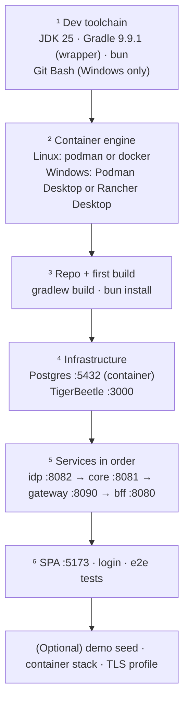
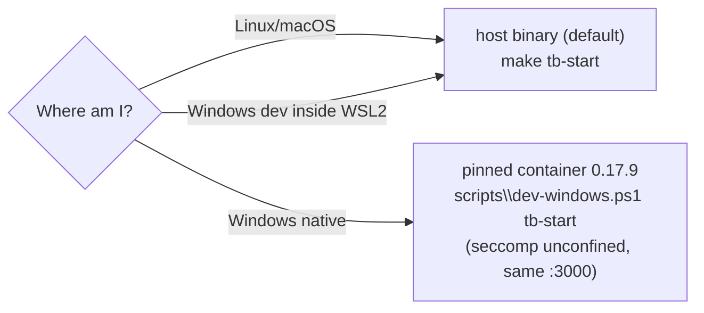
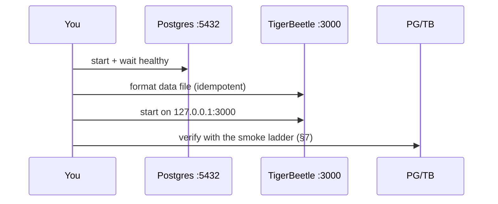
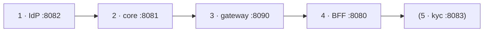
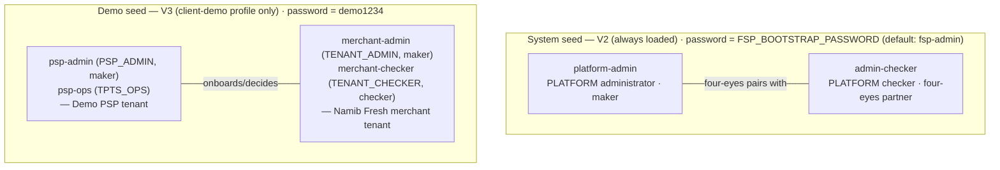

# FSP Full Setup Guide — Windows & Linux (from zero to running stack)

> One document, both operating systems, complete troubleshooting. For the deep
> Windows container-engine comparison see `docs/windows-dev.md`; for what the
> system *is* see `docs/architecture.md`; binding rules live in `AGENTS.md`.
>
> Scripts referenced: `scripts/windows-setup.ps1`, `scripts/dev-windows.ps1`
> (Windows) and the repo `Makefile` (Linux).

---

## Table of contents

- [0. The roadmap (read once)](#0-the-roadmap)
- [1. Install the toolchain](#1-install-the-toolchain)
  - [1a. Toolchain on Linux](#1a-toolchain-on-linux)
  - [1b. Toolchain on Windows](#1b-toolchain-on-windows)
- [2. Install the container engine](#2-install-the-container-engine)
  - [2a. Linux](#2a-linux)
  - [2b. Windows (no Docker Desktop)](#2b-windows)
- [3. Get the repo & first build](#3-get-the-repo--first-build)
- [4. Start infrastructure](#4-start-infrastructure)
- [5. Run the backend services](#5-run-the-backend-services)
- [6. Run the frontend](#6-run-the-frontend)
- [7. Verify — the smoke ladder](#7-verify--the-smoke-ladder)
- [8. Optional modes: demo seed, container stack, TLS](#8-optional-modes)
- [9. Tests](#9-tests)
- [10. Reset everything](#10-reset-everything)
- [11. Troubleshooting — full matrix](#11-troubleshooting)

---

## 0. The roadmap

Everything below builds this picture, in order:



**Runtime contract** (same on every OS): six ports on loopback —
`5432` Postgres · `3000` TigerBeetle · `8082` IdP · `8081` core ·
`8090` gateway · `8080` BFF · plus the SPA on `5173` and kyc plugin on `8083`.

---

## 1. Install the toolchain

### 1a. Toolchain on Linux

```bash
# Java 25 via SDKMAN (the repo pins java=25.0.5.0+8-tem in .sdkmanrc)
curl -fsSL https://get.sdkman.io | bash
source ~/.sdkman/bin/sdkman-init.sh
cd /path/to/FinancialServicesPlatform
sdk env                    # reads .sdkmanrc, installs+activates exact Temurin JDK 25

# build essentials + git
sudo apt -y install git build-essential unzip   # DEB family
#   (Fedora: sudo dnf install -y git gcc make unzip · Arch: sudo pacman -S ...)

# Bun (frontend runtime + package manager + test runner)
curl -fsSL https://bun.sh/install | bash   # adds ~/.bun/bin to PATH in a new shell

# node is NOT required — bun IS the runtime/toolchain for the SPA
```

Verify:

```bash
java -version    # openjdk 25
git --version
bun --version    # 1.2.x+
```

### 1b. Toolchain on Windows

Fastest path — the installer does it all:

```powershell
powershell -ExecutionPolicy Bypass -File scripts\windows-setup.ps1 -InstallToolchain
```

That installs *(winget)*: Git for Windows, **Temurin JDK 25**, **Bun**.
Open a **new** terminal afterwards, then verify:

```powershell
java -version     # openjdk 25
git --version
bun --version
```

Manual alternatives:

| Tool | Manual install | Notes |
|---|---|---|
| JDK 25 | `winget install EclipseAdoptium.Temurin.25.JDK` | or WSL2 + sdkman (§1a identical) |
| Bun | `winget install Oven-sh.Bun` | native Windows support; no Node needed |
| Git for Windows | `winget install Git.Git` | **required** — provides `bash` for `make pki`/`dev-pki.sh` and Git-Bash for the Makefile subset |
| Podman/Rancher engine | see §2b | the big one, next section |

> **Windows path rule (Gradle):** if your repo clone (or `GRADLE_USER_HOME`)
> lives inside **OneDrive/Drive-synced** folders, Gradle's file locking breaks.
> Use `C:\dev\...` on plain NTFS and set
> `[Environment]::SetEnvironmentVariable('GRADLE_USER_HOME','C:\dev\gradle-home','User')`.

---

## 2. Install the container engine

### 2a. Linux

Any of the three — pick per taste:

```bash
# Podman (rootless, recommended)
sudo apt -y install podman            # or: dnf/pacman install podman

# Docker CE
curl -fsSL https://get.docker.com | bash && sudo usermod -aG docker $USER   # re-login

# Rancher Desktop (GUI): install from https://rancherdesktop.io or winget-like appsource
```

Check: `docker compose` **or** `podman compose` resolves (the Makefile calls
`docker compose`; adjust `COMPOSE` alias of your shell if you use podman —
`alias docker-compose='podman compose'` covers it).

### 2b. Windows (no Docker Desktop)

Run the installer (Administrator PowerShell; **reboot once after WSL2 features
are enabled**, then re-run — it is idempotent):

```powershell
# Podman Desktop — recommended default
powershell -ExecutionPolicy Bypass -File scripts\windows-setup.ps1

# OR Rancher Desktop (gives real `docker` + `docker compose` verbs)
powershell -ExecutionPolicy Bypass -File scripts\windows-setup.ps1 -Engine rancher
```

What you get (details in `docs/windows-dev.md`): WSL2 + VirtualMachinePlatform
features, Git for Windows, Podman Desktop + `podman` machine running, and a
standalone `docker-compose.exe` on PATH so `podman compose` works.
With `-Engine rancher`: Rancher Desktop preconfigured to the **dockerd (moby)**
engine, WSL2 provider, Kubernetes **off**.

> **8 GB laptop?** The installer auto-sizes the engine VM to the machine's RAM
> (≤9 GB → 2 GB/2 vCPU, ≤17 → 5 GB/2, above → 6 GB/3), leaving the host room to run
> the five JVM services natively. On 8 GB: skip `stack-up`, run
> `scripts\dev-windows.ps1 dev` (one call starts everything in its own terminals),
> cap the Gradle daemon with `org.gradle.jvmargs=-Xmx1g` in `%USERPROFILE%\.gradle\gradle.properties`.
> Resize anytime: `dev-windows.ps1 tune [-MemoryMB n -Cpus n]`.

Verify:

```powershell
podman machine list        # or: docker ps
podman run --rm hello-world
```

### 2c. TigerBeetle — OS-dependent placement



The repo ships TigerBeetle 0.17.9 as a Linux ELF (host binary). On **Windows
native**, use the container route with `--security-opt seccomp=unconfined`
(Docker 25+/podman seccomp profiles block io_uring otherwise) — the script
handles it, image pin matches the Java client pin exactly.

---

## 3. Get the repo & first build

```bash
# both OSes
git clone <repo-url> FinancialServicesPlatform
cd FinancialServicesPlatform

# first build + check everything compiles and tests infra glue
# Linux:
cd backend && ./gradlew build -x test && cd ..
# Windows:
cd backend ; .\gradlew.bat build -x test

# frontend deps (bun)
cd frontend && bun install
```

First build downloads Gradle 9.9.1 (wrapper), Spring Boot 4.0.9, TigerBeetle
client 0.17.9 — 3–8 minutes on decent network. Subsequent builds are quick.

---

## 4. Start infrastructure



| | Linux | Windows |
|---|---|---|
| Postgres up | `make infra-up` | `powershell -File scripts\dev-windows.ps1 infra-up` |
| TB format+start | `make tb-start` | `powershell -File scripts\dev-windows.ps1 tb-start` |
| status incl. ports | `make infra-up && docker compose -f infrastructure/docker-compose.yml ps` | `powershell -File scripts\dev-windows.ps1 status` |

Data lives in:

- Linux: docker/podman volume `infrastructure_postgres-data` + `infrastructure/tigerbeetle-data/`
- Windows: same paths; WSL VM-managed volumes (survive `machine stop`, wiped only deliberately — §10)

---

## 5. Run the backend services

**Order matters** (gateway boots against the catalog; core+IdP must be up first —
or gateway retries until they are):



| Service | Linux (`backend/<svc>` dir) | Windows (same dir) |
|---|---|---|
| IdP | `./gradlew bootRun` | `.\gradlew.bat bootRun` |
| core | `./gradlew bootRun` | `.\gradlew.bat bootRun` |
| gateway | `./gradlew bootRun` | `.\gradlew.bat bootRun` |
| BFF | `./gradlew bootRun` | `.\gradlew.bat bootRun` |
| kyc plugin | `cd backend/plugins/kyc && ../../gradlew bootRun` | `..\..\gradlew.bat bootRun` |

One terminal per service. Each terminal wants the same env so defaults work:
`FSP_BOOTSTRAP_PASSWORD=fsp-admin` (dev-only default). The internal hop uses **per-target
credentials** (no shared god-key — red-team hardening): generate one secret per service
(`openssl rand -hex 24`) and set the matching env when booting each side of a hop:

| Env variable | Holds the inbound secret of | Who must carry it outbound |
|---|---|---|
| `FSP_INTERNAL_CREDENTIAL` | core | gateway + recon-worker (as `FSP_INTERNAL_CREDENTIAL_CORE`) |
| `FSP_INTERNAL_CREDENTIAL_EMI` | emi | core (core→EMI money hop), gateway (`/v1/emi/**`), recon-worker |
| `FSP_INTERNAL_CREDENTIAL_PSP` | psp | gateway (`/v1/psp/**`), recon-worker |
| `FSP_INTERNAL_CREDENTIAL_IDP` | idp | gateway (`/idp/policy/**` hop) |

If a service's variable is unset, its internal plane is **fail-closed** (`INTERNAL_PLANE_CLOSED`
/ 401) — never open.

### 5.1 Who you can log in as — **default dev credentials**

All of these exist out of the box; nothing to create. Two "layers": the **system
seed** is always there (every environment), the **demo seed** only when core runs
with `--spring.profiles.active=client-demo` (§8).



| Login as | Password | Where | Who it is / use it for |
|---|---|---|---|
| **`platform-admin`** | `fsp-admin` * | system seed (`V2__seed_system.sql`) | Platform root admin — creates PSP tenants, platform CoA, the top of the hierarchy |
| **`admin-checker`** | `fsp-admin` * | system seed | Platform-level checker — the deliberate four-eyes partner for `platform-admin` (maker ≠ checker is enforced per person, so every FOUR_EYES op needs this second login) |
| **`psp-admin`** | `demo1234` | demo seed (`V3__seed_demo.sql`) | Demo PSP administrator (PSP_ADMIN) — maker of onboarding/JE/GL/bank-account requests |
| **`psp-ops`** | `demo1234` | demo seed | Demo PSP operations (TPTS_OPS) — KYC review panel / ops screens |
| **`merchant-admin`** | `demo1234` | demo seed | Namib Fresh merchant admin (TENANT_ADMIN) — maker inside a depth-2 tenant |
| **`merchant-checker`** | `demo1234` | demo seed | Namib Fresh checker (TENANT_CHECKER) — resolves the merchant's four-eyes queue |

`*` = `$FSP_BOOTSTRAP_PASSWORD` if you set the env; `fsp-admin` is the dev-only default baked into the seed placeholder.

**How the passwords work:** seeds hash with pgcrypto `crypt(x, gen_salt('bf',10))`
— the same bcrypt format Spring Security/IdP verifies, so logins flow through the
IdP (`POST /bff/auth/login` → gateway → IdP `persons.password_hash` check).

**Persons created via the API** (new admins after activation, applicants, etc.)
are initialized with `fsp.security.default-person-password` — env
**`FSP_PERSON_PASSWORD`**, dev default **`fsp-person-2026`** — also verified by the IdP.

**Infrastructure credentials (containers/env, not portal logins):**

| What | Default | Where set |
|---|---|---|
| Postgres user / password | `fsp` / `fsp` (plugin container DB: `fsp_plugin_kyc` / `fsp_plugin_kyc`) | `infrastructure/docker-compose.yml` |
| Internal hop credentials (per target) | none — must be injected | `FSP_INTERNAL_CREDENTIAL` (core), `FSP_INTERNAL_CREDENTIAL_EMI`, `FSP_INTERNAL_CREDENTIAL_PSP`, `FSP_INTERNAL_CREDENTIAL_IDP`; callers carry the matching per-target secret (table §5). Unset = fail-closed |
| TLS identity password | `fsp-dev` | env `FSP_TLS_PASSWORD` (`make pki`) |
| IdP key pin | — | signing key is a mounted file, not a password |

> ⚠️ Every value here is **development-only**. In real environments:
> set `FSP_BOOTSTRAP_PASSWORD` and `FSP_PERSON_PASSWORD` explicitly, never run the
> `client-demo` profile, and replace the static internal credential in the FAPI2 slice.

Successful boot lines to watch for:

```text
core:    Flyway ... migrations applied (V1..V32)   → Tomcat started on 8081
emi:     emi descriptor live (catalog digest ...)   → Tomcat started on 8086
idp:     idp JWKS available ...                    → Tomcat started on 8082
gateway: catalog fetched (N operations)            → started on 8090  (boot FAILS if core unreachable — retry loop)
bff:     Tomcat started on 8080
```

---

## 6. Run the frontend

Linux/macOS: `cd frontend && bun install && bun run dev` → `http://localhost:5173`.
Windows: just run **`scripts\dev-windows.ps1 dev`** — one call brings up postgres,
TigerBeetle, all five services and the SPA in separate terminal windows
(`stop` reverses, `tune` resizes the engine VM, `status` shows every port).

Beyond the portals there is a **widget workbench** for building portal screen panels
with or without an LLM: see **`docs/widget-workbench.md`**
(quick start: `cd frontend && bun run workbench` → `http://localhost:5173/widget-workbench/`).

```bash
cd frontend
bun run dev        # Vite :5173 ; proxies /bff and /api to BFF :8080
```

Portals: `http://localhost:5173/admin`, `/manufacturer`, `/distributor`,
`/wholesaler`, chooser at `/`, widget workbench at `/widget-workbench`.

---

## 7. Verify — the smoke ladder

Climb in order; the first failing rung is your problem area (§11 maps rungs to
fixes):

```text
L1  engine:            podman machine list | docker ps          → running
L2  postgres:          5432 open, compose ps → healthy
L3  tigerbeetle:       3000 open; log clean (container logs / server.log)
L4  core:              boot shows Flyway V32 applied; :8081 open
L4b emi:                GET :8086/internal/ops/catalog → descriptor JSON (13 ops)
L4c psp:                GET :8085/internal/ops/catalog → descriptor JSON (13 ops);
                        demo money lane: run psp with `--spring.profiles.active=demo-psp`
                        (onboards DEMO-BANK connector + demo merchant, authorize → capture;
                        `--psp-demo-sweep` sweeps a closed cycle — verify log line
                        `psp_sweep_clearing_zero … zeroed_invariant=OK`)
L5  idp:               GET http://127.0.0.1:8082/idp/jwks → key set JSON
L6  gateway:           GET http://127.0.0.1:8090/v1/** with token → NOT 404 ROUTE_NOT_IN_CATALOG
L7  bff chain:         GET :8080/bff/csrf → POST :8080/bff/auth/login (platform-admin/fsp-admin)
                       → GET :8080/api/me/permissions → permission keys (RBAC!)
L8  spa:               http://localhost:5173 loads, overview screen shows tenant + permission count
L9  money path (E2E):  bunx --bun playwright test  (or one manual JE: create → approve → FINALIZED)
```

Manual L6–L7 in one line each (bash):

```bash
curl -s http://127.0.0.1:8080/bff/csrf -c /tmp/c.txt
curl -s -b /tmp/c.txt -H 'Origin: http://localhost:5173' \
     -H 'Content-Type: application/json' --data '{"username":"platform-admin","password":"fsp-admin"}' \
     http://127.0.0.1:8080/bff/auth/login
curl -s -b /tmp/c.txt http://127.0.0.1:8080/api/me/permissions
```

---

## 8. Optional modes

| Mode | How | What it does |
|---|---|---|
| **Demo seed** | run core with `--spring.profiles.active=client-demo` (or Makefile variant) | adds `db/seed/demo`: `psp-admin`, `psp-ops`, `merchant-admin`, `merchant-checker` / `demo1234` + demo tenants. **Never in staging/prod.** |
| **All-in-one container stack** | `make stack-up` (Linux) / `scripts\dev-windows.ps1 stack-up` | builds core/idp/gateway/bff images and runs the whole backend in containers; TB still host/container, same as §2c |
| **TLS profile** | `make pki` once, then run core+bff with `--spring.profiles.active=tls` | HTTPS on core :8443 / bff :8444, BFF→core workload mTLS via the dev PKI |
| **Debug logs** | any service with `--spring.profiles.active=debug` | multi-line logs + Hibernate SQL |
| **Reset a slice** | `make tb-reset` / `scripts\dev-windows.ps1 tb-reset` | wiped ledger only |

---

## 9. Tests

```bash
# backend unit/property (direct matching, recovery, four-eyes, NamibiaRules)
cd backend && ./gradlew test            # Windows: .\gradlew.bat test

# frontend gates
cd frontend
bun run lint && bun run typecheck && bun run build    # bundle budget < 200 KB gz

# E2E (Playwright) — expects the stack from §4–§6 running
bunx --bun playwright test
```

The PRD §9 acceptance chain (KYC onboarding, atomic rollback, four-eyes,
posting → FINALIZED, COMMIT_UNKNOWN recovery, audit correlation) is what E2E
asserts — if it passes on your box, the architecture works end-to-end.

---

## 10. Reset everything

```text
Soft reset (keep schema shape, wipe money/data):
  make tb-reset                          # ledger only
  docker compose -f infrastructure/docker-compose.yml down -v   # postgres data too
  (Windows) scripts\dev-windows.ps1 tb-reset / infra-down

Full teardown:
  make clean && make stop-all
  (Windows) same compose down -v + tb-stop; optionally podman machine stop

Nuclear (engine VM itself):
  podman machine rm podman-machine-default      # removes WSL distro, all volumes
  Rancher: app → Troubleshooting → Reset to factory
```

Re-create = §4 onward. Nothing else persists (Gradle caches aside).

---

## 11. Troubleshooting — full matrix

Each row: symptom → root cause → fix. Rung references point to §7's ladder.

### 11.1 Toolchain/build (before any service runs)

| Symptom (build phase) | Cause → Fix |
|---|---|
| `sdk env` says "sdkman not initialized" | sdkman init not sourced in this shell → run `source ~/.sdkman/bin/sdkman-init.sh` first |
| gradle picks wrong Java (`java 21 …`, compile errors on records/patterns) | `JAVA_HOME` points elsewhere → `sdk env` in repo (Linux) or `JAVA_HOME` env to Temurin 25 (Windows: `setx JAVA_HOME "<path-to-jdk25>"`) |
| `Could not resolve org.springframework.boot` on first build | network/proxy → check corporate proxy env `HTTPS_PROXY`; retry (wrapper downloads once) |
| Windows: gradle daemon dies on file lock | OneDrive/sync or Defender scanning `C:\Users\...\.gradle` → `GRADLE_USER_HOME` outside synced path (§1b callout); add gradle dir to Defender exclusions |
| Windows: `gradlew.bat : command not found` | you're in Git-Bash → use `./gradlew`; in PowerShell use `.\gradlew.bat` |
| `bun: command not found` right after install | PATH update needs a **new** terminal session |

### 11.2 Engine (L1–L2)

| Symptom | Cause → Fix |
|---|---|
| `podman machine init` fails "WSL required" | feature enablement needs **reboot** → reboot, re-run installer |
| `podman: unrecognized command compose` | old podman <5 → upgrade (`winget upgrade RedHat.PodmanDesktop`) or rely on docker-compose wrapper |
| `podman compose` hangs/no binary | wrapper missing → re-run installer (drops `docker-compose.exe` into `%LOCALAPPDATA%\FSP\bin`) or `pip install podman-compose` |
| Rancher: `docker` works, `docker compose` not | you picked **containerd** engine instead of dockerd → Preferences → switch to dockerd (moby) |
| engine tray spins >10 min | virtualization off (BIOS) or Hyper-V conflict (WSA/BlueStacks) → enable VT-x, close conflicting hypervisors |
| `port is already allocated` :5432/:3000 | previous container or a native Postgres service → `scripts\dev-windows.ps1 infra-down` (`docker compose down`), stop Windows `postgresql` service, or reclaim: `lsof -i :5432` / `netstat -ano \| findstr 5432` |

### 11.3 TigerBeetle (L3)

| Symptom | Cause → Fix |
|---|---|
| TB container restart-loops, logs `io_uring … EPERM` | seccomp profile blocks io_uring → the script already uses `--security-opt seccomp=unconfined`; if you ran a bare `podman run`, add **all** flags from `docs/windows-dev.md §4.1` (seccomp + ulimit nofile + pinned 0.17.9 image) |
| core logs `TB transport failure` / boots but JE calls return `je_commit_unknown` fast | TB not reachable on 127.0.0.1:3000 → `dev-windows.ps1 status` must show port 3000 OPEN; restart via `tb-start` |
| `format` says "already formatted" but start fails on data file | partial data dir → nuclear: `scripts\dev-windows.ps1 tb-reset` (wipes ledger) |
| version mismatch error at connect (client vs server) | client pin is 0.17.9 (`build.gradle.kts`); container must be the **same** tag → never mix (AGENTS §1) |
| Linux `make tb-start` fails to exec | wrong CPU arch binary / missing exec bit → `chmod +x infrastructure/bin/tigerbeetle`; the bin is x86-64 Linux only |

### 11.4 Database/migrations (L2–L4)

| Symptom | Cause → Fix |
|---|---|
| core boot: Flyway `validate failed` after you *edited* an applied migration | migrations are immutable (AGENTS §2) → `git checkout -- <file>`; if truly needed, new V-file |
| Flyway `V17 already exists` conflict in team PRs | numbering collision → rebase and renumber to next free (checked by `make docs-check`) |
| Flyway `Detected applied migration not resolved locally: N` | an applied migration was consolidated away — dev DBs keep the history row; config already sets `ignore-migration-patterns: "*:missing"` (never `*:all`), so this is the cue to check whether the deletion was intentional |
| core→EMI hop fails `EMI_CURRENCY_UNSUPPORTED`/`ECONNREFUSED :8086` | emi not running or `FSP_EMI_URL` (core, default `http://localhost:8086`) points elsewhere → §4/§5 start order |
| `password authentication failed for user fsp` | compose env vs core env drift → both default `fsp/fsp`; if you changed compose env, change core datasource env too |
| demo login (`psp-admin/demo1234`) 404/no user | demo seed only loads under `client-demo` profile → run core with `--spring.profiles.active=client-demo` (§8) |
| demo login fails on a *system-seeded* DB that later got `client-demo` | `client-demo` adds rows; if it was never run, run once with the profile ON the existing volume — it's additive |
| `platform-admin` login rejected at IdP | password hash was seeded from the `FSP_BOOTSTRAP_PASSWORD` value **at seed time** (placeholder `${fspBootstrapPassword}`) — if you changed the env after the DB was created, the old password still applies → reset with a fresh postgres volume (§10) or update the hash |
| login works but core answers `permission_denied` everywhere | that login's role has narrow scope by design (e.g. `psp-ops` TPTS_OPS, `merchant-checker` TENANT_CHECKER) → check `GET /api/me/permissions`; use `psp-admin`/`platform-admin` for maker flows |

### 11.5 Service chain (L4–L7)

| Symptom | Cause → Fix |
|---|---|
| gateway fails boot: "catalog unreachable" | core not up yet / wrong `FSP_CORE_URL` → start order §5; gateway retries then exits — restart it after core is green |
| emi `/v1/emi/**` answers 401 `UNTRUSTED Origin` | the request did not pass the gateway (direct-to-8086 access) or the gateway's `FSP_INTERNAL_CREDENTIAL_EMI` differs from emi's env of the same name (per-target credential, §5) |
| emi `/v1/emi/**` answers 403 `ACTOR_TYPE_REJECTED` | a client-credential (machine) token was used — EMI self-service ops are person-plane only |
| gateway: `404 ROUTE_NOT_IN_CATALOG` on a route you *just added* | new `@FspOperation` not yet in the descriptor the gateway watches → restart core (boot gate re-inventories); gateway refreshes within 60 s |
| `401 IDEMPOTENCY_KEY_REQUIRED` on a POST from curl | every `/v1` mutation needs the header (AGENTS §2e) → add e.g. `-H 'Idempotency-Key: 55b1…-v4'`; BFF forwards SPA's key automatically |
| `403 MAKER_CANNOT_APPROVE` approving your own JE | **that's the invariant working** (four-eyes) → use a second admin; in UI it renders an explicit blocked state |
| `409 IDEMPOTENCY_IN_PROGRESS` | same key re-sent while original pending → wait 1 s (Retry-After) or send a fresh key |
| login fails `NO_SESSION` at BFF | CSRF missing on POST → call `GET /bff/csrf` first, send `XSRF-TOKEN` cookie + matching header |
| IdP logs `bad internal credential` | the gateway's `FSP_INTERNAL_CREDENTIAL_IDP` differs from the IdP's env of the same name (per-target credential, §5) |
| gateway logs `token verification failed` | clock skew / wrong issuer → check `FSP_IDP_ISSUER` identical on idp+gateway (default `https://idp.fsp.local`) |

### 11.6 Frontend (L8)

| Symptom | Cause → Fix |
|---|---|
| Vite boots but API calls 502 | BFF down → L7 rung; check :8080 |
| browser stuck on "loading" overview | session hydration chain hit `AUTH_REQUIRED` → IdP token expired (15 min) → reload to bounce to login |
| `B AUTH_REQUIRED` loop | cookie blocked (third-party policy) → use `http://localhost:5173` not a LAN IP; SameSite=Lax needs same-site nav |
| Playwright e2e flaky on cold start | services still booting → wait for smoke ladder L7 green before `bunx --bun playwright test` |
| portal shows **"No menu configured"** or **"Couldn’t load the … menus"** | core hasn't applied the menu seed yet, or core/gateway/BFF is down | restart core; bring the stack up; see [`docs/widget-workflow.md`](widget-workflow.md#fixing-menu-problems) |
| typecheck fails on generated widget types | widget sync drift → `bun run widgets:check` (syncs against core catalog) |

### 11.7 Windows-only extras

| Symptom | Cause → Fix |
|---|---|
| ports open inside WSL but not on Windows localhost | localhost forwarding off → `wslconfig` update or use engine's `-p 127.0.0.1:PORT:PORT` mapping (scripts already set it for TB; postgres compose ports are Windows-mapped) |
| `bash` not found for `pki` | install Git for Windows, then use `bash.exe` full path (script does it: `scripts\dev-windows.ps1 pki`) |
| pki script `openssl` not found in Git Bash | Git for Windows ships openssl; ensure you're using **Git Bash's** bash, not WSL's old env |
| Defender slows first Gradle build massively (2–5×) | add repo dir + `GRADLE_USER_HOME` + `%LOCALAPPDATA%\Podman` (or its WSL vhdx) to exclusions |
| OneDrive "moving" repo files in/out of sync mid-build | clone to a non-synced location — see §1b callout |

### 11.8 When in doubt (the diagnostic one-liner)

```bash
# Linux
docker compose -f infrastructure/docker-compose.yml ps ; ss -ltn | grep -E '3000|5432|80(8[0-3]|90)'
# Windows
powershell -File scripts\dev-windows.ps1 status
```

Every service also exposes `health,info` actuator endpoints; core's log lines are
key=value (one per incident) with `traceId` — when asking for help, attach the
log line for the failing request and your `status` output.
