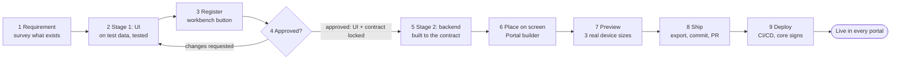

# Widget workflow — from idea to production

A widget goes from idea to every portal in nine steps. One person can do all of them except
approving the UI. Steps 1–7 run on your machine; steps 8–9 are a normal pull request and deploy.



A requested change loops back to stage 1 and is re-tested before the next review. Once approved,
the UI and its data contract are locked, and the backend is built to match.

Related: [portal-menus.md](portal-menus.md) (how menus ship), [ui-metadata-tampered.md](ui-metadata-tampered.md)
(the tampered-UI runbook), [widget-workbench.md](widget-workbench.md), the fsp-widget skill
(`.agents/skills/fsp-widget/`) and the menu-publisher skill (`.agents/skills/menu-publisher/`).

---

## Who does what, with which tools

| Who | Does | Where |
| --- | --- | --- |
| Developer | Writes the requirement, builds or steers the build, places the widget on screens, ships | Repo, widget workbench, Portal builder |
| Agent (fsp-widget skill) | Builds the UI on test data, then the backend, and runs every check | Claude Code in the repo |
| UI approver | Looks at the widget in the workbench and replies "approved" or asks for changes | Workbench preview link |
| Pull-request reviewer | Reviews code, migrations and the menu seed like any other change | Git host |
| CI/CD | Runs the checks, builds, deploys; every environment applies the seed and signs the menus | Pipeline |

Tools:

- **Widget workbench** (`http://localhost:5173/widget-workbench`): preview a widget at every
  screen size on test data or live data, see what it calls, and register it with
  **Register in the system**.
- **Portal builder** (`/widget-workbench/builder`): menus, submenus and the widgets on each
  screen; autosaves; opens real-portal previews.
- **Widget tool belt** (`cd frontend && bun run widgets:<command>`): survey, plan, verify, e2e,
  stage, accept, done. Each prints a short answer; full logs land in
  `frontend/node_modules/.cache/fsp-widget-agent/<id>/`.
- **Menu publisher** (`make menus-publish` or the menu-publisher skill): exports the menus into
  the repo seed.
- **The stage file** `frontend/src/portals/shared/widgets/<area>/<name>/.widget-stage.json`: the
  widget's state (stage, operations, approval, gates). Read it with `bun run widgets:stage <id>`;
  never edit it by hand except its `screen` block. Commit it with the widget — it records who
  approved the UI.

---

## Step 1 — Start: requirement, survey, screen

Write one sentence of what the business needs, then find what already exists before building
anything new.

1. **Write the requirement** in plain words, including who uses it and in which portals.
   Example: "Invoicing with 30-day credit by default, built-in payment options, a menu entry in
   every portal."
2. **Ask the agent** (Claude Code in the repo) to build it; it loads the fsp-widget skill. You
   can also run the steps yourself with the tool belt.
3. **Survey what exists** — reuse beats new:
    - `bun run widgets:survey <terms>` lists backend operations (method, path, permission, risk,
      request and response types), widgets and SME widgets that match.
    - `bun run widgets:dto <Outer.Name> --ts` prints a backend response type as TypeScript.
    - An existing widget that nearly fits is extended, not copied. An SME widget with the same
      job is ported.
4. **Decide the screen**: a new menu point (for example Billing › Invoices) or a place on an
   existing screen.
5. **Draft the operations sheet**: every read and write with its endpoint, permission, kind
   (view, create, modify, approve), request and response shape, and what the screen does on
   success, 403, 409 and 422. Each one is marked REUSE (exists) or NEW (built in stage 2).

## Step 2 — Stage 1: build the UI on test data

Stage 1 produces a working widget on fixtures (test data that plays the server), so the UI can
be judged before any backend exists.

The widget lives in one folder: `frontend/src/portals/shared/widgets/<area>/<name>/`.

| File | Holds |
| --- | --- |
| `index.tsx` | The manifest: id, version, label, category, portals it works in, permissions it needs, data sources and commands, actions, size per screen tier |
| `widget.tsx` + components | The UI |
| `data.ts` | The API calls (literal `/api/...` paths) and fixtures for every operation, NEW ones included. Fixtures can be stateful: a payment changes the balance, a conflict returns 409 |
| `model.ts` | Wire types (the contract), pure logic, hooks. Writes use `retry: 0` |
| `<name>.test.ts` | Unit tests for the logic |

Rules that catch people out:

- **Lay out by tier, not by viewport.** Use `context.tier` (xs, sm, md, lg). Tailwind `sm:` and
  `md:` classes follow the browser window, not the widget's frame, and break inside a phone-sized
  frame.
- **Money** is a minor-unit string on the wire; compute with BigInt, never floats.
- **No** `fetch`, storage, `any`, hex colours or `@media` in widget code — `widgets:verify`
  rejects them.
- Every fixture scenario must work: default, empty, error, forbidden (no permissions).

Run the gates until green:

1. `bun run widgets:plan <id> --requirement "…"` — writes the operations sheet into the stage file.
2. `bun run widgets:verify <id>` — code rules, `widgets:check`, typecheck, lint, unit tests,
   generated-skill freshness.
3. `bun run widgets:e2e <id> --scaffold`, write the real journeys, then
   `bun run widgets:e2e <id> --lane workbench`. The workbench lane sweeps every scenario at every
   tier, checks permission gating and runs the user journeys.
4. If the stack is up, `--lane portal` signs in through the real BFF and opens the real screen;
   NEW operations are answered from fixtures.

Preview it any time at `http://localhost:5173/widget-workbench/w/<id>` (all tiers). Useful URL
switches: `?portal=DISTRIBUTOR`, `?scenario=empty|error`, `?cells=none`, `?tier=xs&single=1`.

## Step 3 — Register the widget

Registering puts the widget into core's widget registry; until then no portal will render it and
the menu export refuses screens that place it. Registration is direct — one person with
`ui.widget.register` does it, no second approver.

Three places to press it (all do the same thing):

- **Widget page** — `/widget-workbench/w/<id>`, under the title: **Register in the system**. It
  shows "✓ Registered in the system v1.0.0" when done, or "Register v1.1.0 (system has v1.0.0)"
  after a version bump.
- **Registry** — `/widget-workbench/registry`, the Register button on the widget's row.
- **Portal builder palette** — a widget the system doesn't hold shows
  "not in the system yet · Register".

From the command line (used by the agent): `bun run widgets:register-bff <id>`. It signs in
through the BFF like a person and records the registration in the stage file.

Core refuses a widget that names a permission it doesn't know (`UI_WIDGET_UNKNOWN_CELL`). A widget
with new permissions therefore needs its permission migration applied first — the one backend
piece that can land in stage 1. Re-register whenever the widget's version changes.

## Step 4 — Review and approve the UI

The approver judges the widget in the workbench; replying "approved" locks the UI and its data
contract, and only then does backend work start.

The review message carries:

- the preview link and the screen it sits on;
- the registry entry (`<id>@<version>`, who registered it);
- the operations: how many are REUSE and NEW, with each NEW one's exact request and response shape;
- the checks: verify, workbench e2e (test count), portal lane;
- the decisions made along the way (for example: partial payments allowed, NAD and ZAR only).

What the approver does:

1. Open the preview, switch Portal (for example DISTRIBUTOR for an org view, PLATFORM for
   admin), try the journeys, look at phone size.
2. Reply **"approved"**, or list changes. Every change re-runs verify and e2e before it comes back.

On approval: `bun run widgets:accept <id> --by "<approver>"`. It refuses unless verify,
registration and workbench e2e are green on the current files, then records who approved and a
hash of the UI and of the contract (`data.ts` + `model.ts`).

After that the backend must serve exactly those shapes. If it can't (security, an invariant,
missing data), stop, explain and get a new approval — never reshape the contract silently.

## Step 5 — Stage 2: build the backend to the locked contract

Stage 2 turns every NEW operation into a real core (or plugin) endpoint that serves exactly the
approved shapes, then proves it live with nothing stubbed.

For each NEW operation:

- **Endpoint** in the domain's controller under `/v1/...` (the browser's `/api/...` path minus
  the prefix), annotated `@FspOperation(id, permission, risk, component, title)`. Without it the
  gateway can't route it. Risk: reads READ, writes WRITE, approve-kind or money-sensitive
  FOUR_EYES.
- **Who is asking** comes from `fsp.actor`, never from headers or the body. Core is the only
  decision point.
- **Tenant isolation**: the tenant in the path is checked against the actor, and every record
  against that tenant's side; anything else is a 404.
- **Collections**: `page`, `size` (max 100), safelisted `sort`, `q`, filters — all in SQL.
- **Writes** carry `expectedVersion` (409 on a stale one). The Idempotency-Key is handled by
  core's filter; make the domain safe to replay.
- **Four-eyes** for approve-kind writes: `ApprovalService.open` with its own operation type and
  handler; maker and checker must be different people. (Portal menus and widget registration
  don't use four-eyes; money and governance actions still do.)
- **Money** in minor units; it only moves through a balanced journal entry or the EMI/PSP
  ledgers. No database transaction or lock is held across a call to another service.
- **Data**: a new migration `V<next>__<name>.sql` for tables, permission keys and role grants
  (applied migrations are never edited); the same keys in `permission-catalogue.ts`; new
  organisations' role templates in `RoleTemplates`.
- **Tests** that fail before and pass after: happy path, permission refusal, cross-tenant
  refusal, version conflict, validation, four-eyes refusal.

Then close the loop:

1. `cd backend && ./gradlew :core:test --tests '<package>.*'` — scoped, the full suite is slow.
2. `bun run widgets:skill` — regenerates the endpoint catalogue.
3. `bun run widgets:plan <id>` — every NEW should now read REUSE.
4. `bun run widgets:verify <id>`.
5. Rebuild and restart core: **stop it first**, then build the jar, then start it.
6. `bun run widgets:e2e <id> --lane all --live` — browser → BFF → gateway → core, nothing stubbed.
7. `bun run widgets:done <id>` — refuses while any NEW remains, the UI or contract changed since
   approval, the live run isn't green, or the generated skill is stale.

## Step 6 — Put the widget on a portal screen

The Portal builder is where menus, submenus and widgets are arranged for each portal; every edit
saves to the server by itself.

Open `http://localhost:5173/widget-workbench/builder` and sign in (the bar at the top).

1. Pick the **Portal** (Admin console, Manufacturer, Distributor, Wholesaler, Merchant).
2. In **Menus** on the left: **+ menu** adds a menu, **+ sub** adds a submenu (a screen). Drag to
   reorder.
3. Select a submenu to open its screen, then drag widgets from the **Widgets** palette onto it.
   The palette shows only widgets that work in that portal.
4. Size each widget per tier with the size buttons above the screen (phone first) or in the
   inspector on the right. The inspector also edits labels, route ids, icons and widget settings.
5. Watch the **errors / warnings** badge and the Checks list. Autosave waits while there are errors.
6. The top bar says **Saved to server** when your work is stored.

Useful to know:

- **Discard my changes** (two clicks) returns the portal to the menus that ship today; autosave
  then makes that the server draft again.
- If this browser's copy differs from the server's newest layout, a red notice offers **Use the
  server's layout** before your next edit overwrites it.
- There is no Publish or Export button — shipping is Step 8.

## Step 7 — Preview at desktop, tablet and mobile size

The preview buttons open the real portal, at a real device size, with your current menus and
widgets and live data — what users will get, before anything is committed.

| Button | Window size |
| --- | --- |
| Desktop ↗ | 1440 × 900 |
| Tablet ↗ | 820 × 1180 |
| Mobile ↗ | 390 × 844 |

- Each opens in its own browser window and redraws on every edit you make in the builder.
- Sign in there as a user of that portal (for example a merchant user for the merchant portal);
  sign-in and every permission check still apply.
- A **PREVIEW** pill marks the window; **Exit** leaves preview mode.
- Preview exists only in development builds; production builds don't contain it.

## Step 8 — Ship: export, commit, pull request, deploy

Menus ship like code: export them into the repo seed, commit, open a pull request, and CI/CD
deploys them with everything else. The pull request is the review; nothing is signed by hand.

1. **Export** — ask the agent to "publish my menus" (menu-publisher skill), or run
   `make menus-publish`. It writes each portal's newest layout and every registered widget into
   `backend/core/src/main/resources/db/seed/system/R__seed_portal_menus.sql`. It fails if a menu
   places an unregistered widget — register it (Step 3) and run again.
2. **Check** — `cd frontend && bun run menus:check`. Every placed widget must be in the seed and
   in this build at the same major version, and every menu must have submenus. A failure here
   would break the deploy; fix it, don't commit.
3. **Read the change in words** — the skill summarises per portal: menus and submenus added,
   removed, renamed or moved; widgets placed or removed; version changes.
4. **Commit** the seed together with the widget code and migrations it depends on, on a branch
   (never on main), then push and open a pull request.
5. **CI** should run the tests, `menus:check` and the docs check (no pipeline file exists yet —
   see "What the pipeline must run" below); reviewers review code, migrations and seed.
6. **Deploy** — each environment runs Flyway: new migrations, then the repeatable seed ("the repo
   wins": each portal's published layout becomes exactly the seed; unchanged rows are not
   touched). At boot core signs every portal whose menus changed with that environment's own key
   (audited as `UI_BUNDLE_SIGNED_AT_BOOT`). A plain restart signs nothing.

Locally, restarting core does the same as a deploy.

## Pushing a menu as code — walkthrough

A menu change is one generated file,
`backend/core/src/main/resources/db/seed/system/R__seed_portal_menus.sql`, pushed through a
normal branch and pull request. Nobody edits it by hand and nobody publishes in an environment.

### What the file holds

- Every registered widget (id, version, label, portals, permissions).
- One published layout per portal: its menus, submenus and the widgets placed on each screen, as JSON.
- It is a Flyway *repeatable* seed: it runs again whenever its content changes, and **the repo
  wins** — each environment's published menus become exactly what the file says.

### The commands, start to finish

```bash
# 0. a branch — never main
git switch -c feat/menus-billing-invoices

# 1. build and preview in the Portal builder until the top bar says "Saved to server"

# 2. export every portal's newest layout into the seed
make menus-publish

# 3. prove the menus render with this build
cd frontend && bun run menus:check && cd ..

# 4. see what changed
git diff --stat -- backend/core/src/main/resources/db/seed/system/R__seed_portal_menus.sql

# 5. commit the seed together with what it depends on
git add backend/core/src/main/resources/db/seed/system/R__seed_portal_menus.sql
git add frontend/src/portals/shared/widgets/billing/invoices          # new widget code, if any
git add backend/core/src/main/resources/db/migration/V41__invoices.sql # new migrations, if any
git commit -m "feat(menus): every portal: + Billing › Invoices"

# 6. push and open the pull request
git push -u origin feat/menus-billing-invoices
gh pr create --title "feat(menus): + Billing › Invoices" --body "<the per-portal summary>"
```

The shortcut: tell the agent **"publish my menus"**. The menu-publisher skill checks the builder
saved, exports, runs `menus:check`, writes the change per portal in plain words (for example
"merchant: + Inventory › Stock levels; admin: 'Back Office User' renamed 'Staff'"), and commits.
It pushes and opens the pull request only when you ask.

### What belongs in the same pull request

| Change | Include | Why |
| --- | --- | --- |
| The seed | Always | It is the menu change |
| Code of a widget the menu places for the first time | Yes | `menus:check` fails if a placed widget isn't in the build |
| Migrations for the widget's permissions or tables | Yes | Core rejects a widget whose permissions it doesn't know |
| Unrelated work | No | Keep the review about the menu |

### What the reviewer checks

- The per-portal summary matches the intent (right portals, right names, right order).
- Widget versions in the seed match the code in the same pull request.
- Nothing was removed by accident — the export takes every portal, so a stale local layout shows
  up as unexpected removals.

### What the pipeline must run

This repository has no pipeline file yet, so these stages have to be wired into whatever CI/CD
you use:

| Stage | Command | Fails when |
| --- | --- | --- |
| Frontend checks | `bun run typecheck`, `bunx vitest run`, `bun run menus:check` | A placed widget is missing or at another major version; a menu has no submenus |
| Backend tests | `cd backend && ./gradlew test` | Any test fails |
| Docs | `make docs-check` | Generated architecture docs are stale |
| Deploy core | your usual deploy | — |

On deploy, Flyway applies new migrations, then the seed. At boot core signs each portal whose
menus changed with that environment's own key; the log shows `ui_bundle_boot_sync signed=<n>`.

### Working with teammates

- **Two people changed menus.** The seed is one generated file, so don't hand-merge a conflict.
  Take theirs, restart core locally (it applies the merged seed), open the builder and choose
  **Use the server's layout** if offered, redo your edit, export again.
- **After pulling someone's menu change**, restart core before you export; otherwise your older
  local layout can overwrite theirs.
- **A change made in an environment's own builder** is overwritten by the next deploy that
  changes the seed. Every menu change goes through the repo.

### Rolling back

Revert the commit (`git revert <sha>`), merge, deploy. The seed brings the previous menus back
and core re-signs them at boot.

## Step 9 — After deploy: verify, change, remove

After each deploy, check the menu as a real user; later changes go round the same loop.

Verify in each environment:

- [ ] Core's boot log shows `ui_bundle_boot_sync signed=<n>` with the portals you changed.
- [ ] Sign in as a user of each changed portal: the new menu entry is there and the screen loads.
- [ ] Users without the widget's permissions don't see it.
- [ ] Money or approval flows are tried once end to end where the environment allows.

Changing a widget later:

- **UI only** — edit, bump the version, re-run verify and e2e, re-register, ship.
- **A data shape changes** — it goes back through approval (`widgets:accept`) before the backend
  is changed.
- **Menu only** — edit in the builder, preview, Step 8.

Removing a widget: take it off every menu in the builder first, export and ship, then delete the
code. `menus:check` fails the build while any menu still places it.

---

## Fixing menu and UI-metadata corruption

A portal renders its menus only after the browser verifies their signature, so any corruption
shows up as a refusal card, never as a broken page. Read the card's reason line, then fix the
cause below.

> **On a shared, staging or production environment, don't re-sign or re-pin anything.** The
> tampered card is a security control. Capture the **Evidence id** from the card, the time and the
> portal, and escalate. The fixes below are for developer machines (and for a deploy you know you
> just made).

### How the check works

| Piece | Role |
| --- | --- |
| `infrastructure/pki/dev/ui-builder-signing.pem` | Core signs each portal's menus with this key (read at core startup) |
| `frontend/src/portals/signed/trust-store.json` | The portal verifies against the public key pinned here (kid `ui-builder-dev-1`) |
| Postgres `ui_bundles` | The published menus and their stored signature |
| `UiBundleBootSync` (core) | At boot, signs every portal whose bundle is missing, stale or signed by another key |

The portal shows menus only when all of them agree.

### Reason on the card → cause → fix

| Card says | Usual cause | Fix (developer machine) |
| --- | --- | --- |
| **UI metadata tampered** · *Signature does not validate* | Stored bundle signed by an older key (keys regenerated, database copied from another machine); core still holds the old key; or the SPA pins a teammate's key (`trust-store.json` pulled from git) | Restart core — it re-signs at boot. Still failing → `bun run portal:check`; if it reports a different key, `bun run portal:pin` and reload |
| **UI metadata tampered** · *Signing key is not in this build's trust store* | The bundle was signed under a key id this build doesn't pin (another environment's key, or no pki step after cloning) | `bun run portal:check`, then `bun run portal:pin` and restart core; reload. Don't commit the pin |
| **UI metadata tampered** · *Delivered payload is not the signed payload* / *Content hash drifted* | The bundle row was changed after signing (a hand edit in the database, a partial restore) | Never edit it by hand. Restart core — it re-signs from the published layout. Outside dev: escalate |
| **UI metadata tampered** · *Signed payload is not a layout this build understands* | The published layout doesn't fit this frontend build (a hand-edited seed, an old build against new menus) | Re-export from the builder (`make menus-publish`), `bun run menus:check`, restart core |
| **UI metadata tampered** · *Signed layout belongs to a different portal* | One portal's bundle stored under another | Re-export and restart core; check the seed wasn't hand-edited |
| **No menu configured for this portal** · *No signed layout has been published* | Fresh database, the seed has no layout for this portal, or core hasn't booted since the seed changed | Restart core. Still empty → the portal has no layout in the seed: build it in the builder, export, restart |
| *The signed layout could not be fetched* | Core, gateway or BFF is down, or the session expired | Bring the stack up, sign in again |
| A screen shows **"not registered yet"** instead of a widget | The menu places a widget core doesn't hold | Register it (Step 3); re-export if its version changed |
| The menus are **old** after a deploy | The seed wasn't applied, or core wasn't restarted | Check the boot log for `ui_bundle_boot_sync`; restart core; confirm the deployed commit has the seed change |
| The builder opens **wrong or empty menus** | This browser's saved copy is stale or damaged (`localStorage` key `fsp.widget-workbench.builder.<portal>`) | Click **Use the server's layout** if offered, or **Discard my changes**. Last resort: delete that key in the browser's dev tools and reload |
| **`menus:check` fails** in CI | A placed widget is missing from the build, at another major version, or a menu has no submenus | Fix the menu in the builder (or restore the widget), export again — never hand-edit the seed |
| **Export refuses**: unregistered widget | A menu places a widget core doesn't hold | Register it, export again |

### The three commands that fix most cases

Run these from `frontend/` on a developer machine:

```bash
bun run portal:check   # do the key pair and the SPA pin belong together?
bun run portal:pin     # only if portal:check reported a different key: re-pin the SPA to your key
# then restart core: it re-signs every portal that is missing, stale or signed by another key
```

If `portal:check` reports missing keys, generate them once (`make pki` on Linux/macOS,
`powershell -File scripts\dev-windows.ps1 pki` on Windows) and restart core.

### Never do this

- Don't edit `ui_bundles` or `ui_layouts` in the database, or hand-craft a signature. Restart core:
  it signs through the same path as production.
- Don't hand-edit `R__seed_portal_menus.sql`. Change the menus in the builder and export.
- Don't commit the `trust-store.json` change that `portal:pin` makes — it pins *your* key and
  breaks every other developer.
- Don't delete `ui-builder-signing.pem` casually: a new key invalidates every bundle until core
  restarts.

Full runbook: [ui-metadata-tampered.md](ui-metadata-tampered.md).

---

## Rules that never bend

These hold on every widget, every stage; [AGENTS.md](../AGENTS.md) is the full source.

| Rule | In practice |
| --- | --- |
| FAPI 2.0 | Tokens never reach the browser. The browser talks only to `/api/**` on the BFF (session cookie + CSRF); the gateway checks the token and DPoP; core decides every permission |
| Tenant isolation | Every read and write is checked against the organisation in the path and its subtree. A record of another organisation is a 404 |
| Four-eyes at the person | Where it applies (money, governance, approvals such as voiding an issued invoice), maker and checker are different people; machine actors never make or check. Portal menus and widget registration are exempt |
| Money | Minor units, strings on the wire, BigInt or `long` in code, never floats; money moves only through a balanced journal entry or the EMI/PSP ledgers |
| Idempotency | Every write carries an Idempotency-Key (the client libraries add it). Writes are never retried automatically |
| Concurrency | Optimistic versions on every changing record; no database transaction or lock held across a remote call |
| Migrations | Applied migrations are never edited; demo data never goes into migrations or the system seed. Pull before you pick the next number; a test (`MigrationHistoryRepairTest`) fails the build if two files share a version. If a clash reaches a branch anyway: renumber the file that was never pushed, make it re-runnable (`IF NOT EXISTS` / `ON CONFLICT`), and add its old script name to `MigrationHistoryRepair.RETIRED_SCRIPTS` — databases that ran the old number then heal themselves at the next core start |
| Shared working tree | No `git stash`, no `tsc -b` (use `bun run typecheck`), commit only when asked, never on main |

## Troubleshooting

Most problems so far came from a stale dev server or a service that wasn't restarted. For menu
and signature errors, see [Fixing menu and UI-metadata corruption](#fixing-menu-and-ui-metadata-corruption).

| Symptom | Cause | Fix |
| --- | --- | --- |
| An error that doesn't match the code (e.g. "useConnection is not defined") | The dev server serves an old copy of a file | Run Vite under Node: `node node_modules/vite/bin/vite.js --host` (Bun's file watcher misses quick edits) |
| Registration refused: `UI_WIDGET_UNKNOWN_CELL` | The widget names a permission core doesn't know | Apply the permission migration (restart core), then register |
| Live e2e fails but workbench is green | Core is running old code, or the dev database lacks the data | Stop core, rebuild the jar, start core; check the data the test expects |
| Core won't start after a change | Read the first `Caused by` in the log | Common: two constructors without `@Autowired`, a wrong Java version (needs Java 25) |
| Autosave says "Not saved: fix the errors first" | The layout has errors | Fix what the Checks list names |
| Pressing a button twice does nothing | The double-press guard (700 ms) | Wait a moment; tests wait `COOLDOWN_MS + 50` |

Never rebuild a service's jar while it is running: stop it, build, start.

## Command cheat sheet

Run widget commands from `frontend/`, the rest from the repo root.

| When | Command |
| --- | --- |
| Where does a widget stand | `bun run widgets:stage <id>` |
| Find endpoints, widgets, permissions | `bun run widgets:survey <terms>` |
| A backend type as TypeScript | `bun run widgets:dto <Outer.Name> --ts` |
| Operations sheet (REUSE / NEW) | `bun run widgets:plan <id> --requirement "…"` |
| All code checks | `bun run widgets:verify <id>` |
| Write the e2e spec | `bun run widgets:e2e <id> --scaffold` |
| Run e2e | `bun run widgets:e2e <id> --lane workbench\|portal\|all [--live]` |
| Register (CLI) | `bun run widgets:register-bff <id>` |
| Record UI approval | `bun run widgets:accept <id> --by "<who>"` |
| Regenerate endpoint catalogue | `bun run widgets:skill` |
| Finish | `bun run widgets:done <id>` |
| Backend tests (scoped) | `cd backend && ./gradlew :core:test --tests '<package>.*'` |
| Export menus into the seed | `make menus-publish` |
| Check menus render with this build | `bun run menus:check` |
| Check / re-pin the portal signing key | `bun run portal:check` / `bun run portal:pin` |
| Typecheck the frontend | `bun run typecheck` |
| All frontend unit tests | `bunx vitest run` |
