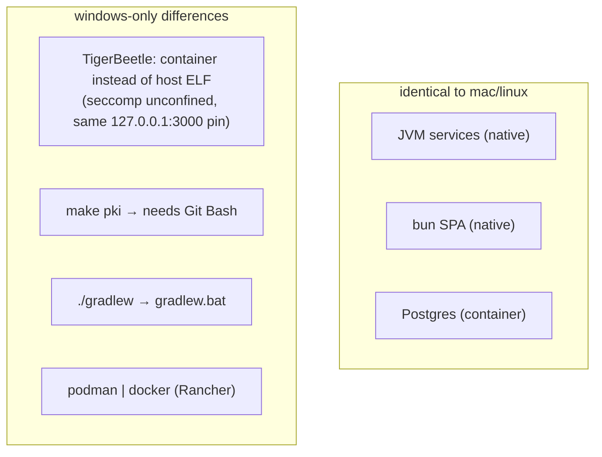

# FSP on Windows — dev environment without Docker Desktop

> Companion to `docs/architecture.md` §12. Tools referenced here:
> `scripts\windows-setup.ps1` (installer) and `scripts\dev-windows.ps1`
> (make-equivalents). Both are idempotent — safe to re-run.
> For the dual-OS end-to-end setup + troubleshooting matrix see `docs/setup-guide.md`.  
>  
> **TL;DR:** run `powershell -ExecutionPolicy Bypass -File scripts\windows-setup.ps1`
> in an Administrator PowerShell, reboot once, then — easiest — start everything with
> `powershell -File scripts\dev-windows.ps1 dev` (full bring-up in one call; `stop`
> reverses; `tune` resizes the engine VM; §5.4–5.5 below). For LLM-assisted portal
> widget authoring see `docs/widget-workbench.md`.
> Full manual walkthrough and every decision below.

---

## 0. Which option, and why (decision matrix)

The repo needs exactly **one container engine** (for PostgreSQL in dev; the whole
stack optionally). TigerBeetle is special on Windows — §4. The engine choices:

| | **Podman Desktop** | **Rancher Desktop** | Docker Desktop |
|---|---|---|---|
| License | free & open source (no per-seat licensing friction) | free & open source (SUSE) | paid for larger orgs |
| Linux VM provider | native WSL2 (best Windows integration) | Lima/WSL2 | its own WSL2 integration |
| CLI semantics | `podman …` (drop-in docker-compatible); `podman compose` via a compose binary | **real `docker …` + `docker compose`** (moby engine built in) | docker native |
| Rootless / least privileged | ✅ rootless by default | moby runs rootful inside VM | rootful VM |
| Kubernetes | optional extension | optional — **turn OFF** for FSP dev | optional |
| Daemon | no central daemon (per-VM) | dockerd (moby) in VM | dockerd |
| **FSP verdict** | **✅ recommended default** | good pick if you want exact `docker`/`docker compose` muscle memory | skip (licensing + you need WSL2 anyway) |

**Why Podman Desktop is the script default:** it uses Microsoft's own WSL2 as the
container VM (first-party support, fastest file/network path), has zero licensing
cost, and Podman's CLI is a drop-in for everything the FSP Makefile calls. The
only gap ("docker compose → podman compose") is closed by the installer, which
drops a standalone `docker-compose.exe` on your PATH so `podman compose` routes
through it transparently.

**Two ways to run the repo itself:**

| Path | What runs where | Best for |
|---|---|---|
| **Native Windows + Podman/Rancher** (main subject of this doc) | Java services + Bun SPA run *natively on Windows*; only Postgres (+ TigerBeetle container) run in containers | daily Windows work |
| **WSL2 Ubuntu dev** (§8, lighter setup) | the *entire* repo inside WSL2 Ubuntu — identical to the mac/linux instructions incl. `make tb-start` host binary | closest match to `AGENTS.md §8`; zero Windows quirks |

---

## 1. Prerequisites

| Requirement | Value / check |
|---|---|
| Windows | 10 **21H2+ (build 19044)** or 11 — script verifies |
| CPU | x64, virtualization enabled in BIOS (script warns if missing) |
| RAM | ≥ 16 GB (JVMs + WSL VM + browsers); 8 GB works but tight |
| Disk | ≥ 25 GB free (WSL2 distro ~1.5 GB, images ~3 GB, Gradle caches ~4 GB) |
| Admin PowerShell | all installer steps need it (script self-elevates) |
| Winget | present on Win10 21H2+/Win11 by default |

Ports used (all on 127.0.0.1): 5432 Postgres · 3000 TigerBeetle · 8081 core ·
8082 IdP · 8090 gateway · 8080 BFF · 8083 kyc plugin · 5173 Vite SPA.

---

## 2. Podman Desktop — full walkthrough (recommended)

### 2.1 One-command install

```powershell
powershell -ExecutionPolicy Bypass -File scripts\windows-setup.ps1
# add -InstallToolchain to also install Temurin JDK 25 + Bun
```

What the script does, step by step (so you know what changed on your machine):

1. Verifies Windows build/arch/virtualization.
2. Enables Windows features **Windows Subsystem for Linux** and
   **VirtualMachinePlatform** via DISM; runs `wsl --update`; sets WSL default
   version 2. *(A reboot is required — the script tells you; re-run after reboot,
   it skips finished steps.)*
3. Installs **Git for Windows** (winget `Git.Git`) — required for
   `make pki`/`infrastructure/pki/dev-pki.sh` and general shell tooling.
4. Installs **Podman Desktop** (winget `RedHat.PodmanDesktop`).
5. Locates the bundled `podman.exe` and puts its folder on your **user PATH**.
6. Runs `podman machine init --now` — creates and starts the **WSL2 provider**
   machine (distro `podman-machine-default`). Skipped if a machine already exists.
7. Downloads the standalone **`docker-compose-windows-x86_64.exe`** from the
   docker/compose GitHub releases into `%LOCALAPPDATA%\FSP\bin` and adds that to
   user PATH — this makes `podman compose` work.
8. With `-InstallToolchain`: installs **Temurin JDK 25** and **Bun** (winget).

### 2.2 Verify the engine

```powershell
podman --version                      #  5.x expected
podman machine list                   #  one machine, State = Running
podman run --rm hello-world           #  proves the WSL2 VM + pull + run all work
podman compose version                #  routes to the docker-compose.exe wrapper
# if you skipped the wrapper: pip install podman-compose  is an alternative
```

### 2.3 The Podman Desktop UI (optional but useful)

Open **Podman Desktop** from the Start Menu and skim:

- **Dashboard** — shows the machine, its CPU/RAM, and running containers
  (fsp-postgres, fsp-tigerbeetle, stack containers).
- **Preferences → Resources → Podman machine** — machine is *already running*;
  leave defaults. If your laptop has >8 GB you can raise machine memory:
  `podman machine stop && podman machine set --memory 6144 && podman machine start`
- **Preferences → Extensions — compose** — you may install the built-in
  *Compose* extension (nice UI); the CLI path already works either way.
- **Terminal tab per container** — handy for `psql` into fsp-postgres.

### 2.4 Rootless note (why Podman is the safer default)

Podman containers run **rootless**: no single privileged daemon owns all
containers, and the WSL2 VM user maps to your Windows identity. Nothing in FSP
needs root — Postgres and TigerBeetle data volumes live in

```text
%USERPROFILE%\.local\share\containers\podman\...   (inside the WSL2 distro)
```

so `podman machine stop` = everything stops safely; files persist.

---

## 3. Rancher Desktop — full walkthrough (alternative)

### 3.1 One-command install

```powershell
powershell -ExecutionPolicy Bypass -File scripts\windows-setup.ps1 -Engine rancher
```

### 3.2 Manual first launch (the choices that matter)

Start **Rancher Desktop** once from the Start Menu. On the first-run welcome
screen (and later under **Preferences**), set exactly:

| Preference | Choose | Why |
|---|---|---|
| **Container Engine** | **dockerd (moby)** | gives you the real `docker` and `docker compose` CLIs — the repo's `docker compose -f infrastructure/docker-compose.yml …` works verbatim |
| **Virtual Machine** | **WSL2** | first-party Windows networking + port forwarding |
| **Kubernetes** | **OFF** | FSP dev doesn't use k8s; leaving it on wastes ~2 GB RAM |
| **Start automatically at login / in background** | ON | dev convenience |
| **Path: allow only safe paths / sudo** | defaults | — |

Click **Apply**. Rancher pulls the WSL data distro (`rancher-desktop`) and builds
the lima/moby VM (2–5 minutes). The tray icon settles when ready.

The script pre-writes these choices into
`%APPDATA%\rancher-desktop\settings.json` when the file already exists; if you
skipped that, set them by hand exactly as the table above.

### 3.3 Verify

```powershell
docker --version                      # Rancher's dockerd answers
docker compose ls                     # compose plugin present
docker ps                             # empty table = up and running
docker run --rm hello-world
```

`docker context show` should list `rancher-desktop` as current — then every
repo command in `AGENTS.md §8` works as written (`docker compose -f …`).

### 3.4 Rancher-specific notes & gotchas

- `docker compose` here is the **Compose v2 plugin inside Rancher's moby** — no
  wrapper needed (unlike Podman path).
- Kubernetes off keeps memory at a container-engine-only footprint (~1.5 GB).
- Rancher regenerates its VM on major updates — data volumes
  (`postgres-data`) live in a WSL distro volume and **survive**, but if you
  ever "Reset Kubernetes/Container Images", re-check `docker volume ls`.
- Port forwarding works like Docker Desktop: container port → Windows localhost.

---

## 4. TigerBeetle on Windows (the special one)

`infrastructure/bin/tigerbeetle` is a **statically linked Linux ELF** — a
TigerBeetle *server* does not ship a Windows binary, and AGENTS §2's "host
binary" rule exists because **Docker 25+'s default seccomp profile blocks
io_uring**. On Windows there are two supported ways, both equivalent:

### 4.1 Option A — TigerBeetle as a container (Podman or Rancher) ← use this

`scripts\dev-windows.ps1` `tb-*` commands wrap this. What they run:

```powershell
# format (first time; idempotent)
podman run --rm --user 0:0 --security-opt seccomp=unconfined `
  -v "${PWD}\infrastructure\tigerbeetle-data:/data" `
  --entrypoint /tigerbeetle ghcr.io/tigerbeetle/tigerbeetle:0.17.9 `
  format --cluster=0 --replica=0 --replica-count=1 /data/0_0.tigerbeetle

# run
podman run -d --name fsp-tigerbeetle `
  -p 127.0.0.1:3000:3000 `
  --security-opt seccomp=unconfined `
  --ulimit nofile=65536:65536 `
  -v "${PWD}\infrastructure\tigerbeetle-data:/data" `
  --entrypoint /tigerbeetle ghcr.io/tigerbeetle/tigerbeetle:0.17.9 `
  start --addresses=0.0.0.0:3000 /data/0_0.tigerbeetle
```

(Rancher users: `docker run …` with the identical flags.)

Three details that make this safe & correct:

| Detail | Reason |
|---|---|
| `--security-opt seccomp=unconfined` | io_uring syscall must pass the profile (same spirit as AGENTS §2's host-binary rule; on Windows the container VM is dev-only, TigerBeetle stays 127.0.0.1-only, so exposure stays local) |
| image pinned `0.17.9` | matches the Java client pin in `build.gradle.kts` — **never bump one without the other** (AGENTS §1) |
| volume = the repo's `infrastructure\tigerbeetle-data` | same data dir the linux `make tb-*` targets use; TB logs land there too (`server.log` is only written by the host-binary path, container logs go to `podman logs fsp-tigerbeetle`) |

Port `127.0.0.1:3000` matches `fsp.tigerbeetle.addresses` in
`backend/core/src/main/resources/application.yml` — core connects to Windows
localhost and podman/rancher forwards into the VM.

### 4.2 Option B — TigerBeetle inside WSL2 (host binary, mirrors AGENTS §8)

If you installed a full Ubuntu distro anyway (see §8):

```bash
wsl -d Ubuntu
cd /mnt/c/Users/<you>/FinancialServicesPlatform   # (or wherever you cloned the repo) — run from the repo root
make tb-start && make tb-stop                     # the real ELF binary on Linux — identical to mac/linux
```

Pick Option A when your repo lives on Windows and you want zero WSL file access;
pick Option B when you've cloned the repo inside WSL2 (much faster Gradle/Java
on that path, §8).

---

## 5. Daily workflow (native Windows path)

Open **any** terminal (PowerShell works; Git Bash also fine). First session only:

```powershell
# 1. infrastructure
powershell -File scripts\dev-windows.ps1 infra-up     # Postgres :5432
powershell -File scripts\dev-windows.ps1 tb-start     # TigerBeetle :3000 (container)

# 2. dev PKI (bash needed → Git for Windows)
powershell -File scripts\dev-windows.ps1 pki

# 3. backend — four terminals (Windows PowerShell), each in repo root:
cd backend\idp      ; .\gradlew.bat bootRun            # :8082
cd backend\core     ; .\gradlew.bat bootRun            # :8081  (add -Dspring-boot.run.profiles=client-demo for demo seed)
cd backend\gateway  ; .\gradlew.bat bootRun            # :8090  (start AFTER core+idp, or let it retry)
cd backend\bff      ; .\gradlew.bat bootRun            # :8080
# optional plugin:  cd backend\plugins\kyc ; ..\..\gradlew.bat bootRun   # :8083

# 4. frontend
cd frontend ; bun install                       # first time only
cd frontend ; bun run dev                       # :5173
```

Every-day session = steps 1, 3 (skip `bun install`, `pki` unless `make pki`
contents changed).

### 5.1 make-equivalent table (native Windows)

| Mac/Linux target | Windows |
|---|---|
| `make infra-up` / `down` | `scripts\dev-windows.ps1 infra-up` / `infra-down` |
| `make tb-start` / `stop` / `reset` | `scripts\dev-windows.ps1 tb-start` / `tb-stop` / `tb-reset` |
| `make backend-*` | `cd backend\<svc>` + `.\gradlew.bat bootRun` |
| `make frontend-dev` / `install` | `bun run dev` / `bun install` (Bun ships Windows) |
| `make test-e2e` | `cd frontend && bunx --bun playwright test` |
| `make pki` | `scripts\dev-windows.ps1 pki` (uses Git Bash) |
| `make stack-up` / `down` | `scripts\dev-windows.ps1 stack-up` / `stack-down` |
| `make docs-refresh` / `docs-check` | `scripts\dev-windows.ps1 docs-refresh` / `docs-check` |
| `make docs-hook` | `git config core.hooksPath .githooks` |

Note: `make` itself also works on Windows if you have **Git Bash** and run it
from there (the Makefile's docker/tb-host-binary lines do *not* work natively,
but infra-up + all Java/bun targets do — TB stays on the §4 container path).

### 5.2 Default dev logins (out of the box)

| Username | Password | Available when | You are |
|---|---|---|---|
| `platform-admin` | `fsp-admin` | always (system seed) | platform root admin (maker) |
| `admin-checker` | `fsp-admin` | always (system seed) | platform checker — four-eyes partner of `platform-admin` |
| `psp-admin` | `demo1234` | core run with `--spring.profiles.active=client-demo` | demo PSP admin (maker) |
| `psp-ops` | `demo1234` | `client-demo` | demo PSP operations (KYC review) |
| `merchant-admin` | `demo1234` | `client-demo` | Namib Fresh merchant admin (maker) |
| `merchant-checker` | `demo1234` | `client-demo` | Namib Fresh checker — resolves its four-eyes queue |

Four-eyes demo flow: as `psp-admin` create + submit a JE, then as `merchant-checker`
(or `psp-ops` at PSP scope) approve — maker ≠ checker is enforced per person, so
use two different portal logins (two browser profiles or windows).
Persons created via the API default to `$FSP_PERSON_PASSWORD` (`fsp-person-2026`).

### 5.3 Smoke chain (identical to AGENTS §8)

```powershell
curl http://127.0.0.1:8080/bff/csrf
# → POST /bff/auth/login (platform-admin / fsp-admin or $FSP_BOOTSTRAP_PASSWORD)
# → GET http://127.0.0.1:5173 in your browser
```

### 5.4 One command to run everything

```powershell
powershell -ExecutionPolicy Bypass -File scripts\dev-windows.ps1 dev
```

`dev` starts the whole platform in the stated order — engine VM (auto-sized), postgres,
TigerBeetle, then `idp → core → gateway → bff → plugin-kyc` each in **its own terminal
window** (so you can read each service's logs as AGENTS §2c expects), then the SPA. It ends
by printing the smoke chain and the stop command.

| Command | What it does |
|---|---|
| `dev` | everything up (containers for pg/tb + native JVM terminals + SPA terminal) |
| `stop` | reverse: stops vite, gradle daemons, leftover JVM ports, TB, postgres |
| `tune` | resize the engine VM (defaults **auto-size from the laptop's physical RAM**; override with `-MemoryMB 3072 -Cpus 2`) |
| `status` | engine + ports (5432, 3000, 8082, 8081, 8090, 8080, 8083, 5173) at a glance |
| `dev` on an existing checkout without prior `windows-setup.ps1` | run the installer first — it creates the engine machine; `dev` only needs the engine CLI on PATH |

### 5.5 Engine sizing — laptops with limited RAM

`windows-setup.ps1` and `dev-windows.ps1 tune` size the engine VM **from the laptop's total RAM**, so the HOST keeps enough memory for the five JVM services that run as native terminals:

| Laptop RAM | Engine VM (auto) | What fits | What to avoid |
|---|---|---|---|
| **8 GB** | **2 GB / 2 vCPU** | postgres + tigerbeetle only; all five services run **natively** via `dev` | `stack-up` (5 JVM containers won't fit) — the 2 GB VM is only for postgres/TB |
| 12–16 GB | 5 GB / 2 vCPU | everything incl. `stack-up` | — |
| 32 GB+ | 6 GB / 3 vCPU | everything + IDE + parallel builds | — |

Extra tips for 8 GB machines:

- Run services **natively** (`scripts\dev-windows.ps1 dev`) — JVMs on the host use exactly what each service needs, no container overhead.
- Cap the Gradle daemon's appetite: add `org.gradle.jvmargs=-Xmx1g` to `%USERPROFILE%\.gradle\gradle.properties` (and `org.gradle.daemon=true` so builds reuse it instead of re-forking).
- Close heavy apps (IDE indexing, Chrome tabs) during first build; afterwards idle JVMs sit at ~150–300 MB each.
- Low on memory mid-session: `dev-windows.ps1 stop` frees everything; the script is idempotent, `dev` brings it all back.
- If even 2 GB is too much: only postgres is a hard container (`infra-up`); TigerBeetle can live in **WSL2 instead** (§4.1 option B) — then the VM holds postgres alone (~512 MB is enough: `tune -MemoryMB 512 -Cpus 1`).

---

## 6. Environment variables on Windows (session-scope, PowerShell)

Only when you deviate from defaults:

```powershell
$env:FSP_BOOTSTRAP_PASSWORD      = 'fsp-admin'       # core seed admin (dev only!)
$env:FSP_INTERNAL_CREDENTIAL     = '<generated: core inbound>'
$env:FSP_INTERNAL_CREDENTIAL_EMI  = '<generated>'   # core/gateway/recon carry emi's secret
$env:FSP_INTERNAL_CREDENTIAL_PSP  = '<generated>'   # gateway/recon carry psp's secret
$env:FSP_INTERNAL_CREDENTIAL_IDP  = '<generated>'   # gateway carries idp's secret
$env:FSP_PERSON_PASSWORD         = 'fsp-person-2026' # created-via-API persons
$env:FSP_IDP_ISSUER              = 'https://idp.fsp.local'
$env:FSP_TLS_PASSWORD            = 'fsp-dev'
```

User-persistent versions (survive terminals):
`[Environment]::SetEnvironmentVariable('FSP_BOOTSTRAP_PASSWORD','fsp-admin','User')`.

---

## 7. Troubleshooting (Windows-specific)

| Symptom | Cause → fix |
|---|---|
| `podman machine init` fails after fresh install | features were enabled but **reboot missing** → reboot, re-run |
| `podman: error while loading shared libraries` / CLI not found | PATH is stale → open a **new** terminal; or full path: `%LOCALAPPDATA%\Programs\Podman Desktop\resources\bin` |
| `podman compose` → "docker-compose not found" | wrapper not installed → re-run installer, or `pip install podman-compose`, or use the standalone binary directly |
| TigerBeetle container exits instantly (Podman) | seccomp flag missing → use the script's `tb-start` (which passes `seccomp=unconfined`); check `podman logs fsp-tigerbeetle` |
| core logs `TB transport failure` / `je_commit_unknown` | TigerBeetle not up → `scripts\dev-windows.ps1 status` — port 3000 must read OPEN |
| `EADDRINUSE :5432` | another local Postgres (or a previous container) → `scripts\dev-windows.ps1 infra-down`, or stop the Windows Postgres service |
| Gradle can't write to `~/.gradle` (OneDrive-synced profile!) | Gradle user home inside OneDrive locks files → set `GRADLE_USER_HOME` outside OneDrive, e.g. `C:\dev\gradle-home` |
| `wsl --update` fails behind a corporate proxy | `wsl.exe --update --web-download`, or install the MSI from Microsoft Learn |
| Docker/Rancher tray spins forever | virtualization off in BIOS → enable VT-x/AMD-V; also check "Windows Hypervisor Platform" feature |
| machine/VM consumes more RAM than documented | someone resized before the auto-sizing existed → `scripts\dev-windows.ps1 tune` (no args = correct size for this laptop) |
| `dev` opens terminals that close instantly | `gradlew.bat bootRun` failed at once (port in use / PKI) → relaunch manually from `backend\<svc>` and read the error; first-time JDK missing → run installer with `-InstallToolchain` |
| SPA terminal closes instantly | `bun` missing → installer `-InstallToolchain`, then open a new terminal |
| workbench says "registry server unavailable" | services not up → `dev-windows.ps1 dev`, then sign in via the BFF (§6 env vars for non-default passwords) |
| Vite dev server slow / file-watch misses changes | repo cloned on a Windows-mounted drive *inside* WSL2 → clone inside the WSL filesystem instead (§8), or mark trust with `bun run build` sanity |
| `bash` not found for `pki` | Git for Windows missing → re-run installer |

---

## 8. The WSL2-only alternative (cleanest, mirrors AGENTS §8 exactly)

If you prefer the mac/linux developer experience, do everything *inside* WSL2
Ubuntu — including Podman, optionally:

1. `wsl --install -d Ubuntu-24.04` (admin PowerShell; reboot if asked)
2. Inside Ubuntu:

   ```bash
   sudo apt update && sudo apt -y install build-essential unzip git curl
   curl -fsSL https://get.sdkman.io | bash && source ~/.sdkman/bin/sdkman-init.sh
   cd /path/to/repo && sdk env              # installs java 25 per .sdkmanrc
   curl -fsSL https://bun.sh/install | bash # bun + node toolchain
   # TigerBeetle runs as the repo's host binary here — no container needed:
   make infra-up && make tb-start
   # services:
   make backend-idp && make backend-core && make backend-gateway && make backend-bff
   ```
3. Containers, if you want them *inside* WSL2 Ubuntu, are **not required** —
   Postgres is the only compose service and you already started it with
   `make infra-up` from Ubuntu (docker-in-WSL needs Podman/Rancher/Docker — any
   of the three; Podman inside WSL2 Ubuntu also works rootless: `sudo apt
   install podman`).
4. Optional: install **Podman Desktop app on Windows** purely as a UI to inspect
   the engines — it coexists fine.

Port access from Windows browsers: `localhost` works across WSL2 boundary by
default (localhost forwarding) — open `http://localhost:5173` in your Windows
browser.

---

## 9. What's different vs the mac/linux instructions (summary card)



| Concern | mac/linux | native Windows |
|---|---|---|
| Postgres | compose | compose (podman or rancher) — same file |
| TigerBeetle | host ELF binary | pinned 0.17.9 container, `--security-opt seccomp=unconfined` |
| Makefile | full | partial (via Git Bash) + `scripts\dev-windows.ps1` wrappers |
| PKI | `bash dev-pki.sh` | same script through Git Bash (`pki` command) |
| Java wrapper | `./gradlew` | `.\gradlew.bat` |
| Bun | native | native (Bun ships Windows) |

---

## 10. Teardown / clean slate

```powershell
powershell -File scripts\dev-windows.ps1 stack-down     # container stack (if used)
powershell -File scripts\dev-windows.ps1 infra-down     # postgres
powershell -File scripts\dev-windows.ps1 tb-reset       # wipe TB ledger data
podman volume rm infrastructure_postgres-data            # wipe DB (destructive)
podman machine stop                                      # engine fully down
# factory reset, if ever needed:
podman machine rm podman-machine-default                 # removes the WSL distro
```

Rancher: **Troubleshooting → Reset to factory** inside the app removes its WSL
distro; `docker volume rm infrastructure_postgres-data` (or the volumes panel)
wipes data.
