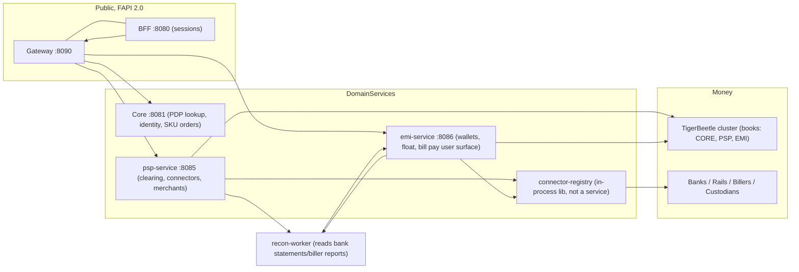

# Bank Connectors, Bill Payments, PSP & EMI Services — Architecture Plan

**Status:** APPROVED-ARCHITECTURE v2 · 2026-11-19 · Owner: platform engineering
**Normative chapter:** [docs/architecture/13-money-movement-and-rails.md](../docs/architecture/13-money-movement-and-rails.md) (open questions §12 resolved — Namibia PSD-1 / PSD-3 / VAA 10-2023 grounding).
**Depends on:** `docs/architecture/01-runtime-topology.md`, `12-notifications-and-push.md` (§12.9 auth-plane pattern), `plans/plugin-platform-plan.md` (isolation rules), AGENTS.md (FAPI 2.0, four-eyes, minor units, double-entry, outbox, schema isolation).

---

## 0. Requirement-to-design traceability

| # | Requirement (from brief) | Where addressed |
|---|---|---|
| R1 | Bank connectors integrated with actual SKU & digital-asset transactions; ledger reflects real values | §3 (connector registry), §7 (SKU/assets posting model) |
| R2 | Bill payments: secure, atomic, long revert window, **zero impact on TigerBeetle** during settle | §5 (saga + pending two-phase) |
| R3 | A configurable "space" (grace window) the system uses to **rollback / mark done / mark yet-to-reconcile** | §5.4 (TTL disposition ladder) |
| R4 | **Sealed interface** defining all bank/service-provider protocols | §3.2 (sealed taxonomy), §3.4 (protocol support: transport channels, message formats, per-bank profiles) |
| R5 | Separate PSP and EMI services; EMI owns platform wallets | §2 (service topology), temp-wallet verdict in §1 |
| R6 | Mechanisms ensuring no double debit/credit | §6 (exactly-once stack) |
| R7 | Fail fast on comm problems, graceful degradation | §8.1–8.3 (breaker + timeouts + ambiguity rule) |
| R8 | Temp failure → subsequent messages fail **without provider check** until cooldown elapses | §8.2 (OPEN state fail-fast) |
| R9 | 429 handling + **moving-window** protocol | §8.4 (sliding-window limiter) |
| R10 | Support **parallel and sequential** provider protocols | §4.4 (concurrency models in the sealed SPI) |
| R11 | Proven finance-industry algorithms/patterns only | §9 (pattern provenance) |
| R12 | FAPI 2.0 compliance throughout | §10 (compliance mapping) |

---

## 1. Business-model verdicts: PSP clearing vs EMI wallets

### 1.1 PSP (payment service provider — merchant acquiring, pass-through)

* PSP **never owns** customer or settled merchant money. In-flight money lives in a
  **safeguarded/segregated bank account** at the partner bank (regulator-approved construct).
* On the platform ledger, in-flight funds live in **nominal clearing accounts**
  (`TB account: PSP_CLEARING_<rail>_<ccy>`, `is_debit_account=false`, customer-creditor=false, internal).
* The "temp wallet" the user asked about **exists but is not a wallet**: it is the
  clearing *position*, and it is a **hard invariant that every PSP clearing account is
  zero at end of each settlement cycle** (a settlement sweeper + recon assert "clearing == 0 else page").
  This mirrors Stripe's `pending/available` split and ISO 20022 payment-gateway clearing.
* Merchant payable is a **liability account** (`MERCH_PAYABLE`), paid out by sweep transfers.
* PSP revenue = fee postings at capture time (explicit, auditable fee JEs — no hidden skimming).

### 1.2 EMI (prepaid wallets — platform-held float)

* EMI issues **real wallets**: persistent customer liabilities (`WALLET_<person>` accounts, currency-scoped).
  Platform float mirrors these in segregated/segmented bank accounts;
  **wallet ledger sum == float bank statement** is a recon invariant that must hold at every checkpoint.
* Full four-eyes on manual wallet adjustments; automated adjustments only via audited ops runbook flows.
* EMI supports **digital assets** as additional account classes (custody model §7.3) — assets use
  separate TigerBeetle **ledgers** (e.g. `L_ASSET_*`), never mixed with fiat minor-unit math.
* **Regulatory constraint (resolved in §12.2):** PSD-3 §9.1.1 — regulated e-money wallets are
  **NAD-only, redeemable at par**; ZAR/USD/GBP positions ride as bank-linked/on-sent accounts
  (§10.1.5), not wallet balances. Loyalty points are non-convertible to cash/e-money (§9.1.3).

**Decision (R5):** `psp-service` and `emi-service` are **separate Spring Boot services**,
each with its own PostgreSQL schema + Flyway history (plugin-platform isolation rules),
own TigerBeetle cluster accounts/ledgers, own outbox, own IdP client registration.
Both sit behind the API gateway (:8090) as FAPI RS256+DPoP resource servers; both treat
core (`:8081`) policy answers as authoritative for identity/permission *lookups* but own
their own domain preconditions (mirroring the split-PDP stance in chapter 01).

---

## 2. Service topology



**Ownership split (the one-way coupling rule carried over from §12.9):**

| Concern | Owner | Note |
|---|---|---|
| Who may buy SKU X (price, inventory reservation) | Core + inventory plugin | Core raises the order; EMI/PSP only *execute movement* |
| Customer wallet balance | EMI | Sole decision point for wallet sufficiency |
| Clearing & merchant acquiring | PSP | Owns rail abstraction and connector lifecycle |
| Bill payment orchestration | EMI (`BillPaymentSagaEngine`) | Uses PSP's connector registry — a *library*, not a network hop |
| Authoritative booked positions | TigerBeetle | Both services write with two-phase pending semantics (§5) |
| Settlement & reconciliation | recon-worker | Reads statements/reports; feeds the disposition ladder (§5.4) |

---

## 3. Bank connector architecture (R1, R4)

### 3.1 Connector = config, not code, per bank

One connector **binary** (all protocol adapters compiled in), one *row* per counterparty
in `psp.banks` / `emi.providers` with: protocol seal-variant, endpoint, cert bundle ref,
rate-limit profile, concurrency profile, fee schedule, currency list, and **enabled flag** (four-eyes-gated).
Adding Bank XYZ = config row + credentials mount; **not** a redeploy.

### 3.2 Sealed protocol taxonomy (R4) — exact shape

```java
/** The one true protocol SPI. Exhaustive switch at compile time — a new rail
 *  forces every dispatch site to handle it. */
public sealed interface ProviderProtocol {

    /** Session-oriented card networks / ISO 8583 terminals. */
    sealed interface SessionBound extends ProviderProtocol
            permits Iso8583Protocol, TerminalStreamProtocol {}

    /** Message-based interbank rails. */
    sealed interface MessageTyped extends ProviderProtocol
            permits Iso20022PacsProtocol, Iso20022PainProtocol, NachaProtocol {}

    /** Modern HTTP rails. */
    sealed interface HttpBased extends ProviderProtocol
            permits RestOpenBankingProtocol, UpiProtocol, BillerRestProtocol,
                    WalletRailProtocol, CustodianRestProtocol {}

    record Iso8583Protocol(String networkId, HostProfile host) implements SessionBound {}
    record TerminalStreamProtocol(String terminalId, HostProfile host) implements SessionBound {}
    record Iso20022PacsProtocol(String bic, CertificateRef cert) implements MessageTyped {}
    record Iso20022PainProtocol(String bic, CertificateRef cert) implements MessageTyped {}
    record NachaProtocol(String companyNameEntry, FtpProfile ftp) implements MessageTyped {}
    record RestOpenBankingProtocol(String apiProfile, CertificateRef mtls) implements HttpBased {}
    record UpiProtocol(String pspHandle, CertificateRef cert) implements HttpBased {}
    record BillerRestProtocol(String billerCode, BillerContract contract) implements HttpBased {}
    record WalletRailProtocol(String walletNetwork, HmacRef hmac) implements HttpBased {}
    record CustodianRestProtocol(String custodianCode, CertificateRef mtls) implements HttpBased {}
}

/** What a protocol adapter can and cannot do — capability, not instance, drives dispatch. */
public sealed interface RailCapability {
    /** Session-bound rails: exactly one in-flight message per session/terminal; everything else fails fast. */
    record Sequential(int maxInFlightPerSession) implements RailCapability {}
    /** HTTP rails: N parallel calls, per-provider cap. */
    record Parallel(int maxInFlight, Duration connectTimeout, Duration readTimeout) implements RailCapability {}
    /** Query-only rails: status checks are idempotent and cheap (recon probes). */
    record StatusProbe(Duration freshnessWindow) implements RailCapability {}
}
```

Adapter interface (implemented once per rail family, ~6 classes for N banks):

```java
public interface ProtocolAdapter<P extends ProviderProtocol> {
    ProviderProtocol.Family family();
    RailCapability capability(P cfg);
    /** Idempotent by (Idempotency-Key, account-ref) — never duplicates money. */
    RailResult submit(P cfg, FinancialMessage msg);
    /** Safe at any time: ask the counterparty what actually happened. */
    Optional<RailStatus> probe(P cfg, FinancialMessage msg);
}
```

### 3.3 Response taxonomy (sealed — same discipline)

```java
public sealed interface RailResult {
    record Accepted(String railRef, Instant settledAtOrEta) implements RailResult {}
    record AcceptedPending(String railRef) implements RailResult {}          // "submitted, awaits confirm"
    record Rejected(String code, boolean permanent) implements RailResult {} // NSR "invalid account"
    record Failed(FailureKind kind) implements RailResult {}
}
public sealed interface FailureKind {
    record CommUnreachable(Duration observedFor) implements FailureKind {}   // socket refused/timeout
    record TemporarilyUnavailable(int retryAfterSeconds) implements FailureKind {} // 503/ Retry-After
    record RateLimited(Duration movingWindowReset) implements FailureKind {} // 429 — §8.4
    record DefinitiveFailure(String railCode) implements FailureKind {}      // rejected by scheme
}
```

Every adapter classifies into this taxonomy — services never see HTTP status codes,
only these seals **(R7 input discipline)**.

### 3.4 Bank communication-protocol support (R4b) — per-bank profiles, zero new code

The Phase-0 bank registry (`BankAccountService`: FNB Namibia, Nedbank Namibia,
Standard Bank Namibia, Bank BIC Namibia, Letshego Bank Namibia — master data moving to the
KYC plugin) spans **different integration styles per subsidiary**. The design rule:
**a new bank is a `bank_connector` config row, never a code change** — the row pins
transport + message format + dictionary version, and the existing rail-family adapter
interprets the profile.

#### 3.4.1 Sealed transport channels (the wire) — orthogonal to protocol format

```java
/** How bytes reach the counterparty. Adding a transport touches nothing else. */
public sealed interface TransportChannel {
    record MtlsHttpChannel(String endpoint, CertificateRef clientCert) implements TransportChannel {}
    record VpnHttpChannel(String endpoint, SharedSecretRef shared) implements TransportChannel {}   // HTTPS inside bank VPN
    record TcpSessionChannel(HostProfile host, Duration sessionTimeout) implements TransportChannel {} // ISO 8583 sockets
    record SftpChannel(FtpProfile profile, String outBasket, String inBasket) implements TransportChannel {} // batch files
    record MqChannel(String queueManager, String reqQueue, String respQueue) implements TransportChannel {} // IBM MQ
}
```

Health semantics per channel feed the §8.3 breaker: HTTP/mq channels probe on
consecutive-failure counters; SFTP in-baskets go stale on cadence miss (monitored),
which is a **recon warning, never a breaker** (a late statement file is not a rail outage).

#### 3.4.2 Message-format registry (the vocabulary)

| Format | Messages used | Adapter family | Notes |
|---|---|---|---|
| **ISO 8583** (1987/1993/2003 variants) | MTI 0200/0800 (auth), 0420 (reversal), 0800 status probes | `Iso8583Protocol` | bitmap per-bank profile; `RailCapability.Sequential`; sub-second TLEs |
| **ISO 20022** (dictionary version **pinned per bank**: 2021 vs 2023 differ) | `pain.001` credit initiation, `pacs.008` FI-to-FI, `pacs.002`/`pain.014` status, `camt.053/.054` statements | `Iso20022PainProtocol` / `Iso20022PacsProtocol` | XSD-validated; dictionary mismatch = profile error, caught in sandbox conformance suite |
| **SWIFT MT** (legacy, some corporate banking) | MT103 (credit), MT195 (enquiry), gpi status via tracker | `Iso20022PainProtocol` wrapper (MT⇄MX) | only if a bank offers nothing newer; never build new integration on MT |
| **NACHA/ACH batch** | file layouts incl. entry-detail addenda | `NachaProtocol` | SFTP exchange, two-batch window per day; file acknowledged before value |
| **Bank REST/JSON (open banking)** | proprietary payload, OAuth2 client-credentials + mTLS | `RestOpenBankingProtocol` | idempotency per profile header convention |
| **Biller REST** | biller-specific query/pay/verify + webhook or poll status | `BillerRestProtocol` | verification-before-pay when supported |
| **Statement/CSV batch** | bank-specific fixed-width or CSV, SFTP in-basket | recon-worker parsers | ingest is claim-once (file + line hash), never re-applied |

#### 3.4.3 Per-bank profile rows (assumed integration shapes — **verified in Stage 0 survey**)

| Bank | Assumed profile row | Why plausible | Verify at Stage 0 |
|---|---|---|---|
| FNB Namibia (FirstRand) | `RestOpenBankingProtocol` + `SftpChannel` (camt.053) | FirstRand exposes group REST APIs + file exchange | sandbox enrollment; API scope |
| Nedbank Namibia | `RestOpenBankingProtocol` + mTLS | group open-banking platform | OAuth2 scopes, cert pipeline |
| Standard Bank Namibia | `SftpChannel` batch (pain.001/pain.008-adjacent CSV) + processor ISO 8583 | corporate-file-first culture | file spec, encryption on basket |
| Bank BIC Namibia | `SftpChannel` CSV batch | smaller bank, file-based rails | file spec |
| Letshego Bank Namibia | `RestOpenBankingProtocol` or batch | lean digital bank | actual API availability |

`bank_connector` row shape (new columns this design adds):
`rail_family, transport_channel, message_format, dictionary_version, charset/locale,
timeout_profile (connect/read/overall), endpoint_credential_ref (env-only),
scheme limits, settlement window, statement cadence, idempotency convention`.
Sandbox conformance suite per row = the acceptance gate for enabling the bank
(pay/query/reverse/statement round-trip, dictionary-version validation, breaker drill).

#### 3.4.4 Cross-cutting protocol rules

* **Dictionary versions are data:** a bank upgrading ISO 20022 versions changes one config
  column; adapters resolve templates by `(format, dictionary_version)`.
* **Encoding discipline:** all payloads parse to internal types immediately; no raw message
  text survives past parsing (the §2c zero-secret rule); errors quote field paths, not payloads.
* **Statement/recon ingestion** (any transport): SFTP/webhook file → hash-claim → parse →
  `recon_rows` → saga disposition feed; cadence miss = recon warning (see 3.4.1).
* **Session-bound adapters** (`TcpSessionChannel`) own logon/logoff/echo-keepalive and map
  session loss to `FailureKind.CommunUnreachable`, never to silent retry.
* **Stage 0 protocol survey deliverable:** one signed-off profile row per bank above;
  no Stage 1 adapter work begins until profiles are verified against sandbox truth.

---

## 4. Money movement: connector → TigerBeetle, never direct

* The **connector never credits/debits platform books directly.** Adapters produce
  `RailResult`; the **saga engine** (per service) is the only writer against TigerBeetle.
* All money in minor units, ISO-4217 currency-scoped ledgers (existing invariant).
* Balanced JEs per book per currency (existing invariant); TB flags used as state:

| TB mechanism | Use here |
|---|---|
| **Two-phase pending transfers** | Every in-flight leg posts as `pending`; saga dispositions it (§5) |
| **`post_pending_balance` / commit** | "mark done" (R3: confirmed by customer/recon) |
| **`commit + close_pending`** | Same, if amount changed on confirm |
| **Rollback / void pending** | "revert" (R3: TTL expiry, customer cancel, recon says bounce) |
| **`linked` chain** | Atomic multi-leg debits (wallet → clearing + fee) so partial failure cannot strand value |
| **`closing_debit`** | Clearing-account sweep to merchant payable at settlement |

This is the **exact TB pattern** proven by the existing ledger work: pending → resolution,
no direct debit-to-credit star matching, journal-first.

---

## 5. Bill payments (R2, R3, R8) — subsection of EMI

### 5.1 The core trick: bill pay never touches the customer's wallet until *confirmed*

You asked for "bill payment takes a larger time to revert but should not impact
TigerBeetle." Industry answer = **authorization hold (funds-in) + clearing (funds-out)**,
i.e. **TigerBeetle pending transfer**:

1. **Debit hold (instant, reversible):** pending transfer `DR WALLET, CR BILL_CLEARING`
   (EMI-side clearing/suspense "space" — this *is* your configurable space).
   Customer sees "pending bill payment"; spendable balance drops. **No irreversible money moved.**
2. **Submit to biller** via connector (outside any DB/TB transaction, §8 timeouts).
   Result lands in `bill_payment_saga` row (single state machine).
3. **Confirmed:** `commit` pending → wallet debit final; recon matches biller credit.
4. **Reverted (needs the long window!):** `void pending` → wallet released.
   Triggers: biller rejects, TTL expires, recon finds a bounce, person cancels pre-submit.
5. **Ambiguous (timeout after submission!):** biller may have credited the biller account
   even though the adapter saw a timeout — **you may NOT void on a timeout.**
   Row → `PENDING_RECOGNITION` ("yet to reconcile") and **void is blocked**; only a
   recon probe (`StatusProbe` freshness ≤ window) can disambiguate.

### 5.2 Sagas aren't compensations — they're state machines over *pending transfers*

`bill_payment_saga` (EMI schema) columns: `id`, `person_id, wallet_id, currency, amount_minor`,
`biller_id, account_ref, idempotency_key` (unique), `state`, `rail_ref NULL`,
`submitted_at, settled_at, expires_at, attempt, last_failure_kind NULL`.

**Held funds do double duty as the "space" (R3):** the configurable grace period is a
column, not an ad-hoc constant — `fsp.emi.saga.confirmDeadline` default e.g. 35 days;

### 5.3 The "space" ladder (R3 — explicit, config-driven)

`fsp.emi-space-grace-seconds` — **the one knob that decides every disposition deadline.**

| Outcome the operator asks for | Disposition |
|---|---|
| "Rollback the payment" | void pending, customer released, JE: clearing reversed in-place (audit: saga id referenced) |
| "Mark it as done" | commit pending, biller settle confirms, recon matched, JE finalizes |
| "Yet to reconcile" | nothing moves yet — stays pending with `expires_at`, recon probes; this is the state that buys the long revert window for free |

Ambiguity rule (**hard invariant**): **timeout of an already-submitted bill-payment
is NEVER treated as failure.** The pending hold persists; only `probe()` or a bank
statement can void it. If the customer needs funds immediately, an explicit
**customer-requested force-void** path exists — four-eyes gated, audited, and
provisioned for a claw-back reversal (industry "good-funds release") — never the
default automated path. This is the ISO 8583/MPI "authorization ambiguity" doctrine
applied to billers.

### 5.4 Why this is industry-proven

* **ISO 8583 / card-world authorization → settle gap** maps to pending → commit.
* **NACHA return window** (business days per return code) maps to the TTL ladder.
* **Biller-credit ambiguity** (postpaid utility "credit posted, ack lost") maps to
  `PENDING_RECOGNITION`. The exact pattern used across payment gateways
  (Stripe/PayU/Razorpay/Adyen) for `pending → success/refund` — we reuse it because
  the alternatives (direct settle; immediate void on timeout) both produce real money errors.

---

## 6. Exactly-once / no double debit (R6)

**Stacked defenses — each layer independently sufficient:**

| Layer | Mechanism |
|---|---|
| **Idempotency key (unique DB index)** | `(service, kind, idempotency_key)` unique; duplicate submit = SELECT existing saga → return it (no re-execute). Covers client retries and internal replays. |
| **Financial-message key** | Sent as provider `Idempotency-Key`/`reference`; biller/bank may honor → same key returns same result (industry-standard "request dedup"). |
| **TB pending uniqueness** | A pending transfer tagged `user_data_128 = sagaId` — **a second commit of the same saga id is a no-op** (TB enforces uniqueness of `{ledger, account, user_data_128}` for pending with `id` collision semantics; the engine still asserts). |
| **Outbox = the single submitter** | Rail submission only happens from the outbox sweeper that *claims* (conditional UPDATE … WHERE state='READY'), so even a paused/resumed cluster never double-submits. Same claim pattern as `ChannelDispatcher` (§12.9). |
| **Connector-side request dedup cache** | `connector_calls(rail_ref)` unique → replay of the *same* message returns the recorded result, not a second submit. |
| **Recon invariant** | `SUM(clearing positions) == SUM(biller acks)` — daily + on-demand; any break = P0 page. |

The one rule with teeth: **the biller idempotency key is a SHA-256 of
(saga id + biller account-id + amount + currency)** — so a *malicious or buggy variation
in any of those* changes the key and the money can never collide two different obligations
under one key.

---

## 7. Actual-value integration for SKUs and digital assets (R1)

### 7.1 SKU transactions (Core is the order brain, EMI/PSP are the money hands)

```mermaid
sequenceDiagram
    participant U as Customer (BFF)
    participant C as Core (order/PDP)
    participant IV as Inventory plugin
    participant EMI as emi-service
    TB as TigerBeetle (EMI book)
    U->>C: POST /v1/orders {sku, qty}
    C->>IV: reserve(sku, qty)  [atomic status-precondition]
    C->>EMI: charge(wallet, orderRef, total, idemKey)
    EMI->>TB: linked pending: DR WALLET / CR SKU_CLEARING (+ fee, + tax liability)
    TB-->>EMI: pending posted
    EMI-->>C: 202 {orderId, state=HELD}
    Note over EMI,TB: fulfilment confirm → commit; expiry/refund → void
```

* Money legs are **linked pending chains** (wallet + tax + fee), committed as one once
  the fulfilment precondition flips (inventory plugin emits `RESERVED→CONFIRMED`).
* Cancel / expiry → void pending. **No orphan value, no star matching, no manual JE.**
* Prices quoted from the SKU catalog are authoritative *at charge time*; order row
  stores the `price_fingerprint` (hash of the quote) so a repo price change between
  quote and charge is a visible, four-eyes event — not a silent slip.

### 7.2 Digital assets (custody side)

* Each asset class uses its **own TB ledger** (`L_ASSET_<ASSETTYPE>`, unit = asset minor
  unit, e.g. 1e8 for 8-decimal tokens; **never** mixed with fiat minor-unit math).
* Every asset leg mirrors a fiat leg in the EMI book (e.g. `BUY`: DR WALLET(₹), CR ASSET_CUSTODY(coin))
  — **the recon invariant is a cross-ledger equality** (asset ledger sum × mark == fiat reserve),
  recorded as `asset_recon_rows`.
* Custodians are just **connectors** (`CustodianRestProtocol` seal-variant §3.2) —
  deposit/withdrawal sagas identical in shape to bill payments (§5), including
  **disambiguation via custody probe / on-chain fact** (block height in `probe()`).

### 7.3 "Ledger reflects actual values"

* All three money books (CORE, PSP, EMI) share the invariant engine:
  `expected_balance(books) ≈ SUM(statements)` computed by `recon-worker` per settlement cycle.
* The **mark price** (for asset valuation) is a config/four-eyes value with timestamp,
  never a free-form number in a JE description.

---

## 8. Failure-handling doctrine (R7, R8, R9, R10)

### 8.1 Timeouts (fail fast, gracefully) — the numbers

| Phase | Budget |
|---|---|
| Connector connect timeout | 2 s (hand-rolled per protocol) |
| Connector read timeout | 8 s for `HttpBased`; 15 s for `SessionBound` (auth/latency) |
| Saga overall | `expires_at` (config; default 35 d for bill pay) |
| Probe freshness | `StatusProbe.freshnessWindow` (default 15 min) |

**Any comm-level timeout in a submitted message → `Failed(CommUnreachable)` →
saga → `PENDING_RECOGNITION`, breaker opens.** Never immediate user-facing failure
— the money already moved into the clearing "space"; customer sees "in progress".

### 8.2 Circuit breaker (R8 — the "fail without checking" rule you asked for)

Per `(connector, counterparty)` breaker with states `CLOSED / OPEN / HALF_OPEN`:

* **CLOSED:** normal.
* **OPEN:** every incoming message **fails immediately with
  `Failed(CommUnreachable/TemporarilyUnavailable)` — no provider call is even attempted
  until the breaker's cooldown elapses.** This is exactly your R8 requirement.
* **HALF_OPEN:** one probe request; success → CLOSED, fail → back to OPEN with backoff.
* Trip conditions: 3 consecutive `CommUnreachable`, or 5 in any 60 s window,
  or a provider-announced `TemporarilyUnavailable` with `Retry-After ≥ 30 s`.
* Implementation: **resilience4j-circuitbreaker** (proven, Spring Boot 4 native integration)
  keyed `connector:<railId>`; metrics exported for dashboards (P1 gap from backend review).

**Consequence:** while OPEN, sagas queue in `READY` state; the sweeper skips them
(fast-fail path answers the request) and **doesn't re-submit at all until cooldown
expires** — this is what "should fail without checking unless some time has passed" literally means.

### 8.3 Ambiguity discipline (the banking-grade rule that most breakers miss)

* `CommUnreachable` on an **already-submitted** message **must not be folded into
  "failure → revert."** Only `Rejected(permanent=true)` or an explicit
  `DefinitiveFailure` allows immediate void. Everything else requires a `probe()`.
* Rationale (documented, not folk-lore): ISO 8583 §"message ambiguity" and card-network
  reversal rules — a lost ACK may still have been executed end-to-end.
* This is enforced **in the saga engine, not the connector**, so no adapter can get it wrong.

### 8.4 Rate limiting — moving window (R9)

Per-connector, token-source-aware (some banks rate-limit per second, some per window):

* **Sliding-window counter** (Redis-free: in-process `RingBuffer<Long>` of timestamps,
  or per-instance + distributed `keyed semaphore` when >1 replica) — window = provider's
  advertised window (default 60 s) with a configurable burst divisor.
* On `Failed(RateLimited(window))`: breaker does **not** open (it isn't a failure!)
  but the limiter's window is **re-seeded** from the provider's `Retry-After`/`X-RateLimit-Reset`
  (moving-window reset), and the current request parks in the limiter's queue with
  an exponential-decay priority (never starve older sagas).
* All requests while the window resets **fail-fast locally** — same no-provider-call
  rule as OPEN (mirrors R9). This is the exact algorithm in
  "Sliding Window Counter" (Cloudflare et al.) — proven at CDN scale.

### 8.5 Parallel vs sequential protocols (R10) — first-class in the SPI

* `RailCapability.Sequential(maxInFlightPerSession=1)` (ISO 8583, terminal streams):
  adapter holds a **per-session mutex** (JVM `KeyLocks` on `terminalId`), so the second
  concurrent caller **fails fast** with a "session busy" transient rather than corrupting
  the stream. This maps to existing `KeyLocks` infra (no new locking primitive).
* `RailCapability.Parallel(maxInFlight)` (HTTP rails): **bounded semaphore per
  `(connector, host)`**, acquired *outside* any DB transaction; releases before the
  result reaches the saga. A queue-shedding timeout (e.g. 3 s) on acquiring the
  semaphore → `Failed(TemporarilyUnavailable)` → breaker sees it as load, not error —
  **this is the bulkhead pattern** (Hystrix/Resilience4j Bulkhead — proven).
* The choice is **data**, not code: `RailCapability` per config row; adding Bank Y on a
  sequential rail reuses Bank X's adapter class unchanged.

---

## 9. Proven pattern provenance (R11)

| Concern | Pattern | Provenance |
|---|---|---|
| In-flight money | Two-phase pending transfers | ISO 8583 auth/settle, Stripe pending/available |
| Long revert window | Saga state machine with TTL dispositions | NACHA return windows / ACH |
| Exactly-once rail submit | Idempotency key + outbox claim | Stripe/PayU idempotency, CQRS outbox |
| Comm failure decision-making | StatusProbe disambiguation | Card-network ambiguity doctrine |
| Per-counterparty fail-fast | Circuit breaker (3 states) | Nyrsiö/Nygard, resilience4j standard |
| Rate limiting | Sliding-window counter | Cloudflare "Sliding Window Counter" |
| Sequential rail access | Per-session KeyLocks | Existing `KeyLocks` infra (§backend AGENTS) |
| Parallel rail access | Bulkhead semaphore | Hystrix/Resilience4j bulkhead |
| Asset custody | Cross-ledger mirror invariant | Custody/attestation practice (e.g. Coinbase, Fireblocks PoR) |

---

## 10. FAPI 2.0 / platform-invariant mapping (R12)

| Invariant | How this plan honors it |
|---|---|
| Gateway sole public origin | psp/emi expose only internal mTLS faces; all customer/BFF traffic via gateway; `@FspOperation` on every route; OperationCatalog-registered |
| Tokens never in browser | Bill pay / wallet UI via BFF session (`HttpOnly SameSite=Lax` cookie + CSRF); DPoP at gateway; no bearer in SPA |
| Core is the PDP | Identity/permission lookups hit core; **domain preconditions** (sufficiency of funds, biller limits) owned by each new service, against its own DB — split-PDP exactly like §12.9 auth-plane |
| Four-eyes at `person_id` | Manual wallet adjustments, connector enable/disable, force-void/disambiguation override, merchant payout config — all four-eyes, maker ≠ checker at `person_id` |
| Tenant subtree isolation | psp/emi rows carry `tenant_id` + `hierarchy_path`; cross-tenant read impossible in service DB queries |
| Money minor units | Everything `NUMERIC(20,0)` / `long`; assets separate ledgers; string on the wire |
| Transactional outbox | Every mutation (saga transitions, wallets, clearing JEs) writes rows + outbox in one tx; outbox is the *only* rail submitter |
| Zero secret logging | Rail refs, ids, codes only; never keys, tokens, full account numbers (masked last 4) |
| Internal hop Zero Trust | psp↔core, emi↔core use `X-FSP-*` identity headers + `X-FSP-Internal-Credential`, exactly like §12.9 |

---

## 11. Delivery plan (staged, each stage independently verifiable)

**Stage 0 — schema & primitives (2–3 d). ✅ DELIVERED 2026-11-21** — implemented as R5 dictates:
  **separate Boot services with their own DBs and Flyway histories** (`backend/emi` :8086 →
  `fsp_emi` V1; `backend/psp` :8085 → `fsp_psp` V1; `backend/recon` read-only no-port skeleton
  with the invariant checklist in code). EMI V1: wallet (NAD-only CHECK), biller
  (reversal_class default C), bill_payment_saga (§5.2 rows + state ladder + idempotency
  uniqueness), connector_call (layer-3, unique per kind+key), asset_ledger (closed-loop
  defaults), tax_rate_bucket, emi_outbox. PSP V1: bank_connector (§3.4.3 row shape),
  merchant (pay_over_days=2), clearing_position (zero-per-cycle invariant), merchant_payable,
  settlement_batch, statement_ingest (hash-claim-once), psp_outbox. All mutable aggregates
  carry `version` (§2.8). Boot-verified: both services migrate and start; `init-dbs.sql`
  extended with `fsp_psp`/`fsp_emi` DBs + roles. Supersedes the "core V32/V33" reservation —
  core's next free number remains V32.

**Stage 1 — connector registry + circuit breaker (3–4 d). ✅ DELIVERED 2026-11-19** — sealed
  taxonomy compiles in `shared/…/rails/` (`ProviderProtocol`, `RailCapability`, `RailResult` +
  `FailureKind` (incl. local `Backpressure`), `TransportChannel`, `RailStatus`, `RailFamily`,
  `ProtocolAdapter`, `RailGuard` + `RailTransportException`, `ReversalClass`); resilience4j core
  2.4.0 breakers/bulkheads; 429 Retry-After window-freeze; `StatusProbe` = no bulkhead lease;
  9 tests (`RailGuardTest`, `RailTaxonomyTest`) covering breaker OPEN semantics, scheme-
  rejection immunity, throttle freeze, bulkhead refusal, half-open probe closure, and
  compile-time exhaustive switches. Gotcha captured: r4j 2.4 records call **durations** —
  raw nanoTime would open the breaker on success alone. Stage 2+ adapters build on this.

**Stage 2 — EMI wallets (3–4 d). ✅ DELIVERED 2026-11-21 (engine + ledger; REST/wire lands with
  the gateway stages)** — `emi` module: `EmiTbService` (book 8xx wrapper, wallet = CREDIT_BOUND,
  float = DEBIT_BOUND), `EmiWalletService` (`open` deterministic-TB-id + idempotent; `deposit`
  unique (kind, bank ref) — a replayed statement never double-credits; `redeem` TB balance
  precondition + daily cap counted only on BOOKED via `wallet_daily_turnover`; `balance`);
  every movement = journal PENDING (deterministic Uuid5 transfer id) → TB → BOOKED/FAILED, no
  provider I/O inside DB transactions. V2 migration (wallet_journal, wallet_daily_turnover).
  12 unit tests + real-TB smoke runner (`--spring.profiles.active=demo-wallet`): deposit 100.00,
  redeem 25.00 → wallet balance 75.00 == float mirror 75.00. Gotcha: TB cluster id is 0 in dev
  (`tb format --cluster=0`) — a wrong cluster id hangs the client silently. Remaining for full
  Stage-2 closure: `@FspOperation` REST + four-eyes adjustment flow (rides the Stage-3 wire work;
  self-service wallet CRUD via portal widget).

**Stage 3 — bill payments — ✅ DELIVERED 2026-11-22.** The authorization-hold saga
engine lives in `backend/emi/src/main/java/com/fsp/emi/bill/` (V3 migration adds the
append-only `saga_event` audit trail + biller `endpoint_url`):
- `BillPaymentSagaEngine` — the §5 ladder over TB two-phase transfers: `start` places the
  PENDING authorization hold (DR wallet pending → CR derived bill-clearing account,
  `timeout = fsp.emi.saga-grace-seconds` = the §5.3 single disposition knob), `submit`
  sends to the biller through the Stage-1 guard ladder, `confirm`/`probeDisambiguate`
  post the pending (commit), `voidSaga` voids it, `sweepExpired()` is the TTL sweeper
  (expired HOLD → auto-void; expired SUBMITTED → `PENDING_RECOGNITION`, void blocked;
  VOID_UNKNOWN retries; self-healing probes for ambiguated sagas with probe support).
- Doctrine honored: timeout-after-submit is NEVER a failure — ambiguous transports park
  the saga in `PENDING_RECOGNITION`; four-eyes force-void (maker ≠ checker, audited in
  `saga_event`) is the only non-probe resolver; TB `pending_transfer_expired` at the
  grace deadline lands the saga in EXPIRED (funds already released, DB truth repaired).
- Transfer ids all deterministic Uuid5 (`emi:saga:<id>:{hold,commit,void}`), so replays
  are idempotent at TB (exists ⇒ success). `Breaker-open` (`CommUnreachable` with zero
  observed time) treated as guard-local “nothing sent” → stays HOLD; observed > 0 → PR.
- `BillerGateway` seam + `BillerRestGateway` (`BILLER_REST` adapter: JDK HttpClient,
  credential fetched by env-var name only at call time, amount_minor string on the
  wire, 429→RateLimited w/ Retry-After, 4xx→Rejected(permanent), 5xx→TemporarilyUnavailable,
  timeout→`CommUnreachable` = outcome unknown) + `ConnectorCall` exactly-once layer-3 rows
  (RECORDED before the hop; ACKED/REJECTED/PENDING/FAILED after).
- 17 engine tests + 11 gateway wire tests (in-JVM HTTP stub) green; real-TB smoke
  (`--spring.profiles.active=demo-biller`): hold N$125 → submit → commit → wallet 175.00
  == expected, bill-clearing holds 125.00 (float-mirror invariant); pre-submit void
  releases fully. Noted surprise (correct behavior): the CREDIT_BOUND wallet counts
  *pending* debits — overlapping holds must fit within the committed balance.
- Remaining for full Stage-3 closure: **REST WIRE DELIVERED 2026-11-22** — `emi/api`
  exposes the self-service surface (8 `@EmiOperation` ops: wallet open/view/redeem, bill
  pay/history/view/refresh/cancel) behind an `EmiIdentityFilter` zero-trust edge; the
  gateway fetches emi's `/internal/ops/catalog` descriptor and routes `/v1/emi/**`
  (permission-bearing ops get the core PDP decide before forwarding). Verified live:
  descriptor + digest served, untrusted hops 401, machine plane 403, TB-backed wallet
  opened over the wire with string minor-unit balance. Remaining: portal widget, dispute
  (reversal-class A/B/C) flows, recon statement-driven recognition (Stage 6).

**Stage 4 — SKU money (§7.1) — LANDED (2026-11-22).** Core order → EMI charge with
linked pending chains, fulfilment confirm/void, price-fingerprint audit bond.
- **Fingerprint audit bond (R1):** core computes `SHA-256("sku|<walletId>|<orderRef>|<merch>|<fee>|<tax>|<ccy>")` at quote time and passes `priceFingerprint` with every order; EMI re-hashes the parts and refuses any mismatch with `409 EMI_PRICE_FINGERPRINT_MISMATCH` **before touching money**. Golden vector pinned byte-identically in both test suites (`sku|...0001|ORD-1|100|10|5|NAD` → `7b70f8fb…7695`); replay with a changed fingerprint → `SKU_PRICE_FINGERPRINT_MISMATCH` on the core side. Silent repricing is structurally impossible.
- **Linked pending chain (R6):** one TB call per `LegPhase {HOLD, COMMIT, VOID}`; hold = wallet DR pending → sku/fee/tax clearing CR (codes 305/306/307, no bounds + history; zero legs skipped) with all-but-last legs `FLAG_LINKED` (atomic all-or-nothing); confirm posts new transfers against the pending ids; void void-pends them. Hold timeout = `sagaGraceSeconds` (35 d); `PendingTransferExpired` repairs both sides to EXPIRED ("timeout is not failure", R2/R3) and the sweep is bounded-paged + `KeyLocks`-guarded.
- **State machines:** EMI charge HOLD→CONFIRMED/VOIDED/EXPIRED (unknown transport stays HOLD — Uuid5 deterministic ids carry retries); core order CREATED→CHARGE_HELD→CHARGE_CONFIRMED/VOIDED/EXPIRED/FAILED, folded from EMI money-truth by `sync`. Post-commit void refused (`EMI_CHARGE_COMMITTED`/`SKU_ORDER_COMMITTED`) — confirmed charges resolve via dispute flow only.
- **Wire:** 5 `@EmiOperation` ops (`emi.order.charge/confirm/cancel/view/history`) on the EMI zero-trust edge; 7 `@FspOperation` ops (component `orders`) on core (`sku.order.charge/confirm/cancel/sync/mirror/view/history`, all owner-scoped); mirror JE DR SKU-clearing **2211** / CR SKU-revenue **4011** posted with the fingerprint + order-ref in the description (core-book audit trail; four-eyes + je.post.immediate enforced).
- **Verified:** 73 EMI tests green (charge engine + wire), core tests green, full build green, docs gates green. **Live smoke vs real TB (book 806):** charge 100/10/5 → HOLD (3-leg linked chain), replay idempotent (same charge id), confirm → wallet balance 7500→7385, zero-fee single-leg hold → void → balance unchanged.
- Remaining: inventory-plugin fulfillment hookup (RESERVED→CONFIRMED flips the EMI confirm) folded into the Stage-5/6 order-completion lane.

**Stage 5 — PSP clearing — LANDED (2026-11-22).** Merchant onboarding, acquiring sagas,
settlement sweeper (`closing_debit` clearing→payable), recon statement ingest.
- **Money doctrine proven live:** capture = two-phase LINKED pending chain on book 805 —
  leg0 DR settlement-float gross → CR clearing (`FLAG_LINKED`, all-but-last), leg1 DR
clearing fee → CR fee-revenue (chain terminator, plain PENDING). Sweep resolves the chain
  with post-pending legs (same linked layout), posts `closing_debit` (DR clearing NET → CR
merchant-payable, code 503), and enforces the per-cycle zero-clearing invariant
  (`psp_sweep_clearing_zero … zeroed_invariant=OK`) in-process via `assertClearingZero`.
  Live smoke vs real TB proved the mis-layout (LINKED on the terminating fee leg) fails
with `PendingTransferNotFound` at index 1 — the EMI-`ChargeService` doctrine was re-applied
  and re-validated end-to-end (authorize → capture → backdated cycle sweep → SETTLED,
  payable accrual, position drained, clearing zero).
- **Bookkeeping mirror:** `clearing_position` rows (per connector/currency/day) are written
  by capture (+gross) and decremented by the sweep (−gross — fee extraction and closing
  debit together drain the whole gross, so the mirror tracks TB clearing exactly; a missing
row heals deterministically at sweep). Exactly-once claim = `settlement_batch` row
  (COMPLETED replay returns counts + `replay=true`); late captures for closed cycles are
  swept into the next batch for the same (connector, currency, cycle) or surfaced by the
  invariant worker (Stage 6).
- **Recon ingest:** `POST /v1/psp/statement/ingest` — sha256 hash-claim-once over canonical
  sorted rows (UNIQUE file_hash), ≤10k rows/file, taxonomy `UNKNOWN_RAIL_REF` /
  `AMBIGUOUS_RAIL_REF` / `AMOUNT_OR_STATE_DRIFT`; demo ingest matched 1/1, replay-safe.
- **Rail plane:** `AcquirerRestGateway` (shared `RailResult` taxonomies) + `AcquirerDemoGateway`
  (deterministic, `FAIL-` prefix rejected, ref `demo-<bankCode>-<pspRef>`), `rail_call`
  exactly-once ledger, `AcquireSweeper` re-drives unacknowledged acquires (48 h window →
 `PSP_AUTH_WINDOW_EXCEEDED`); pending-expiry commit repairs VOIDED (`PSP_CAPTURE_TIMEOUT` —
  "timeout is not failure").
- **Wire & gateway:** 13 `@PspOperation` ops (merchants/acquisitions/capture/void/sweep/
  statement/payables/catalog) on the PSP zero-trust edge (:8085, money string per §2b,
  `PspIdentityFilter` forbids machine actors as humans); gateway `fetchServiceOps()` merges
  EMI + PSP catalogs with the same internal-credential trust model —
  `gateway_psp_catalog_updated operations=13` verified live.
- **Demo hygiene:** `PspDemoRunner` (profile `demo-psp`) with idempotent
  `maybeOnboard`/`activateIfPending` plus a `--psp-demo-repair` one-off manual closing-debit
  for residue from earlier builds (never run outside the demo profile).
- **Verified:** 43 PSP tests green (acquire sagas, settlement sweep incl. pending-expiry
  repair, statement taxonomy, merchant state machine, controller contract), full
  `./gradlew build` green; live smoke vs real TigerBeetle + Postgres green end-to-end.

**Stage 6 — recon-worker (3–4 d) — LANDED (2026-11-22).** Invariants per book and cross-book,
daily + on-demand runs, page-on-violation (hooks into the notifications plane, §12.9 dispatch).
- **Worker:** `backend/recon` — stateless, read-only, no own DB, no port (`web-application-type:
  none`); `@Scheduled` sweep probing `GET /internal/recon/snapshot` on PSP (:8085) + EMI (:8086)
  (credential-only hop); EMI daily deep probe at boot + UTC midnight. Pure invariant math in
  `ReconInvariants` (unit-tested): `pspClearingZero`, `pspPayOver`, `pspStaleCaptures`,
  `emiCustody` (float == walletSum + heldSum, PSPD-3 custody doctrine).
- **Doctrine:** only PROVEN breaks page — probe noise (feed down, unparseable/missing money,
  unknown TB account) never pages and never defaults to zero.
- **Paging:** core machine op `POST /v1/recon/pages` (`@FspOperation(id="recon.page")`) →
  `NotificationService.reconPage` pages every active holder of `recon.view` (V33 migration,
  role-template grant), records notifications + valid-JSON `Notification.PushRequired` outbox;
  worker dedupes violation keys 24 h in-memory and retries on core-unreachable without burning
  the dedupe; deterministic daily idempotency key sanitized to core's charset.
- **Verified:** recon unit/job/service tests green (worker, core, PSP, EMI), full `./gradlew build`
  green; live smoke — induced backdated-capture demos → `PSP_CAPTURE_STALE`/`PSP_CLEARING_RESIDUAL`/
  `PSP_PAY_OVER_BREACH` P0s each sweep, core page landed (`recipients=2`, notification rows,
  parseable outbox payload, `idempotency_recorded 200`), repeat sweeps `recon_page_suppressed`,
  core-outage path retried, clean demo state → silent sweeps.

Total ≈ 3–5 weeks with review gates per stage.

---

## 12. Risks & open questions — RESOLVED with recommendations

Grounded in the actual Namibian regulatory framework (the platform's jurisdiction per
`BankAccountService` BoN registry + `NamibiaRules` FIA 13/2012):**Payment System Management
Act 14/2023**, **PSD-1** (PSP licensing, GN 1/2026), **PSD-3** (e-money, GN 561/2024), and the
**Virtual Assets Act 10/2023** + BoN Custody of Client Assets Rules (GN 515/2023).

### 12.1 Custody for digital assets — RECOMMENDED: closed-loop-first
* **Platform-issued internal units** (invoice-finance participation, loyalty, escrow vouchers):
  keep INTERNAL custody. Keep them strictly **non-transferable / non-resalable / closed-loop** —
  Schedule 2 of the VAA **excludes closed-loop items** from VASP licensing, so no licence is
  triggered. Enforce closed-loop-ness in code: no transfer endpoint, no fiat redemption path.
* **Anything tradeable / resalable / exchangeable for value** IS a virtual asset: requires a
  VASP licence (Class M broker-dealer / S marketplace / O wallet-services / **R custodian**) and
  mandatory BoN Custody Rules: third-party licensed custodian first (do NOT self-custody at launch),
  segregation/omnibus election, **internal record checks and external custody reconciliations at
  intervals ≤ 2 months** (Rules 13/15), a written shortfall policy (Rules 19–20), Travel-Rule
  originator/beneficiary data on transfers.
* **Decision:** ship closed-loop internal assets in Stages 2/4; defer public virtual assets until
  a licence-class decision is made (partner with a Class R custodian + apply for the consumer
  class in parallel if the product needs them). Fines for unlicensed VASP operation are up to
  N$10m / 10 years — no shortcuts here.

### 12.2 PSP jurisdiction & safeguarding — RECOMMENDED: Namibia, two-step licensing
* Domicile = Namibia (already implied: NAD/ZAR/USD/GBP Phase-0 books, BoN bank registry, BIPA).
* **Phase 0: license as PSD-1 "third-party payment service provider"** (section 13 — technology
  provider that does **not hold funds**): money moves bank-account-to-bank-account with the
  platform as rail/switch only. Smallest regulatory surface; requires **sponsoring-bank + system
  operator attestations (§13.1.5)** and a prohibition on netting/offsetting (§13.1.2).
* **Phase 1 (when instant clearing must be ours): apply for "payment facilitator"** (section 12):
  pooled **merchant bank account at a Namibian licensed bank** (pick from the existing Phase-0
  static list), funds never our assets/not commingled with the e-money trust account (§12.2.2),
  **pay-over to recipients within 2 business days (§12.2.3)** — our T+0/T+1 sweep satisfies it —
  and **daily 100% reconciliation with 1-business-day deficiency fix (§12.2.4)** — our\n  clearing-zero invariant *is* this requirement.
* EMI: enter as **PSD-3 micro e-money issuer** (§11: P2P + P2B only, ≤ N$5,000/day, total funds
  ≤ N$1m, no savings/credit products), then apply for the full e-money licence before scaling.
  Trust account at a licensed bank; **100% coverage reconciled daily** (§13.1.5) — the recon-worker
  must treat any deficiency as a **P0 page with 1-business-day fix**, matching §13.1.5 verbatim.
* **Wallet design constraint this forces (changes §1.2):** PSD-3 §9.1.1 — **e-money balances are
  NAD-denominated and redeemable at par**. Multi-currency (ZAR/USD/GBP) balances must be modeled as
  **bank-linked / on-sent accounts (§10.1.5 interoperable on-sending)**, not e-money wallet
  balances. Wallet ledger in code stays per-currency for the *platform product*, but the regulated
  customer-facing wallet surface is NAD-only until BoN approves more. Loyalty/points must stay
  **non-convertible to cash/e-money** (PSD-3 §9.1.3).
* Dormancy is not optional: **6-month dormancy flag → 1-month advance notification → 3-year
  segregated hold → transfer to BoN** (PSD-3 §15) — this becomes a scheduled dormancy sweeper job.
* Bill payments are a **permissible e-money service by name** (PSD-3 §10.1.9 "value added services
  i.e., airtime, water, electricity, gym membership").

### 12.3 Per-biller reversal SLAs — RECOMMENDED: 3-class taxonomy in `biller_contract`
| Class | Meaning | Reversal policy |
|---|---|---|
| **A — reversible-anytime** | platform fees, own-service charges | self-service void before commit; four-eyes after |
| **B — reversible-by-contract-window** | utilities, insurance premiums, municipal accounts | window per biller contract (T+0…T+30); auto-conditional on **recon proof** (biller confirms credit not applied); else PENDING_RECOGNITION + four-eyes |
| **C — non-reversible** | airtime/data vouchers, prepaid electricity *where credit already applied* | hard no; only dispute-remedy via biller |
* Contract-silent billers default to **Class C** (conservative; upgrade on contract evidence).
* Outer bound governed by PSD-1 §16 dispute SLA: complaints resolved within **15 business days**;
  the dispute flow must surface reversal *evidence*, not just outcome.
* Never auto-reverse post-commit without recon evidence: the §5.3 ladder already enforces this
  (void only on definitive rejection / TTL / recon verdict).

### 12.4 Tax liability granularity — RECOMMENDED: rate-bucket accounts, fingerprinted
* Two accounts in Phase 0: `TAX_LIABILITY_STD` (Namibia VAT 15% — standard-rated sales) and
  `TAX_LIABILITY_ZERO` (zero-rated recorded at 0 with a marker JE; exempt sales post no tax lines).
* **Rate-bucket is config (four-eyes), snapshotted per JE** via the existing price-fingerprint
  mechanism — a treasury rate change is a visible, auditable event, never a silent re-compute.
* Monthly recon: `SUM(tax liability delta in booked period) == VAT-return obligation for the
  period`; drift = P0 page. Not per-line-item accounts (keeps the book small; per-bucket is
  sufficient for VAT-return reconciliation).

### 12.5 Multi-replica connectors — RECOMMENDED: single-instance + hard instance guard
* Stay single-instance per service for Phase 0 (mirrors the §12.9 dispatcher precedent).
* **Do not buy distributed limiter/breaker state yet.** Instead add a **boot-time mutual-exclusion
  guard** (Postgres advisory lock, `pg_try_advisory_lock` held by the sweeper role; refused boot
  releases it): safety no longer depends on ops restraint — a second instance physically cannot
  start the dispatchers.
* Scale-out trigger (documented): sustained rail p95 latency × volume exceeding one box → then
  migrate breaker/rate-limiter state to a shared store (Redis or a DB timer table) and re-run the
  duplication-window risk review. Cost of deferral ≈ zero; risk gated by the instance guard.

### 12.6 Flyway drift (V3/V18/V22/V27) — RECOMMENDED: restore-from-git first, repair second, per-file
1. `git log --follow --diff-filter=D '**/db/migration/V{3,18,22,27}__*'` — classify each of the
   four as **deleted / renamed / superseded**.
2. **Renamed → restore the original filename** (checksums match; zero risk). This is the likely
   majority case (history was refactored during the notify/ledger work).
3. **Genuinely superseded (logic folded into a later migration) → `flyway repair` that row only**
   (repair only edits `flyway_schema_history`; it does NOT fix schema drift on its own), because the
   history must describe reality — never repair blindly.
4. Boot-verify immediately after (this also unblocks V29–V31 apply), then re-run
   `make docs-check` + the migration smoke check before Stage 0.

### 12.7 New: regulatory-obligation → system-feature traceability (add to §10)
| BoN obligation (citation) | System feature that satisfies it |
|---|---|
| 100% daily coverage, deficiency fixed ≤1 business day (PSD-3 §13.1.5) | recon-worker daily invariant + P0 page (Stage 6) |
| Merchant pay-over ≤2 business days (PSD-1 §12.2.3) | sweeping via `closing_debit` (Stage 5) |
| No interest paid on wallets; loyalty points non-convertible (PSD-3 §9.1.3, §14) | wallet product surface restrictions (Stage 2) |
| Real-time wallet transaction processing (PSD-3 §9.1.5) | in-process pending transfers, no batch settlement for wallet legs |
| Dormancy pipeline 6mo/1mo-notice/3yr/BoN (PSD-3 §15) | scheduled dormancy sweeper (new job, Stage 2) |
| Dispute resolution ≤15 business days (PSD-1 §16.2) | dispute flow SLA timer on bill-payment sagas |
| Custody record checks + external recon ≤2 months (VAA Rules 13/15) | asset `recon_rows` cadence + shortfall policy (Stage 6) |
| Travel Rule data on transfers (VAA) | only if/when public virtual assets ship (blocked in 12.1) |
| Closed-loop exclusion (VAA Sch. 2) | internal assets: no transfer endpoint, no fiat redemption path (Stage 2/4) |
---

*Maintainer note: sealed-interface sketches are normative shape, not final code —
Stage 1 will pin them into `shared/` so both psp/emi compile against the same module.
No stage touches the notification plane, the auth plane, or the existing CORE book —
the whole plan is additive.*
